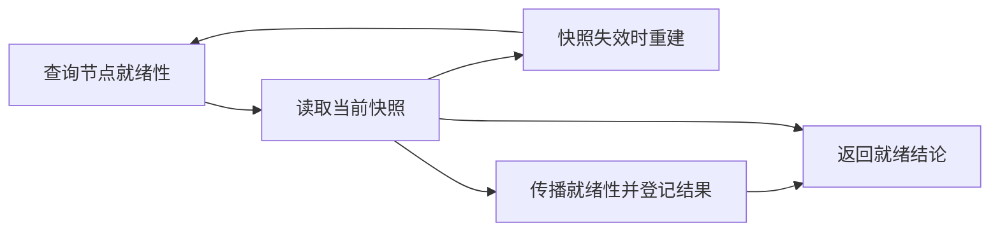
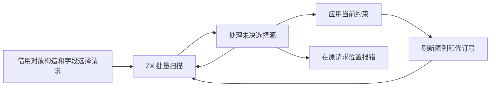

# RX 对象约束就绪与恢复自举

## Intent

将对象展开和字段选择共用的就绪性查询、缓存重建和恢复交给 Source，并让对象构造与字段选择从原位置继续执行。保留已知类型的通过条件、普通轮和最终轮的错误顺序、原始诊断位置及缓冲生命周期。

## Data

起点为 `bbc3cf6f5`。就绪性查询、依赖传播、快照布局及候选扫描已有 RX/ZX 实现，正式执行仍由 Zig 循环选择何时重建、从哪一行恢复和何时报错。

## Edges

图修订号变化后，下一次查询重建快照并从原行重试。普通轮跳过仍不完整的选择源，最终轮在原位置报告错误。展开和选择可以共用就绪列，条件沿用既有 Source 证明结果。对象构造及选择应用后刷新节点视图和修订号，继续借用原请求列。

构造扫描针对有部件的行直接标记为需要处理，空对象仍按原分类判断是否可以跳过。字段选择扫描只读取节点类别，候选通过就绪检查后再读取字段视图。初始 seed 保留原来的查询和应用路径。

## Answer

- RX 执行展开就绪查询的缓存失效与重试，复用 ZX 的快照查询、依赖传播和缓存命中规则。
- 构造和字段选择的正式外层扫描由 RX 执行。字段选择的查找、传播、跳过和恢复使用同一个游标。原生边界负责快照内存、图列绑定和单项应用。
- 定向生成确认三个循环使用栈上游标，恢复轮次的临时堆分配为零。字段级构造和选择写入仍有 Zig 循环，下一批接续展开部件投影、字段约束写回及其诊断。

### 自编译与产物一致性

用 `bbc3cf6f5` 的 Source 工具构建候选，27 个引导步骤通过。候选 SHA-256 为 `1a6b1a5f0c261c1da56b6a84196e0a0abc033f334ef63fc5dd462bf8aca31420`。五份引导清单的 17,650 个生成文件逐字节一致。十次常驻编辑请求的计数及产物哈希与上阶段一致。修改的 RX 和 ZX 文件通过格式与 lint 检查。

正式候选通过 83 个构建步骤、153 项 Zig 测试和 17 项 CLI 集成，覆盖 RX 推导、对象展开、字段选择、诊断位置、分配失败和 Store 执行。初始 seed 通过解析器构建和 39 项 RX 回归。

### 性能对照

固定 705 个入口和 16 个分区，关闭常驻生成器，交错三轮取中位数。三个工具均由 Source 构建，并执行各自的 Source 分析与生成。对照的 9,894 个生成文件及所有权 memo 逐字节一致。

| 对照     | 冷生成墙钟 | 冷生成 CPU | 冷进程树峰值 RSS | 冷系统记录峰值 RSS | 热生成墙钟 | 热生成 CPU |
| -------- | ---------: | ---------: | ---------------: | -----------------: | ---------: | ---------: |
| 固定基线 |     2.09 s |     9.04 s |         738.0 MB |           769.9 MB |     1.64 s |     6.45 s |
| 上阶段   |     1.93 s |     9.47 s |         533.3 MB |           542.8 MB |     1.46 s |     6.28 s |
| 候选     |     1.93 s |     9.48 s |         526.7 MB |           547.4 MB |     1.45 s |     6.29 s |

较上阶段，冷生成墙钟持平，CPU 增加 0.01 秒，进程树峰值减少 6.6 MB，系统记录峰值增加 4.6 MB。热生成墙钟减少 0.01 秒，CPU 增加 0.01 秒。无改动检查仍为 0.03 秒。较固定基线，冷生成墙钟减少 0.16 秒，CPU 累计增加 0.44 秒，进程树峰值减少 211.3 MB。
