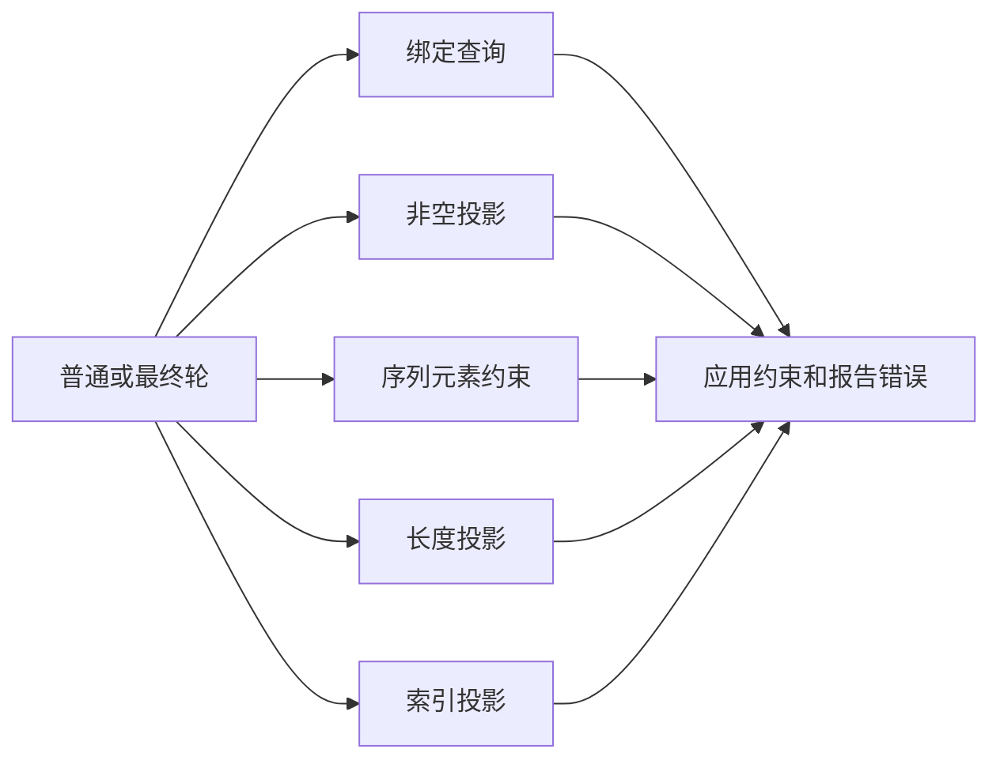
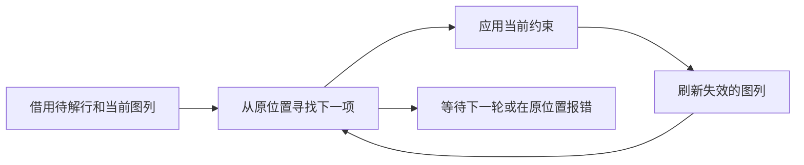

# RX 待解约束重放自举

## Intent

把普通与最终 RX 求解轮次内，仍由手写 Zig 推进的五类待解约束迁到 Source。保留每类约束的诊断顺序、提交位置和借用存储。

## Data

起点为 `b2fa1d4b5`。普通轮从 `solve/propagate.rx` 依次调用绑定、非空、序列、对象、长度和索引。最终轮再次处理非空与绑定。对象已在上一阶段交给 Source。其余五类已有 ZX 扫描或分类，正式路径仍由各自 Zig 循环执行结果并刷新借用列。

## Edges

每种扫描沿用原有起点和退出条件。索引在关联成功后发布 resolved。其他写入保持原有提交次序，失败时由既有报告器引用原跨度。每次图有可能扩容后重新绑定已有列，继续使用初始 seed 的独立实现。

## Answer

- 绑定保留首轮冲突检查，匹配后由 RX 从下一条查询继续查找。非空投影由同一入口处理普通合并、已知类型登记及最终轮的可空推断。[绑定](../../packages/compiler/src/rx/analysis/inference/bindings/run.rx) · [非空](../../packages/compiler/src/rx/analysis/inference/non_null/run.rx)
- 序列保留从原列表或元组借用元素目标，并沿用统一的赋值写入。长度投影由 RX 选择已知字段、待约束列表、开放对象字段或诊断，保留各行跨度。[序列](../../packages/compiler/src/rx/analysis/inference/sequences/run.rx) · [长度](../../packages/compiler/src/rx/analysis/inference/projections/run.rx)
- 即时索引和待解索引共用应用规则，元组索引诊断使用索引表达式的跨度，其他错误使用投影的跨度。后者在合并成功后写入完成标志，再刷新图列。[即时索引](../../packages/compiler/src/rx/analysis/inference/index/immediate.rx) · [索引重放](../../packages/compiler/src/rx/analysis/inference/index/run.rx)
- 定向生成覆盖六个入口。索引计划与循环状态均使用栈上值，借用待解行、元素目标和图的现有列。宿主负责单次图写入、借用视图更新和跨度读取。

### 自编译与产物一致性

由 `b2fa1d4b5` 的 Source 引导器构建候选，27 个引导步骤通过。候选 SHA-256 为 `5b9521250ee72463c89fb93b22f33b4879321aee3a29f56d3ce4a6852d03fd9d`。五份引导清单的 17,661 个生成文件逐字节一致。十次常驻编辑的计数和输出哈希与上阶段一致。RX 和 ZX 改动通过格式与 lint 检查。

正式候选通过 83 个构建步骤、153 项 Zig 测试和 17 项 CLI 集成。既有用例覆盖绑定、分支作用域、列表和元组读取、长度与对象字段、诊断位置及分配失败。初始 seed 通过解析器构建和 39 项 RX 回归。

### 性能对照

固定 705 个入口和 16 个分区，关闭常驻生成器，交错三轮取中位数。三个工具均由 Source 构建，使用各自的 Source 分析与生成。对照的 9,894 个生成文件及所有权 memo 逐字节一致。

| 对照     | 冷生成墙钟 | 冷生成 CPU | 冷进程树峰值 RSS | 冷系统记录峰值 RSS | 热生成墙钟 | 热生成 CPU |
| -------- | ---------: | ---------: | ---------------: | -----------------: | ---------: | ---------: |
| 固定基线 |     2.09 s |     9.02 s |         738.2 MB |           763.2 MB |     1.63 s |     6.41 s |
| 上阶段   |     1.95 s |     9.51 s |         525.1 MB |           548.9 MB |     1.43 s |     6.21 s |
| 候选     |     1.94 s |     9.44 s |         529.0 MB |           552.3 MB |     1.44 s |     6.23 s |

较上阶段，冷生成墙钟减少 0.01 秒，CPU 减少 0.07 秒。进程树采样峰值增加 3.8 MB，系统记录峰值增加 3.4 MB。热生成墙钟增加 0.01 秒，CPU 增加 0.02 秒，无改动检查仍为 0.03 秒。较固定基线，冷生成墙钟减少 0.15 秒，CPU 累计增加 0.42 秒，进程树采样峰值减少 209.3 MB，系统记录峰值减少 210.9 MB。

下一批从正式单项和批量赋值登记入口接续，统一检查索引及行扩容、类型登记后续跑、跨度同步及部分失败时的前缀提交。[赋值登记](../../packages/compiler/src/rx/analysis/inference/assignment/registration.zig) · [批量登记](../../packages/compiler/src/rx/analysis/inference/assignment/registration/series.zx)
