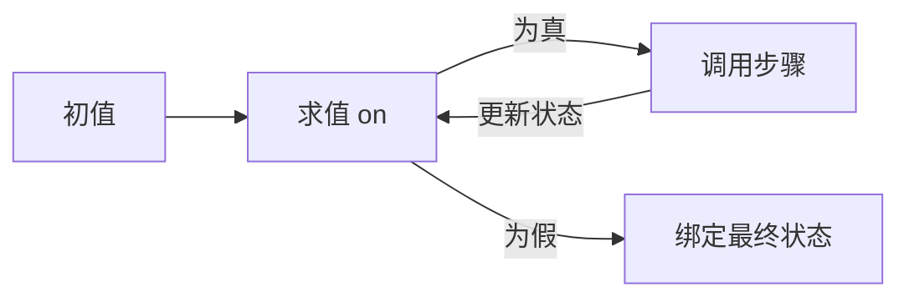

# RX 循环标签与编排边界

## Intent

通过独立的 Loop 标签表达重复调用，使用 on 声明循环条件，并移除 Call 上的 while。同步规范 RX 与 ZX 的职责，避免为了复用已有 RX 而把算法和细粒度状态拼装堆到编排中。

## Data

现有跨模块循环使用同一状态类型反复执行一个 Call。在解析、依赖扫描、参数推导和 IR 生成中沿用静态模块边界。迁移前编译器为 `5ff56d921`。[现有编排约定](../../rules/RX开发约定.md) · [标签入口](../../packages/compiler/src/rx/labels/Loop.zig)

## Edges

由 Call.in 或紧邻同层输出提供初值。on 使用当前状态作为 $in，预先检查布尔结果。子 Call 返回同一非 void 状态类型，最终结果沿用它的常规 $ctx 名称。分支内部的作用域规则和嵌套依赖无环检查继续适用。循环状态通过普通 Iteration IR 借用，生成的代码沿用已有所有权分析。

## Answer

验收覆盖旧属性拒绝、布尔条件、零次及多次迭代、同层默认输入、依赖环与格式化。核对仓库自举入口均使用新标签，并由 Source 引导器接续生成与构建。

### 验收结果

候选引导器接续上一阶段编译了新的 Schema，再以过渡引导器生成全部迁移后的入口。构建通过 26 个步骤。过渡和候选使用同一批新源码，五个 Source 清单共 17,117 个生成文件逐字节一致。把一个对象状态实例分别用旧语法和新语法编译，除输入戳之外，8 个生成文件一致。

标量实例用比较表达式作为 on，并使用进入和离开 Loop 的默认输入。无可用分配空间的执行器覆盖零次及多次迭代。所有否定核验均收到提示，覆盖旧 Call 属性、非布尔条件、字符串条件、循环引用、初始输入缺失和空循环体。

705 入口冻结清单采用相同的 16 分区配置，禁用常驻生成器，三轮交错测量取中位数。对照工具本体均由 Source 生成，并运行各自的 Source 分析与发射。

| 对照     | 冷墙钟 | 冷 CPU | 冷进程树 RSS | 冷系统峰值 | 热墙钟 | 热 CPU |
| -------- | -----: | -----: | -----------: | ---------: | -----: | -----: |
| 固定基线 | 2.07 s | 8.97 s |     738.1 MB |   760.0 MB | 1.64 s | 6.42 s |
| 上阶段   | 1.92 s | 9.49 s |     533.7 MB |   556.4 MB | 1.43 s | 6.25 s |
| 候选     | 1.92 s | 9.47 s |     528.0 MB |   556.9 MB | 1.43 s | 6.24 s |

相比上阶段，冷墙钟持平，CPU 减少 0.02 秒，进程树峰值减少 5.7 MB，系统峰值增加 0.4 MB。相比固定基线，冷墙钟减少 0.15 秒，CPU 增加 0.50 秒，进程树峰值减少 210.1 MB。冻结清单的 9,894 个输出一致。此计时覆盖编译器和依赖扫描，旧新循环执行形态由对象实例的生成结果对照。候选 SHA-256 为 `64b9ae3d4612ca8c2dd79981a20bbdee0c1384e51687fb674f0310202da47a97`。

RX 文本解析、项目推导、项目 CLI 与 watch 验证共通过 98 个步骤和 260 项测试。最终 CLI 的 fmt 自动省略 Loop 前后正确继承的 in，lint、check-rx 和全部迁移文件的格式检查通过。
