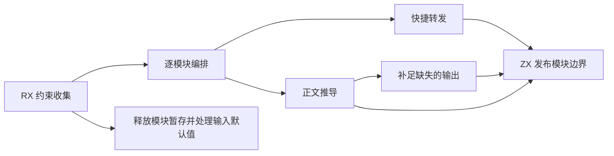

# RX 模块约束收集自举

## Intent

把 RX 推导中从端口登记到约束收集完成的流程迁入 Source。保持模块处理、约束登记和报错的原有顺序，使求解阶段可以直接读取同一批端口和请求。

## Data

起点为 `37baa0989`。端口登记已由 Source 执行。模块的快捷转发与正文推导仍由 Zig 逐行选择，绑定和任务请求的累计边界由 Zig 写入。未固定输入的候选扫描已由 ZX 实现，索引选择、再次扫描与默认值合并仍由 Zig 控制。

## Edges

沿正式入口 `collectFlowConstraints` 检查到图求解之前。预声明输入和快捷转发输入保留固定标记。正文缺少 Return 时按原位置补上 void 输出。绑定和任务边界在该模块成功推导后发布。默认值只处理既未固定也未被赋值边引用的输入，保留引用索引的阈值和 void 节点保护；每次合并后刷新可增长的父节点列视图。

单个模块继续复用暂存区，进入输入默认值阶段前释放该暂存区。可选的引用索引沿用原来的一次布尔列分配。初始 seed 使用原生收集和未索引扫描作为引导路径。

## Answer

- 正式路径的逐模块循环、快捷转发与正文选择，以及无 Return 的补足步骤，由 RX 的 Loop 和 If 表达。旧模块级步骤表已移除。
- ZX 直接写入输入固定标记、绑定结束位置和任务结束位置，计算需要检查的输入数量。
- RX 推进未用输入的扫描与默认值合并。ZX 判断何时建立引用索引，并直接读取已有赋值边、端口和父节点列。
- Zig 仍提供模块表达式作用域、正文和快捷转发的底层约束操作，以及图合并和切片更新。下一批处理图求解在修订号变化时的重新推进，以及最终签名的发布和未决类型恢复。

### 实现复核

最初的生成结果给循环游标分配了堆对象。将原生边界改为借用列和读取标量后，两个 RX 循环均生成栈上状态。定向生成未发现额外的游标堆分配。图的合并和暂存管理仍由现有接口执行。

### 自编译与产物一致性

用 `37baa0989` 的 Source 工具构建候选，27 个引导步骤通过。候选 SHA-256 为 `6eb7940d73c64ac0a202fc982afd2566c075105645b497c758e414327d28bd71`。五份当前引导清单的 17,604 个生成文件逐字节一致。十次常驻编辑请求的分析、复用、发射计数和产物哈希与上阶段一致。修改的 RX 和 ZX 文件通过格式与 lint 检查。

正式候选通过 83 个构建步骤、153 项 Zig 回归和 17 项 CLI 集成，覆盖 RX 推导、分支及任务绑定、项目装载、分配失败和 Store 应用执行。初始 seed 通过解析器构建和 39 项 RX 回归。

### 性能对照

固定 705 个入口和 16 个分区，关闭常驻生成器，交错三轮取中位数。三个工具均由 Source 构建，并执行各自的 Source 分析与生成。固定输入的 9,894 个生成文件及所有权 memo 逐字节一致。

| 对照     | 冷生成墙钟 | 冷生成 CPU | 冷进程树峰值 RSS | 冷系统记录峰值 RSS | 热生成墙钟 | 热生成 CPU |
| -------- | ---------: | ---------: | ---------------: | -----------------: | ---------: | ---------: |
| 固定基线 |     2.09 s |     9.03 s |         737.6 MB |           792.7 MB |     1.63 s |     6.43 s |
| 上阶段   |     1.97 s |     9.56 s |         530.0 MB |           548.6 MB |     1.44 s |     6.26 s |
| 候选     |     1.96 s |     9.46 s |         530.1 MB |           552.3 MB |     1.44 s |     6.26 s |

较上阶段，冷生成墙钟减少 0.01 秒，CPU 减少 0.10 秒，进程树峰值增加约 0.1 MB，系统记录峰值增加 3.7 MB。热生成和无改动检查持平。较固定基线，冷生成墙钟减少 0.13 秒，CPU 累计增加 0.43 秒，进程树峰值减少约 207.5 MB。
