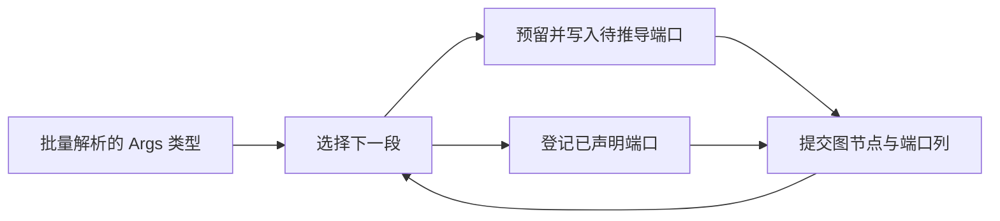

# RX 端口约束登记自举

## Intent

让 Source 推进已声明及待推导 RX 端口的登记。沿输入输出原顺序创建或复用推导节点，保留原模块的诊断位置，并直接写入后续推导消费的端口列。

## Data

起点为 `f4a2f1762`。Args 已由 Source 批量解析。此前每段的类型选择和未知节点形状有 ZX 实现，Zig 仍推进分段循环、登记已声明端口以及逐行写入未知节点位置。

## Edges

按模块顺序先写待推导端口，再登记紧随其后的已声明端口。已声明端口保持输入优先，复用已有已知类型节点。原始模块位置由现有源位置列计算。每段预留后直接写入最终存储，提交前保持节点可见长度。初始 seed 保留 Zig 的登记循环。

## Answer

- RX Loop 推进模块分段，依次写入待推导端口、提交节点并登记后续的已声明端口。原正式入口中的 Zig 分段循环已移除。
- ZX 直接借用模块位置和源表偏移，写入节点诊断位置、端口节点编号、固定标记及绑定和任务游标。已声明端口调用同一个已知类型接口。
- Zig 提供图存储预留、原类型的列视图及节点提交。定向生成核对了循环与字段写入，编排使用栈上状态，可在空暂存分配器下执行。

### 正确性核验

用 `f4a2f1762` 的 Source 工具构建候选，27 个引导步骤通过。候选 SHA-256 为 `2d8a7ccd58a157856499e13bb0c897cdc189cb0abcaa1174994418267a5456b2`。五份当前引导清单的 17,591 个生成文件逐字节一致。十次常驻请求的分析、复用、发射计数和产物哈希与上阶段一致。修改的 RX 和 ZX 文件通过格式与 lint 检查。

正式候选通过 83 个构建步骤、153 项 Zig 测试和 17 项 CLI 测试，覆盖 RX 推导、XML 属性位置、磁盘项目恢复及 Store 应用执行。初始 seed 通过解析器构建和 39 项 RX 回归。

### 性能对照

固定 705 个入口和 16 个分区，关闭常驻生成器，交错三轮取中位数。三个工具均由 Source 构建，并运行各自的 Source 分析与生成。固定输入的 9,894 个生成文件及所有权 memo 逐字节一致。

| 对照     | 冷生成墙钟 | 冷生成 CPU | 冷进程树峰值 RSS | 冷系统记录峰值 RSS | 热生成墙钟 | 热生成 CPU |
| -------- | ---------: | ---------: | ---------------: | -----------------: | ---------: | ---------: |
| 固定基线 |     2.10 s |     9.03 s |         737.4 MB |           759.8 MB |     1.64 s |     6.47 s |
| 上阶段   |     1.97 s |     9.49 s |         524.8 MB |           538.4 MB |     1.45 s |     6.28 s |
| 候选     |     1.94 s |     9.44 s |         528.5 MB |           540.0 MB |     1.44 s |     6.25 s |

较上阶段，冷生成墙钟减少 0.03 秒，CPU 减少 0.05 秒，进程树峰值增加 3.7 MB，系统记录峰值增加 1.6 MB。热生成墙钟减少 0.01 秒，CPU 减少 0.03 秒。无改动检查墙钟为 0.03 秒。较固定基线，冷生成墙钟减少 0.16 秒，CPU 累计增加 0.41 秒，进程树峰值减少 208.9 MB。
