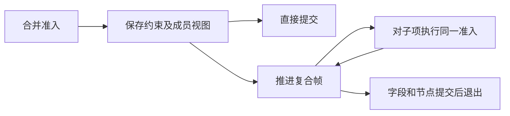

# RX 类型合并帧推进自举

## Intent

从 `Graph.unify` 贯通首帧和子帧的准入、约束快照、字段对齐、位置恢复、写回和退出。由 Source 决定处理次序、帧内容和失败诊断。

## Data

起点为 `82e15e44a`。原入口在 Zig 处理准入结果、保存旧约束，并决定立即提交或进入复合帧。复合帧的扫描已在 ZX，Zig 仍推进位置、准备子帧、选择字段对齐、合并字段和关闭帧。[合并入口](../../packages/compiler/src/rx/analysis/inference/unify.zig) · [原生帧工作区](../../packages/compiler/src/rx/analysis/inference/unify/host.zig)

## Edges

保持根归一化、递归检查及已有类型登记的次序。首帧约束在处理子项前记录，帧内保持成员切片有效期。子项登记可能扩容，必须刷新节点及已知类型视图。按原顺序保留帧容量、字段缓冲与失败释放，原子图写入和物理分配留在现有拥有者。初始 seed 保留原合并。

## Answer

首帧和子帧共用 ZX 准入与约束快照。RX 根据准备好的帧决定立即提交、对齐字段、推进子项或关闭当前帧。子项扫描直接写入借用的恢复位置与两个操作数。删除旧的 Zig 准入分派、子帧驱动和 `unify/frame.zig`，保留初始 seed 的原合并。[首帧](../../packages/compiler/src/rx/analysis/inference/unify/merge.rx) · [子帧](../../packages/compiler/src/rx/analysis/inference/unify/advance.rx)

第一版的生成代码把跨调用的描述符放到了堆上。最终版复用已有按值生成入口，准入结果和约束快照分别写入调用栈上的槽位，RX 借用这些描述符推进。四个入口的定向生成没有帧或请求描述符分配。Zig 仍提供图列借用、帧和字段工作区的物理存储、失败释放，以及节点与限制的最终写入。

### 引导与行为

候选由 `82e15e44a` 的 Source 工具构建，27 个引导步骤通过。候选 SHA-256 为 `6dbe94d08704664b8cca65f4a9b85b983210c9666289d70d56d52d08a0a55ccb`。五份引导清单的 17,638 个生成文件逐字节一致，10 个常驻编辑场景的结果与上一批一致。

正式推导与 XML 表达式共 153 项 Zig 回归通过，CLI 磁盘项目和原生 Store 共 17 项通过。初始 seed 解析器和 39 项 RX 回归通过。

### 性能对照

固定 705 个入口、16 个分区，关闭常驻生成器，交错三轮取中位数。三个工具均由 Source 构建并使用各自的 Source 分析和生成。上一批与候选的 9,894 个冻结生成文件及所有权 memo 一致。

| 对照     | 冷生成墙钟 | 冷生成 CPU | 冷进程树峰值 RSS | 冷系统记录峰值 RSS | 热生成墙钟 | 热生成 CPU |
| -------- | ---------: | ---------: | ---------------: | -----------------: | ---------: | ---------: |
| 固定基线 |     2.06 s |     8.92 s |         737.7 MB |           761.2 MB |     1.65 s |     6.42 s |
| 上一批   |     1.95 s |     9.42 s |         524.7 MB |           547.9 MB |     1.46 s |     6.24 s |
| 候选     |     1.96 s |     9.39 s |         524.4 MB |           547.7 MB |     1.44 s |     6.22 s |

较上一批，冷生成墙钟增加 0.01 秒，CPU 减少 0.03 秒，进程树峰值减少 0.3 MB，系统记录峰值减少 0.2 MB。热生成墙钟和 CPU 各减少 0.02 秒，无修改生成的墙钟保持 0.03 秒。较固定基线，冷生成墙钟减少 0.10 秒，CPU 累计增加 0.47 秒，进程树峰值减少 213.3 MB。
