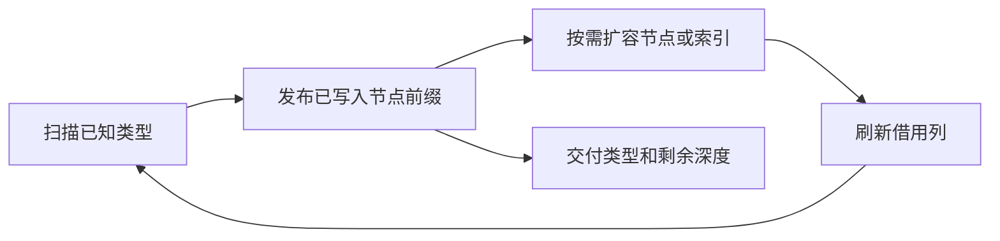
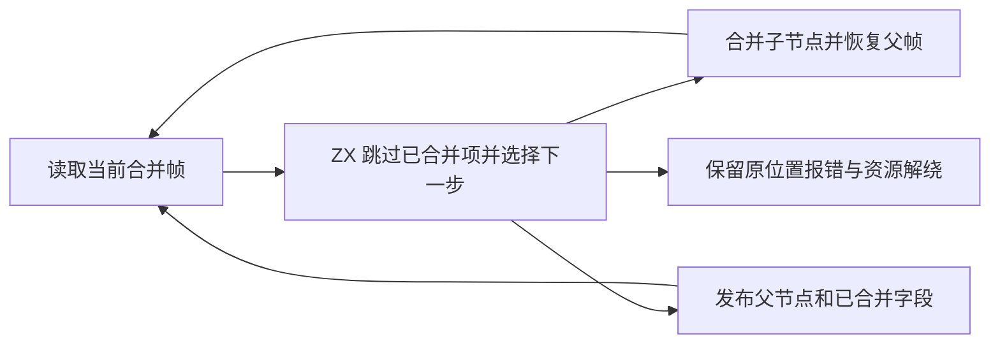

# RX 类型登记与合并自举

## Intent

让正式 RX 类型图的已知节点登记和复合类型合并由 Source 推进。保留每批节点的写回顺序，以及子类型合并时的字段借用、深度检查和错误清理。

## Data

起点为 `c6092f3fd`。ZX 已生成已知类型查找、节点槽写入、索引重建和合并步骤选择。Zig 仍推进登记的扩容恢复、逐帧合并和完成发布。

## Edges

登记先提交本次已写入的节点及源位置，再处理扩容、成功或错误。节点容量和已知类型索引容量单独决定，恢复前更新两者的列视图。对象字段的子合并仍按原顺序完成，父帧只在相应子项处理完成后发布。保留已知类型命中和可直接合并的快路径，以及合并栈和字段映射的内联缓冲。

## Answer

- RX 执行已知类型的扫描、前缀提交、错误处理和扩容恢复。ZX 复用现有登记与哈希规则。Zig 继续提供类型图存储、容量调整和索引内存交接。
- RX 执行复合类型逐帧合并，显式选择子帧、父帧发布或错误。ZX 扫描字段和元素。原生适配保留初始合并准备、栈存储、字段分配和错误退出时的释放。
- 定向生成确认两个入口借用同一批节点和索引描述符。登记使用值返回入口，执行循环与帧游标的临时堆分配为零。
- 下一批沿构造和字段选择共同使用的对象约束推进，接续缓存重建、就绪性比较及传播后的重试。

### 自编译与产物一致性

用 `c6092f3fd` 的 Source 工具构建候选，27 个引导步骤通过。候选 SHA-256 为 `66f1326007a645cd3d7e7654da932703d08b222a0cfa83681ccf1fa3aad024f5`。五份引导清单的 17,639 个生成文件逐字节一致。十次常驻编辑请求的计数及产物哈希与上阶段一致。修改的 RX 和 ZX 文件通过格式与 lint 检查。

正式候选通过 83 个构建步骤、153 项 Zig 测试和 17 项 CLI 集成，覆盖 RX 推导、对象和容器合并、诊断位置、分配失败及 Store 执行。初始 seed 通过解析器构建和 39 项 RX 回归。

### 性能对照

固定 705 个入口和 16 个分区，关闭常驻生成器，交错三轮取中位数。三个工具均由 Source 构建，并执行各自的 Source 分析与生成。对照的 9,894 个生成文件及所有权 memo 逐字节一致。

| 对照     | 冷生成墙钟 | 冷生成 CPU | 冷进程树峰值 RSS | 冷系统记录峰值 RSS | 热生成墙钟 | 热生成 CPU |
| -------- | ---------: | ---------: | ---------------: | -----------------: | ---------: | ---------: |
| 固定基线 |     2.08 s |     9.01 s |         739.4 MB |           761.8 MB |     1.64 s |     6.44 s |
| 上阶段   |     1.95 s |     9.49 s |         525.8 MB |           550.2 MB |     1.44 s |     6.25 s |
| 候选     |     1.96 s |     9.42 s |         526.1 MB |           548.8 MB |     1.45 s |     6.25 s |

较上阶段，冷生成墙钟增加 0.01 秒，CPU 减少 0.07 秒，进程树峰值增加约 0.3 MB，系统记录峰值减少 1.4 MB。热生成墙钟增加 0.01 秒，CPU 持平。无改动检查仍为 0.03 秒。较固定基线，冷生成墙钟减少 0.12 秒，CPU 累计增加 0.41 秒，进程树峰值减少 213.3 MB。
