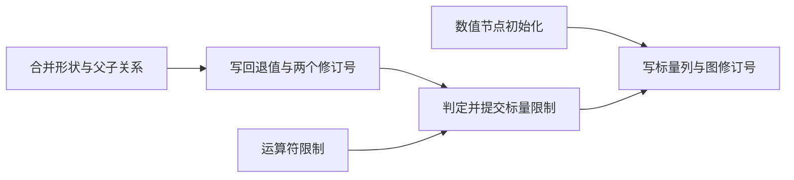

# RX 类型约束共享写回自举

## Intent

贯通图节点合并、运算符的直接限制和数值节点登记。让 Source 写回形状、父节点、允许掩码、回退类型及修订号，保留失败时已提交的前缀。

## Data

起点为 `7ced78ca1`。合并形状与父节点已经由 Source 写入，Zig 仍根据返回值更新回退类型、两个修订号及标量限制。运算符直接限制与合并共用同一个 Zig 结果写回。数值节点创建后，由 Zig 写入同一组标量列并推进图修订号。[合并写回](../../packages/compiler/src/rx/analysis/inference/unification/commit.zig) · [限制写回](../../packages/compiler/src/rx/analysis/inference/scalar/restriction.zig) · [数值节点](../../packages/compiler/src/rx/analysis/inference/nodes/number.zig)

## Edges

失败的合并保留形状、父子关系、回退值及两次合并修订写入，限制掩码及其修订不提交。成功的直接限制只有掩码变化时才推进图修订号。数值节点先完成列写入，再由拥有者发布可见行。仅借用原列和计数地址，报告器使用调用方原来的源码跨度。初始 seed 保留独立的写回路径。

## Answer

合并和直接限制共用 Source 的标量提交。合并先写形状、父节点、回退类型和修订号，再处理限制结果。拒绝时返回原诊断文本，掩码和对应修订保持此前状态。数值节点在保留区域内写好标量列，再由 Zig 写入跨度并发布节点长度。原有端口登记共用的行发布契约保留。[合并编排](../../packages/compiler/src/rx/analysis/inference/unification/commit.rx) · [限制写回](../../packages/compiler/src/rx/analysis/inference/scalar/publication/restriction.zx) · [数值初始化](../../packages/compiler/src/rx/analysis/inference/nodes/number.rx)

Zig 的通路只绑定原图切片、分配节点并交付诊断。新增的两种可空整数写入沿用通用内存的借用写入，只在引导器内部使用。初版生成中合并回退值和掩码的对象被分配到堆上。最终版保留原回退优先级，以标量分别计算回退值和掩码，三个正式入口的定向生成没有额外堆分配。

### 引导与行为

候选由 `7ced78ca1` 的 Source 引导器构建，27 个引导步骤通过。候选 SHA-256 为 `97c11ad0dd0f7ee4b0454cb6f5d3d6fe2e1d5f1ea5380e1b1b179272833fac63`。五份清单的 17,658 个生成文件逐字节一致。10 个常驻编辑场景的结果与上一批一致。

正式 RX 推导与 XML 表达式共 153 项 Zig 回归通过，CLI 磁盘项目和原生 Store 共 17 项通过。初始 seed 解析器构建及 39 项 RX 回归通过。

### 性能对照

固定 705 个入口、16 个分区，关闭常驻生成器，交错三轮取中位数。三套工具均由 Source 构建，并执行各自的 Source 分析和生成。上一批与候选的 9,894 个冻结生成文件及所有权 memo 一致。

| 对照     | 冷生成墙钟 | 冷生成 CPU | 冷进程树峰值 RSS | 冷系统记录峰值 RSS | 热生成墙钟 | 热生成 CPU |
| -------- | ---------: | ---------: | ---------------: | -----------------: | ---------: | ---------: |
| 固定基线 |     2.08 s |     9.04 s |         737.6 MB |           759.5 MB |     1.63 s |     6.43 s |
| 上一批   |     1.95 s |     9.52 s |         528.0 MB |           545.6 MB |     1.44 s |     6.25 s |
| 候选     |     1.95 s |     9.57 s |         529.7 MB |           548.7 MB |     1.45 s |     6.28 s |

较上一批，冷生成墙钟持平，CPU 增加 0.05 秒，进程树峰值增加 1.8 MB，系统记录峰值增加 3.0 MB。热生成墙钟增加 0.01 秒、CPU 增加 0.03 秒，无修改生成墙钟保持 0.03 秒。较固定基线，冷生成墙钟减少 0.13 秒，CPU 累计增加 0.53 秒，进程树峰值减少 207.9 MB。
