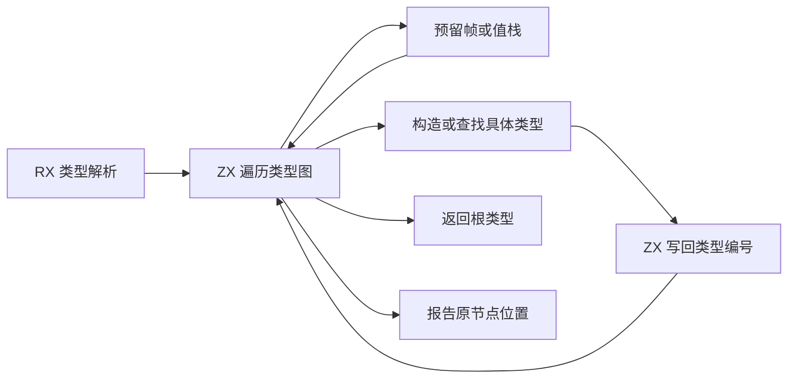
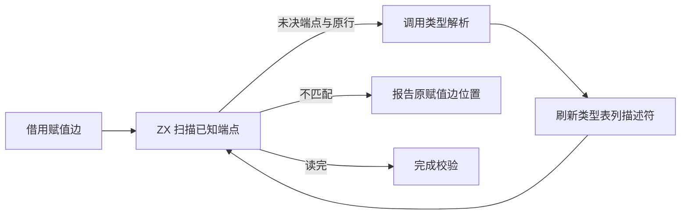

# RX 类型解析与赋值校验自举

## Intent

将 RX 类型节点遍历后的扩容、续跑、构造和登记接入正式 Source 流程，同时迁移赋值校验遇到未决端点时的恢复。保留已知类型的快速路径和原有的分配、诊断位置与校验顺序。

## Data

起点为 `8074235ca`。类型遍历和已知节点的写入已由 ZX 实现，Zig 仍按遍历结果选择扩容、构造或退出。赋值校验已有 ZX 批量扫描，Zig 在端点未决时保存行和已解析的来源端，解析后重新建立列视图并从原行继续。

## Edges

帧和值栈仍优先使用调用者持有的栈上缓冲。首次扩容只复制存活前缀，后续复用已持有容量，沿用原追加和释放策略。类型构造继续用单次构造的 512 字节内联暂存，超出时使用同一短生命周期的 arena。构造提交后只写回节点类型和修订号，节点列的借用保持有效。

赋值校验从原行恢复，保留已解析的来源端。类型登记可能增长类型表，恢复前刷新类型类别和子类型列描述符。初始 seed 保留自己的解析和校验实现。

## Answer

- RX 控制遍历完成、栈扩容后续跑、构造和诊断。ZX 计算帧增长所需的存活范围并恢复遍历状态，构造结果由 ZX 写回节点类型。
- 赋值校验和端点解析的恢复循环由 RX 执行。批量扫描直接读取已有赋值边和图列，遇到冲突仍报告对应的赋值边。
- 定向生成确认两个执行入口使用栈上游标，恢复轮次的临时堆分配为零。Zig 继续持有现有缓冲分配器、类型表写入接口和诊断记录。下一批接续赋值类代表传播和赋值物化，沿同一求解调用核对缓冲和图版本的刷新。

### 自编译与产物一致性

用 `8074235ca` 的 Source 工具构建候选，27 个引导步骤通过。候选 SHA-256 为 `bc6ee1e1be42bd25efb2b8f0bbe44faaf6b6cf728a0e069b72aa5ec04cc73ee2`。五份引导清单的 17,627 个生成文件逐字节一致。十次常驻编辑请求的计数及产物哈希与上阶段一致。修改的 RX 和 ZX 文件通过格式与 lint 检查。

帧宽由 ZX 计算并供遍历和扩容共用。赋值校验接口刷新的是类型表列描述符，继续借用原有的节点和赋值边。

正式候选通过 83 个构建步骤、153 项 Zig 测试和 17 项 CLI 集成，覆盖类型推导与诊断、赋值兼容、分配失败、项目装载和 Store 执行。初始 seed 通过解析器构建和 39 项 RX 回归。

### 性能对照

固定 705 个入口和 16 个分区，关闭常驻生成器，交错三轮取中位数。三个工具均由 Source 构建，并执行各自的 Source 分析与生成。对照的 9,894 个生成文件及所有权 memo 逐字节一致。

| 对照     | 冷生成墙钟 | 冷生成 CPU | 冷进程树峰值 RSS | 冷系统记录峰值 RSS | 热生成墙钟 | 热生成 CPU |
| -------- | ---------: | ---------: | ---------------: | -----------------: | ---------: | ---------: |
| 固定基线 |     2.05 s |     8.92 s |         737.7 MB |           760.1 MB |     1.59 s |     6.30 s |
| 上阶段   |     1.90 s |     9.40 s |         523.6 MB |           545.6 MB |     1.39 s |     6.06 s |
| 候选     |     1.94 s |     9.42 s |         528.8 MB |           551.6 MB |     1.43 s |     6.15 s |

较上阶段，冷生成墙钟增加 0.04 秒，CPU 增加 0.02 秒，进程树峰值增加 5.2 MB，系统记录峰值增加 6.0 MB。热生成墙钟增加 0.04 秒，CPU 增加 0.09 秒。无改动检查仍为 0.03 秒。较固定基线，冷生成墙钟减少 0.11 秒，CPU 累计增加 0.50 秒，进程树峰值减少 208.9 MB。
