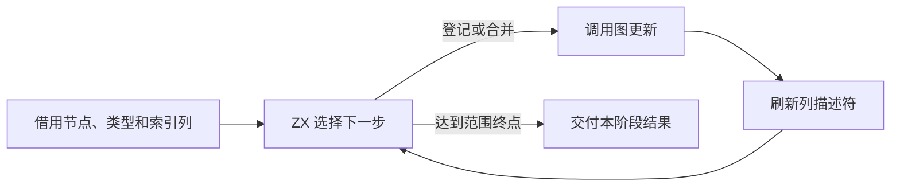

# RX 赋值求解应用自举

## Intent

将 RX 赋值求解从载荷取集、类代表传播到可空层级物化的恢复顺序交给 Source。每次结构更新后，下一次扫描直接借用当前的节点、类型表和已知类型索引。

## Data

起点为 `4631852a6`。ZX 已能选择待登记载荷、同类合并和物化候选，正式路径的两次取集、合并提交、扩容后重新借用以及物化循环仍由 Zig 执行。

## Edges

初始取集跟随新登记的载荷，第二次取集读取新增节点区间。首次登记和后续扫过同一代表时保留剩余深度。物化沿原顺序应用可空层级，延迟标记沿用同一批索引。节点、类型和已知类型表都可能增长，相关视图在更新后刷新。

三个入口使用栈上游标，沿用原有载荷、深度和延迟标记缓冲。初始 seed 保持独立实现。

## Answer

- RX 控制两段载荷取集、类代表传播及物化恢复。ZX 按原规则决定扫描游标、待登记载荷、合并候选、延迟索引和物化层级。
- Zig 宿主继续持有图存储、候选提交和分配器。图更新之后原位刷新描述符，Source 下一轮直接读取同一批存储。定向生成确认恢复游标的临时堆分配为零。
- 下一批沿已知类型登记和类型合并继续，接着核对对象约束的缓存重建和恢复。

### 自编译与产物一致性

用 `4631852a6` 的 Source 工具构建候选，27 个引导步骤通过。候选 SHA-256 为 `a158dbd50c9f749e43bc537a16a3c682527a7241f7769326506f8197888cdddf`。五份引导清单的 17,634 个生成文件逐字节一致。十次常驻编辑请求的计数及产物哈希与上阶段一致。修改的 RX 和 ZX 文件通过格式与 lint 检查。

正式候选通过 83 个构建步骤、153 项 Zig 测试和 17 项 CLI 集成，覆盖 RX 类型推导、可空赋值、分配失败、项目装载和 Store 执行。初始 seed 通过解析器构建和 39 项 RX 回归。

### 性能对照

固定 705 个入口和 16 个分区，关闭常驻生成器，交错三轮取中位数。三个工具均由 Source 构建，并执行各自的 Source 分析与生成。对照的 9,894 个生成文件及所有权 memo 逐字节一致。

| 对照     | 冷生成墙钟 | 冷生成 CPU | 冷进程树峰值 RSS | 冷系统记录峰值 RSS | 热生成墙钟 | 热生成 CPU |
| -------- | ---------: | ---------: | ---------------: | -----------------: | ---------: | ---------: |
| 固定基线 |     2.10 s |     9.06 s |         737.0 MB |           760.0 MB |     1.64 s |     6.43 s |
| 上阶段   |     1.98 s |     9.58 s |         525.3 MB |           543.9 MB |     1.44 s |     6.27 s |
| 候选     |     1.96 s |     9.51 s |         525.0 MB |           547.7 MB |     1.45 s |     6.27 s |

较上阶段，冷生成墙钟减少 0.02 秒，CPU 减少 0.07 秒，进程树峰值减少约 0.2 MB，系统记录峰值增加 3.8 MB。热生成墙钟增加 0.01 秒，CPU 持平。无改动检查仍为 0.03 秒。较固定基线，冷生成墙钟减少 0.14 秒，CPU 累计增加 0.45 秒，进程树峰值减少 211.9 MB。
