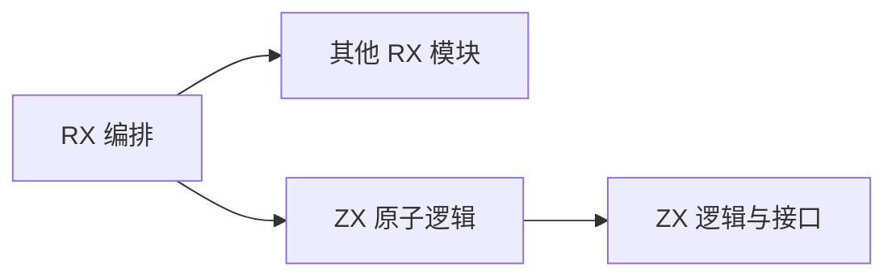
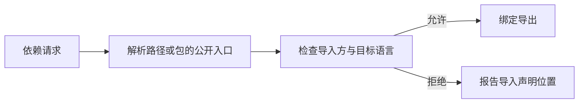

# ZX 与 RX 依赖方向收口

## Intent · 最终目标

禁止 ZX 导入或再导出 RX，保留 RX 调用 RX 和 ZX 的能力。跨阶段流程在 RX 中表达，ZX 只承担原子计算及算法内循环。正式编译和自举使用同一条约束。

## Data · 可用证据

以 `af1d281d6` 为起点。正式模块目标解析允许文字 `.rx` 路径，也允许包名指向 RX，编译库的公开条目另外在链接时解析。已有反向依赖分布在 compiler、genz、CLI 和 pkgs，另有 `genz/reference_imports` 通过包名解析为 RX。调用方必须与限制同批收口。[正式解析入口](../../packages/compiler/src/zx/modules/project/target/host.zig) · [自举包名](../../packages/compiler/build/source_packages.zig)

## Edges · 边界与限制

相对路径、根路径、类型导入、barrel 再导出、包名和已发布库按同一方向检查。复用原语义、缓存、错误和所有权边界。字面量字符串及普通文件名不构成依赖。确认由原子操作过度拆出的无副作用查询可合为一个 ZX 算法。真实效果、阶段及错误恢复由 RX 决定。

## Answer · 验收

先用同一条规则覆盖正式源码、已注册源包及编译库。分批修正纯算法、无循环的编排和重复编排中的反向依赖，复核真实调用路径。候选需用新规则重新生成完整自举清单，并覆盖 ZX 导入、再导出、包名与 RX 调用 RX 的行为和错误。代码与收敛计划一起验收后推送。

### 已接入的迁移

正式入口检查相对路径、源码包入口与编译库公开源路径。候选从真实源码拒绝了直接导入和 `genz/reference_imports` 包名导入。路径规范化、所有权队列推进、包版本和注册表检查继续执行原子 ZX 算法。外部原型和所有权结果发布改由 RX 编排。

需要反复调用 RX 时，用 `Call.while` 检查步骤输入和输出共用的布尔状态字段。编译器直接构造已有的 Iteration IR。watch 的实际源清单通过生成，轮询和重建均发射为普通 Zig `while`，生成的两个循环均未出现堆分配。CLI 的文件源、依赖、库和 lint 遍历进入同一条执行路径。

在类型引用遍历和依赖收集复现的一次错误来自 RX 重复调用的 IR 写入。条件和循环状态先占用了为 Call 预留的表头容量，Call 随后越界写入。修复后，CLI 的 93 个入口、安装的 3 个入口、后端的 4 个入口和包管理器的 22 个入口都通过完整生成。

编译器的库链接、函数发布、常量分析、IR 校验和硬件输出转由 RX 组合，genz 的所有权回放、集合转换及语句生成也收口到 RX。词法扫描、类型名规整和错误集合分析是可独立调用的 ZX 算法。函数写入以同一个签名行准备状态及发布结果，使用已有列写入接口在宿主预留的位置提交。

### 自编译与性能

由 Source 引导器自编译的 ReleaseSmall 候选通过 26 个构建步骤。它和上一轮 Source 引导器分别生成主、执行、宿主、集合和增长五组清单。除输入戳外，17,019 个文件逐字节一致。

最初候选的冷生成峰值超过 12 GB。阶段采样把增长定位到 ABI 和状态类型列。跨函数的字段追加走了保守复制路径，每写一行就复制已有列。现在在各自的构造循环中直接追加自己拥有的列，生成代码恢复了按容量追加。成员求值顺序和列内容保持一致。

在上一轮冻结清单中保留符合依赖方向的 705 个入口。所有对照使用同一输入、16 分区和关闭常驻生成器的配置。工具本体都由 Source 生成，各自运行 Source 分析及发射。每组交错测量三次，下表记录中位数，内存使用十进制 MB。

| 对照     | 冷生成墙钟 | 冷生成 CPU | 冷生成进程树 RSS | 冷生成系统峰值 | 热生成墙钟 | 热生成 CPU |
| -------- | ---------: | ---------: | ---------------: | -------------: | ---------: | ---------: |
| 固定基线 |     2.06 s |     8.98 s |         737.8 MB |       797.6 MB |     1.62 s |     6.37 s |
| 上阶段   |     1.94 s |     9.42 s |         523.6 MB |       550.7 MB |     1.39 s |     6.11 s |
| 候选     |     1.89 s |     9.30 s |         528.2 MB |       549.8 MB |     1.42 s |     6.17 s |

候选较上阶段冷墙钟减少 0.05 秒、CPU 减少 0.12 秒、进程树采样峰值增加 4.7 MB、系统峰值减少 0.9 MB。较固定基线冷墙钟减少 0.17 秒、CPU 增加 0.32 秒、进程树采样峰值减少 209.6 MB。冻结清单的候选和两组基线均生成相同的 9,894 个文件。候选引导器 SHA-256 为 `8a8d76660509ffbbfcb194c1ff5faccb6c2ea81bc7674f8c02022474d29dbf6c`。

正式 CLI 对 ZX 默认导入、类型导入和再导出均在源声明处报错。相同工作目录下的 RX 嵌套调用生成程序并正常运行。编译库集成测试确认 ZX 无法用包名绕过限制，改用 RX 引入后可执行原有分支并正确传播被选中分支的错误。

编译包、扩展名省略、库链接与编解码、库回放、模块化循环、函数效果、类型解析、硬件资源和 RX 推导回归通过。RX IO 与并行 Task 的库消费和再次发布通过。同一编译库实例的两次 RX 调用共享一个只读 Store 槽，不同实例保留各自的槽。
