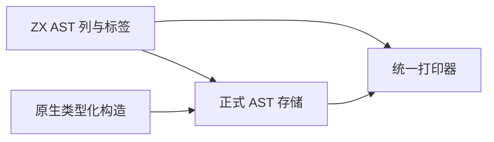

# genz 共享 AST 布局自举

## Intent · 最终目标

让正式 genz 的表达式、语句、声明、字段和分支存储从打印器共用的 ZX 模型取得标签与负载类型。保留已有 Zig 构造入口的类型契约，同时移除正式存储自行选择标签和列元素类型的职责。

## Data · 可用证据

阶段起点为 `a7830a110`。上批已把 AST 标签、偏移和可见范围的提交移入 Source。Zig 存储仍从原生联合体推导标签和负载表示，打印时再逐列核对这套表示与 Source 模型。[直接发布](genz直接AST行与区间自举.md) · [存储入口](../../packages/genz/src/node/storage.zig) · [打印入口](../../packages/genz/src/printer/host.zig)

## Edges · 边界与限制

保留已有 AST 节点、提交顺序与打印结果。原生构造按编译期核对的表示进入已有列，沿用 seed 的独立原生布局。共享模型不增加负载复制或新分配。

## Answer · 验收

复用上批 Source 引导器，对比引导输出、固定清单及安装版生成结果。重点检查带可空字段与嵌套列表的列、分支和声明、分配失败和原生 seed。

### 正式路径

`Storage` 从打印输入所用的 ZX 模型取得五类列布局。表达式、语句和声明的持久标签直接采用 ZX 枚举，字段、分支及负载列直接以 ZX 字段类型分配。原生构造入口只在编译期核对标签、顺序和元素表示。打印器借用这些列，沿用既有 AST 写入顺序，过程中没有额外负载缓冲区。[共享布局](../../packages/genz/src/node/schema.zig) · [存储入口](../../packages/genz/src/node/storage.zig) · [打印器](../../packages/genz/src/printer/host.zig)

初始种子仍使用原生布局。正式 genz 的临时 Zig 构造类型仍被原生发射调用，另外列存储的容量和释放继续使用宿主分配器。后续闭包核对要确认这些构造及 genz 工作区状态的实际调用。

### 集中验收

- Zig 0.17.0、ReleaseSmall、16 分区。候选由上阶段 Source 引导器构建，25/25 个构建步骤通过。种子目标 19/19 个构建步骤通过。候选 SHA-256 为 `73f58f84809d071ed2e4485eb0f32febbb7362e5995e36691986d174797006b5`。
- 主清单、增长、集合、执行及宿主共 16,649 个文件逐字节一致。735 入口的冻结清单共 11,753 个文件逐字节一致，所有权 memo 载荷也一致。生成文件对照排除工具身份戳。
- 八组回归的 251 项 Zig 测试通过。14 项 Node 集成、52 项 Gateway JSON 检查及 86 项 Gateway 执行检查通过。三种 Gateway 输入的 54 个生成 Zig 文件逐字节一致。

固定清单使用由 Source 构建、运行时也执行 Source 分析与生成的相邻两代工具。关闭常驻生成器后交替运行三轮，以下为中位数。RSS 使用十进制 MB。

| 路径               | 比较            |  墙钟（秒） |     CPU（秒） |  峰值 RSS（MB） |
| ------------------ | --------------- | ----------: | ------------: | --------------: |
| 冷生成             | 上一阶段 → 候选 | 2.60 → 2.59 | 13.04 → 12.99 | 665.99 → 666.09 |
| 热生成             | 上一阶段 → 候选 | 1.91 → 1.92 |   8.25 → 8.28 | 646.53 → 645.45 |
| 无改动             | 上一阶段 → 候选 | 0.03 → 0.03 |   0.03 → 0.03 |     0.23 → 0.34 |
| Gateway 无缓存构建 | 上一阶段 → 候选 | 1.34 → 1.34 |   1.44 → 1.43 | 212.01 → 210.58 |
| 冷生成             | 固定基线 → 候选 | 2.82 → 2.59 | 12.43 → 12.99 | 884.77 → 666.09 |

生成测试记录进程树峰值，Gateway 记录单进程最大 RSS。冻结清单覆盖分析与 Zig 源码生成，Gateway 构建覆盖后端编译。完整编译器的冷构建与三阶段自编译留在最终验收。
