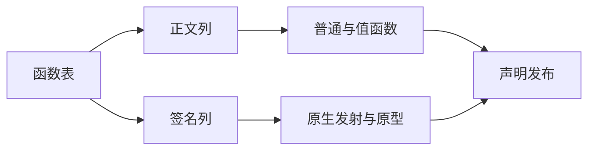
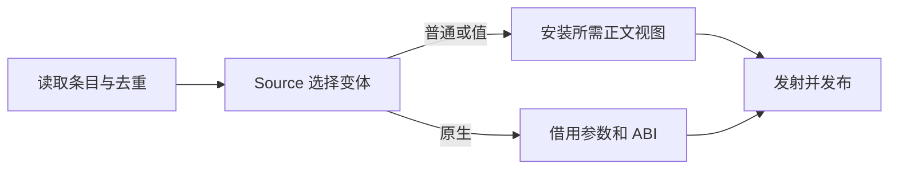

# genz 函数作用域与原型发射自举

## Intent · 最终目标

让正式 genz 在函数模块、签名文件和模块内函数的发射过程中按职责读取函数列。由 RX/ZX 决定签名变体和准备顺序，避免为原生声明安装正文或计算正文效果。

## Data · 可用证据

起点为 `cde28e74e`。`Lower.selectFunction`、独立模块发射、签名文件和模块内假定先构造完整 `ir.Function`。原生原型只消费入参、出参和原生 ABI。普通及值原型还需要选定函数的 Store、错误与效果。签名请求循环已经在 Source，回调仍选择变体并安装全部正文。[作用域](../../packages/genz/src/zx/lower.zig) · [签名发射](../../packages/genz/src/zx/modules/signature/execution.zig) · [原生发射](../../packages/genz/src/zx/external.zig)

## Edges · 边界与限制

维持声明、错误和生成结果顺序，以及源文件路径的去重规则。只借用原存储。普通及值原型继续取得原有的效果和类型事实，原生模块保留 Store 声明所需的列。初始 seed 保留其兼容规则。

## Answer · 验收

覆盖两种引导器生成、普通与值原型、原生调用、Store 和模块内函数。对照产物、所有权缓存及固定性能输入，核对两类发射入口实际读取的列。

### 正式路径

独立函数模块的 RX 发射从 Source 选择原生或普通准备。普通和值函数直接从原表安装正文列，延续错误缓存与效果分析。原生模块仅安装参数、返回类型和 Store 列，跳过正文效果准备。模块帧保存函数编号，原生发射和原型从该编号读取签名。[模块发射](../../packages/genz/src/analysis/module/workflow/execute/function.rx) · [列安装](../../packages/genz/src/zx/functions/scope.zig)

签名文件的宿主按原路径去重，读取函数列中的原生标记和值 ABI 事实。独立函数模块和签名循环共用 ZX 规则在编译期生成的变体表。签名循环接收可空枚举，决定发射原生、普通、值或两种本地原型。普通及值原型按需安装正文和效果，原生原型沿用父作用域的类型环境和签名列。旧的变体结果页缓冲已经移除。签名形状保留既有参数名和顺序。[签名循环](../../packages/genz/src/analysis/functions/signature/execute/run.zx) · [变体规则](../../packages/genz/src/analysis/functions/signature/module/select.zx)

模块内函数和前置条件也直接安装所需的列。原生函数由原生发射器接收 `ir.Signature`，前置条件仅安装谓词的符号、表达式及表达式编号。节点分配和最终程序视图的原生 ABI 适配仍在其原有边界。[模块内发射](../../packages/genz/src/zx/functions/emit.zig) · [前置条件](../../packages/genz/src/zx/contracts.zig)

### 集中验收

- Zig 0.17.0、ReleaseSmall、16 分区，使用上一阶段 Source 引导器构建候选，26/26 个构建步骤通过。候选 SHA-256 为 `e433ee12c2fe49cb350da4d1c0ce66b6d312a2abf7eeb54029d3904db01440f1`。初始 seed 词法目标通过 21/21 个构建步骤。
- 候选重跑正式主清单及四份辅助清单，16,671 个生成文件逐字节一致，排除工具身份戳。签名循环的生成函数没有堆分配，变体规则由 Zig 在编译期求值。
- 函数模块、原生 ABI、增量生成、契约、库链接和 RX Store 路径的集中回归通过 119 个构建步骤、75 项 Zig 测试和 20 项 Node 检查。

### 性能对照

冻结清单含 735 个入口，两代工具均由 Source 引导器生成，运行使用 Source 分析与发射，关闭生成常驻服务。三次交替采样，11,753 个输出文件及所有权 memo 载荷一致。表中用时和进程树 RSS 取中位数，固定基线复用同配置的已验收数据。

| 路径   | 比较            |  墙钟（秒） |     CPU（秒） |  峰值 RSS（MB） |
| ------ | --------------- | ----------: | ------------: | --------------: |
| 冷生成 | 上一阶段 → 候选 | 2.64 → 2.61 | 13.02 → 13.03 | 666.22 → 665.63 |
| 热生成 | 上一阶段 → 候选 | 1.93 → 1.94 |   8.25 → 8.30 | 646.81 → 645.82 |
| 无改动 | 上一阶段 → 候选 | 0.03 → 0.03 |   0.03 → 0.03 |     0.25 → 0.36 |
| 冷生成 | 固定基线 → 候选 | 2.82 → 2.61 | 12.43 → 13.03 | 884.77 → 665.63 |

冷生成的系统单进程 RSS 峰值为 682.95 → 696.80 MB，本轮增加 13.84 MB。采样物理内存峰值为 661.36 → 660.69 MB，进程树 RSS 采样减少 0.59 MB。工具自身的编译步骤约 27 秒，峰值约 1 GB。完整冷构建和三阶段自编译列入最终验收。

### 下一批

沿函数事实的发布出口收口 `function_analysis/generated.zig` 对返回列的复制和生命周期管理。能力、值表示与布局事实应直接在长期结果区构造，类型闭包、遍历工作区和散列输入仍在短期区。验收需从生成代码确认两类分配的归属，并核对普通、类型独立输出和并发生成都可在临时区销毁后使用返回数据。函数事实、所有权基底和入口分析的宿主调度也在同一调用链，须分别确认实际退出的职责。[函数事实编排](../../packages/genz/src/analysis/facts/analyze.rx) · [发布出口](../../packages/genz/src/zx/function_analysis/generated.zig) · [分析调度](../../packages/genz/src/zx/function_analysis.zig)
