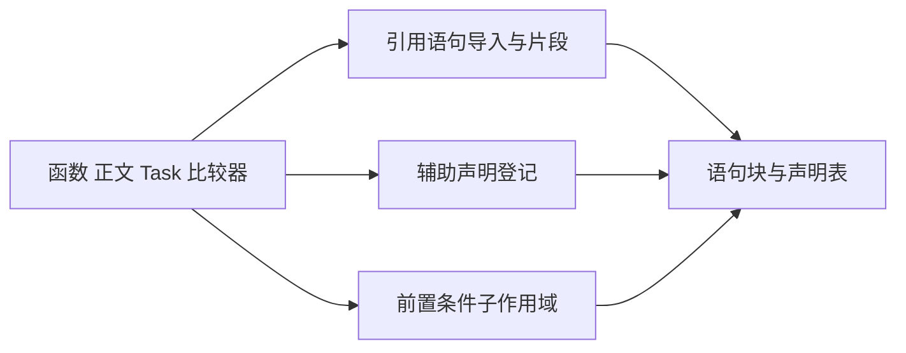
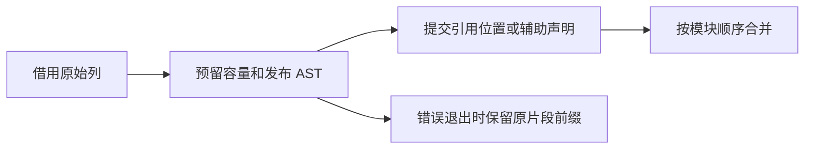

# genz 引用片段与辅助声明自举

## Intent · 最终目标

收口普通函数、值 ABI、Task、比较器和子谓词借用的生成状态。让 Source 推进引用语句发布、辅助声明批量登记与拼接，以及契约子作用域的输入和效果写回。

## Data · 可用证据

基于 `6df5cd606`。引用先向 Zig 的双列片段列表预留，再调用 Source 导入语句，最后写入片段位置。辅助声明表本身已经由 Source 定义，逐条读取并登记常量及最终声明顺序仍由 Zig 推进。函数契约的筛选器与子作用域规则已有 Source 实现，Zig 仍负责逐项恢复、求值、发射和合并效果。

## Edges · 边界与限制

引用语句继续使用统一 AST 导入，失败时保持片段列表长度。辅助名称只在临时来源需要独立存储时复制，声明编号、保留槽的替换行为及模块前缀、辅助、后缀的顺序继续一致。契约只执行前置条件，保留按声明顺序执行及子作用域写回位点。初始 seed 单列。

## Answer · 验收

沿正式入口核对退出的 Zig 状态和遍历。以同一工具链和输入对照排序、Task、公开库、契约和迭代产物，运行现有分配失败回归和固定清单性能验收。

### 正式路径

表达式、循环、比较器及 Task 的引用语句使用同一条 Source AST 导入。RX 只在导入成功后登记片段，暂存列表从两列改为直接存储打包区间。引用汇合读取这些区间，连续行复用原 AST，只有不连续的行需要汇集到新范围。宿主负责绑定读写列和预留列表容量，保留原分配失败顺序。[引用导入](../../packages/genz/src/analysis/functions/references/append.rx) · [连续区间检查](../../packages/genz/src/analysis/node_headers/block/sequence/borrow.zx)

辅助声明的常量按原始偏移批次登记，ZX 处理行号、容量界限及名称的借用或复制。预留槽替换和函数行登记复用现有表。普通入口和独立函数入口均由 RX 在最终发布前接上辅助片段与后缀，类型专用入口直接发布自己的声明。宿主绑定已有 AST 列及结果区。[批量登记](../../packages/genz/src/ast/declarations/table/batch.zx) · [入口发布](../../packages/genz/src/analysis/module/workflow/execute/entry.rx) · [独立函数发布](../../packages/genz/src/analysis/module/workflow/execute/function.rx)

ZX 遍历原始契约种类列，仅打开前置条件对应的作用域。RX 在同一范围内依次求值、发射守卫和交回效果。函数和前置条件共用 Source 的输入使用、分配、I/O 和并行标记合并。子作用域的原生视图安装、递归求值和引用存储接管仍由 Zig 执行。执行探针只在名称需独立存储和既有表增长处使用分配器，阶段输入无需额外堆对象。[契约遍历](../../packages/genz/src/analysis/functions/precondition/execute/walk.zx) · [守卫与作用域写回](../../packages/genz/src/analysis/functions/precondition/execute/lower.rx) · [效果合并](../../packages/genz/src/analysis/functions/context/effects.zx)

### 性能

Zig 0.17.0、ReleaseSmall、16 分区，关闭常驻。候选和上一阶段均由 Source 引导器构建并执行各自的 Source 分析和生成。沿用 735 入口冻结清单，三轮交替取中位数。前后及同一工具冷热生成的 11,753 份产物逐字节一致，排除工具身份戳。所有权缓存载荷一致。

| 场景   | 工具     | 墙钟（秒） | CPU（秒） | 进程树峰值 RSS（字节） | 单进程峰值 RSS（字节） |
| ------ | -------- | ---------: | --------: | ---------------------: | ---------------------: |
| 冷生成 | 固定基线 |       2.82 |     12.43 |            884,768,768 |            934,051,840 |
| 冷生成 | 上一阶段 |       2.59 |     12.98 |            667,992,064 |            685,899,776 |
| 冷生成 | 候选     |       2.59 |     12.90 |            666,484,736 |            692,748,288 |
| 热重建 | 上一阶段 |       1.92 |      8.28 |            646,922,240 |            646,955,008 |
| 热重建 | 候选     |       1.92 |      8.29 |            645,578,752 |            645,611,520 |

较上一阶段，冷墙钟持平、CPU 减少 0.08 秒、进程树峰值减少 1.51 MB、单进程峰值增加 6.85 MB。相对固定基线，冷墙钟减少 0.23 秒、CPU 累计增加 0.47 秒、进程树峰值减少 218.28 MB。热墙钟持平，CPU 增加 0.01 秒。无改动运行墙钟及 CPU 均为 0.03 秒。首轮冷墙钟为 2.96 秒与 3.89 秒，其余两轮候选在 2.58～2.59 秒。计时覆盖引导生成与磁盘缓存复用。

### 引导一致性

候选通过 25 个引导构建步骤。SHA-256 为 `a07c334a8035f555093c9db9f39ddf6b8177bf9053cef0c1f8bd23e578ae39b2`。候选重新生成主、增长、集合及执行四组清单，16,392 份文件逐字节一致，排除工具身份戳。初始 seed 的词法引导通过 19 个步骤。

### 回归

十组回归通过 642 个构建步骤、11,758 项 Zig 测试和 60 项 Node 集成检查。覆盖辅助函数与排序声明、Task 生命周期、原生引用、契约规则和失败清理、公开库与 Store 重定位、模块生成缓存和迭代调用。值返回借用、整数排序及字符串排序三个用例的实际 Zig 源码与上一阶段逐字节一致。变更的 RX/ZX 通过格式检查和 lint。原始日志位于 `.zig-cache/verification-tmp/shared-ast/`。

下一批沿普通模块渲染和 Gateway 的正式入口，收口 AST 列借用、声明范围和服务参数的交接。初始 seed 的旧物化路径单列。
