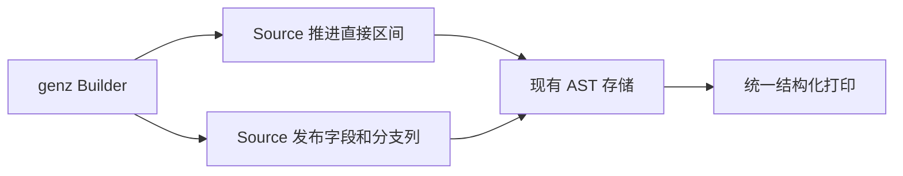

# genz 直接 AST 行与区间自举

## Intent · 最终目标

从正式 Builder 和 Storage 入口迁移直接构造的 AST 区间。表达式嵌套字段、选择分支、函数参数、语句块和模块声明与列导入共用发布规则。保留最小的原生泛型存储操作。

## Data · 可用证据

阶段起点为 `7514a064b`。Source 已持有列导入和区间拼接的规则。直接构造仍从 Zig 逐行追加语句和声明，逐项向字段和选择分支的列写入。部分消费方还会从已存列恢复独立函数参数。[直接构造](../../packages/genz/src/node/storage.zig) · [既有列导入](../../packages/genz/src/node/import_payloads.zig) · [区间发布](../../packages/genz/src/node/blocks.zig)

## Edges · 边界与限制

沿用节点顺序、已提交前缀、错误传播和分配器归属。借用描述符指向调用方已经持有的行，字段名和分支捕获的字节跟随原有借用契约。保留初始 seed 和原生 genz 路径。

## Answer · 验收

用同一候选对比固定清单、引导产物和直接 AST 的既有回归，核对多行、空块和分配失败路径。

### 正式路径

直接构造的表达式、语句和声明从现有行借用输入。Source 按顺序请求负载已准备的节点，在最终列写入标签和偏移，再发布可见长度。宿主提供原先的存储分配和按 Zig 联合体类型写入负载的能力。失败时已发布的前缀保持可见，空输入直接返回当前位置。[直接区间](../../packages/genz/src/analysis/node_headers/direct.zx) · [负载绑定](../../packages/genz/src/node/direct.zig)

对象字段和分支捕获直接用带步长的只读字段视图，从已有行写入最终列。两类数据共用既有 Source 的普通列预留和提交。需要独立函数参数描述符时，也复用既有的 Source 物化逻辑，参数名继续借用原内容。[直接构造](../../packages/genz/src/node/storage.zig) · [列写入](../../packages/genz/src/analysis/node_headers/plain/write.zx)

### 引导和固定清单

Zig 0.17.0、ReleaseSmall、16 分区，关闭常驻。上一版与候选均由 Source 引导器构建，执行 Source 分析和生成。735 个固定入口交替测三轮，以下取中位数。11,753 份生成文件逐字节一致，排除工具身份戳。所有权缓存正文一致。

| 场景   | 工具     | 墙钟（秒） | CPU（秒） | 进程树峰值 RSS（字节） | 单进程峰值 RSS（字节） |
| ------ | -------- | ---------: | --------: | ---------------------: | ---------------------: |
| 冷生成 | 固定基线 |       2.82 |     12.43 |            884,768,768 |            934,051,840 |
| 冷生成 | 上一版   |       2.59 |     12.94 |            665,190,400 |            693,649,408 |
| 冷生成 | 候选     |       2.59 |     13.02 |            669,401,088 |            684,146,688 |
| 热重建 | 上一版   |       1.93 |      8.30 |            645,808,128 |            645,840,896 |
| 热重建 | 候选     |       1.94 |      8.28 |            646,725,632 |            646,758,400 |

较上阶段，冷墙钟持平、CPU 增加 0.08 秒、进程树峰值增加 4.21 MB、单进程峰值下降 9.50 MB。相对固定基线，冷墙钟减少 0.23 秒、CPU 累计增加 0.59 秒、进程树峰值减少 215.37 MB。无改动用时 0.03 秒。

候选通过 25 个引导步骤，SHA-256 为 `15caf400e40627089bfade622f7546384421d667cce7879c0180c253a1785a2d`。五组引导清单共 16,649 份产物逐字节一致，排除工具身份戳。

### 安装版回归

初始 seed 词法引导通过 19 个步骤。八组回归共通过 290 个构建步骤、259 项 Zig 测试及 100 项集成检查。覆盖对象、分支、集合、模块生成及其分配失败、函数分析、Store 和 Gateway。变更的 ZX 通过格式检查和 lint。

三组 Gateway 应用共 54 份实际生成文件逐字节一致。使用相同路径、工具链和优化配置，关闭编译器生成缓存，预热后对有状态入口交替构建三轮。

| 工具   | 构建墙钟（秒） | CPU（秒） | 系统峰值 RSS（字节） |
| ------ | -------------: | --------: | -------------------: |
| 上一版 |           1.35 |      1.45 |          212,533,248 |
| 候选   |           1.34 |      1.45 |          211,451,904 |

原始日志位于 `.zig-cache/verification-tmp/direct-ast/`。标签和偏移的提交已移入 Source，Zig 仍持有类型化负载及其存储，下一批核对它与打印器列模型的重复布局。
