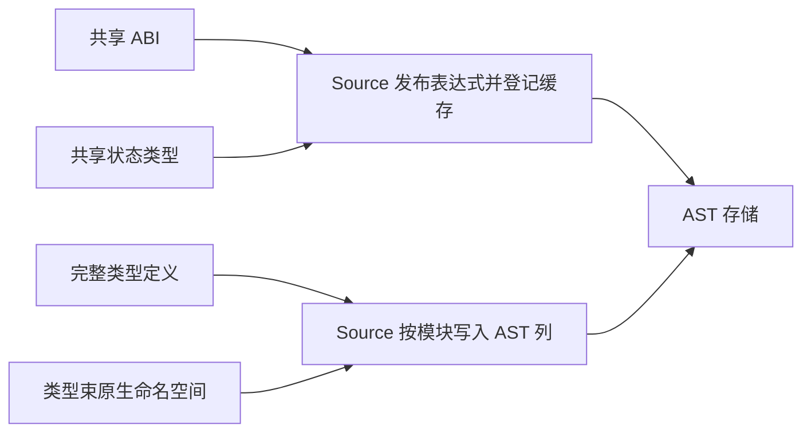
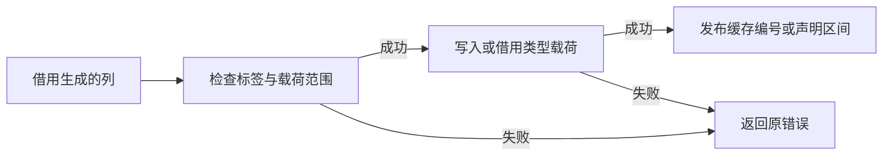

# genz 类型 AST 与缓存发布自举

## Intent

让共享 ABI、状态类型和类型束共用 Source 的 AST 列发布。类型缓存只登记已发布的表达式。沿按需类型、完整类型定义和原生命名空间三条路径核对实际宿主职责。

## Data

起点为 `9676bca5c`。共享 ABI 和状态类型原先在 Zig 分别调用 AST 导入和缓存写入。完整类型定义的表达式、字段和声明由 Zig 按顺序分别发布，类型束的原生命名空间也从 Zig 分别写入表达式及声明。通用模块列已可由 RX 排序发布。[按需 ABI](../../packages/genz/src/zx/types/shared_abi.zig) · [按需状态](../../packages/genz/src/zx/types/shared_state.zig) · [模块列入口](../../packages/genz/src/analysis/node_headers/module/append.rx)

## Edges

保留表达式、字段和声明的顺序及原有分配区。已有外部保证寿命的文本继续借用。来自临时区的嵌套载荷按原规则保留到结果区。缓存提交只跟随成功的表达式发布，失败立即沿原错误传递。Zig 在编译期为 Source 绑定原生列和载荷类型。

## Answer

沿正式生成入口核对缓存登记、表达式与声明发布的先后关系和原有所有权。验证同一批候选的引导产物、类型及模块回归和冻结输入性能。明确仍由宿主提供的列描述符绑定和资源边界。

### 已迁移的正式路径

共享 ABI 和状态类型通过同一个 RX 入口写入表达式，再根据类型种类登记缓存。失败时沿用 AST 导入状态，缓存编号只在写入成功后可见。完整 ABI 和状态类型的表达式、字段与声明，由共用的模块列入口按原顺序提交。原生命名空间也进入这一入口。各列仍按原来的寿命保留、复制或借用载荷。Zig 宿主提供原生列描述符、声明区间以及分配器。

候选通过 26 个自编译构建步骤。把本批源码分别交给上一阶段和候选的 Source 引导器生成主、执行、宿主、集合及增长清单，17,096 个输出逐字节一致。性能采用 705 个冻结入口、16 分区和关闭常驻生成器的同一配置，三组交错各测三轮。工具本体均由 Source 生成，执行自己的 Source 分析与发射。

| 对照     | 冷墙钟 | 冷 CPU | 冷进程树 RSS | 冷系统峰值 | 热墙钟 | 热 CPU |
| -------- | -----: | -----: | -----------: | ---------: | -----: | -----: |
| 固定基线 | 2.06 s | 8.94 s |     738.1 MB |   792.2 MB | 1.59 s | 6.31 s |
| 上阶段   | 1.91 s | 9.42 s |     532.1 MB |   550.5 MB | 1.43 s | 6.24 s |
| 候选     | 1.91 s | 9.37 s |     534.9 MB |   557.5 MB | 1.42 s | 6.21 s |

相比上阶段，冷墙钟持平，CPU 减少 0.05 秒，进程树峰值 RSS 增加 2.8 MB，系统峰值增加 7.0 MB。相比固定基线，冷墙钟减少 0.15 秒，CPU 增加 0.43 秒，进程树峰值 RSS 减少 203.3 MB。冻结清单的 9,894 个输出与上一阶段一致。候选引导器 SHA-256 为 `00c6ee12424ae92ad698697eca7272beeb41c647ced9148d057967e8b755c0a1`。

模块生成、模块化循环、跨模块类型、编译库导入和原生生成通过 184 个构建步骤和 153 项测试。六组独立库消费者成功运行。原生对象 ABI 在声明重排和生成缓存复用后仍正确执行。
