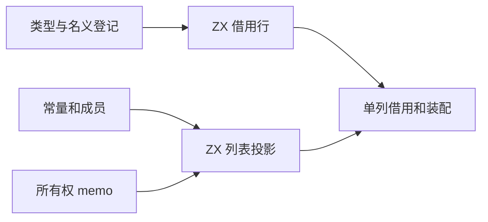

# 借用行与列表投影自举

## Intent

让联结类型登记、编译库常量、公开成员和所有权 memo 通过 ZX 遍历借用列并装配行视图。

## Data

起点为 `7c6e2d82c`。模块类型与名义记录逐列读取由 `readSliceRow` 执行。依赖检查、编译库常量的校验与恢复、公开成员导出和所有权 memo 通过 `projectListColumns` 装配嵌套列表视图。[原生列接口](../../packages/core/src/memory/rows.zig) · [类型登记](../../packages/compiler/src/zx/modules/link/registration/request.zx)

## Edges

输入和输出的列数不一致时先拒绝，单列行号越界时保留已经装配的前缀。在宿主原有视图上填充借用描述符。字段偏移由编译期 ABI 布局提供，数组载荷留在原位置。

## Answer

核对两个批量 Zig 入口退出并覆盖真实联结和 memo 路径。小范围检查空临时分配区、借用地址和错误边界，集中对照原有回归、生成产物及固定性能基线。

### 正式路径

- 联结类型登记的类型列与名义列用 ZX 逐列装配切片视图，随后用既有字段类型解释视图。
- 依赖成员查找、常量校验与加载、公开再导出和所有权 memo 共用 ZX 的列表投影。ZX 检查列数并决定写入顺序，宿主在每列读取对应行、检查边界、写入既有借用描述符。
- 移除 Zig 的整行读取与整组列表投影。保留编译期字段偏移、类型化装配和通用的单列内存操作。

两项空临时分配区核验通过。覆盖读视图与输入载荷地址相同、列数不匹配时保持视图、后续列越界时保留已装配前缀。

### 引导与性能

由 `7c6e2d82c` 的 Source 引导器构建候选，26 个构建步骤通过。候选 SHA-256 为 `efa963f24d6cc09e6bdff2220af46f2f637ddf9541fe0e493ca5aef0407cda20`。

冻结 705 个入口、16 分区，关闭常驻生成器，交错三轮取中位数。工具本体均由 Source 自编译并运行各自的 Source 分析与发射。9,894 个冻结输入的生成文件逐字节一致，所有权 memo 载荷摘要也相同。

| 对照     | 冷墙钟 | 冷 CPU | 冷进程树 RSS | 冷系统 RSS 峰值 | 冷物理占用峰值采样 | 热墙钟 | 热 CPU |
| -------- | -----: | -----: | -----------: | --------------: | -----------------: | -----: | -----: |
| 固定基线 | 2.10 s | 8.98 s |     738.4 MB |        777.6 MB |           772.4 MB | 1.64 s | 6.44 s |
| 上阶段   | 1.97 s | 9.49 s |     524.9 MB |        552.6 MB |           546.9 MB | 1.44 s | 6.24 s |
| 候选     | 1.97 s | 9.42 s |     524.3 MB |        547.7 MB |           542.0 MB | 1.45 s | 6.24 s |

较上阶段，冷生成墙钟持平，CPU 减少 0.07 秒，进程树 RSS 峰值减少 0.6 MB，系统 RSS 峰值减少 4.9 MB。热墙钟增加 0.01 秒，CPU 持平。较固定基线，冷墙钟减少 0.13 秒，CPU 累计增加 0.44 秒，进程树 RSS 峰值减少 214.1 MB。无修改检查的墙钟中位数为 0.03 秒。

两版引导器用本批源码生成五份清单，17,228 个生成文件逐字节一致。冻结输入的所有权 memo 载荷也逐字节一致。

集中回归通过 102 个步骤、252 项测试，覆盖类型合并、编译库联结与编解码、联结边界以及模块生成缓存。
