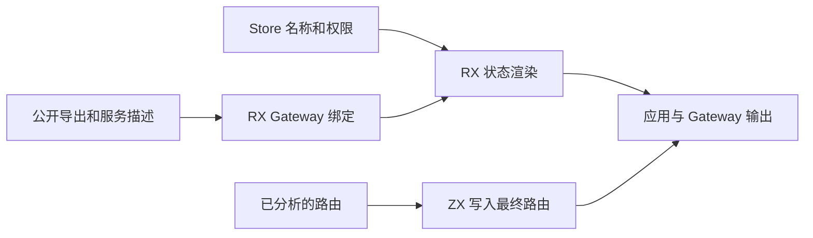

# 公开成员与 Store 绑定列自举

## Intent · 最终目标

沿普通应用和 Gateway 的正式生成入口，让 RX/ZX 直接消费库导出、路由和 Store 的已有列。撤出重复组装公开成员、路由输出和 Store 渲染输入的手写转换。

## Data · 可用证据

阶段起点为 `437a610ea`。生成器已经用绑定结果的槽下标和访问权限列渲染服务。Gateway 仍为每个导出创建临时成员记录，并在 Zig 中转换路由。普通应用与 Gateway 都先将 Store 名称与权限装成对象，再交给生成器读取。[Gateway 绑定](../../packages/compiler/src/backends/zig/gateway/state.zig) · [路由](../../packages/compiler/src/backends/zig/gateway/routes.zig) · [普通状态](../../packages/compiler/src/backends/zig/state.zig)

## Edges · 边界与限制

沿用库导出和路由顺序、错误检查次序及 HTTP 方法拼写。Store 保留普通入口的原有缓存键和兼容渲染入口。初始 seed 保留原生路径。通用列接口只负责描述、读取与写入存储。

## Answer · 验收

用同一候选对照 Gateway 与普通 Store 的现有回归、引导产物及固定清单性能。

### 正式路径

Gateway 将库导出的名称、可空函数编号、公开模块名称与能力标志直接绑定为只读列。Source 按已校验的条目顺序读取当前成员，只分配最终的服务描述列。公开模块以可空 I/O 标志保留无可调用入口的状态，并直接保留进程能力。[宿主绑定](../../packages/compiler/src/backends/zig/gateway/state.zig) · [成员推进](../../packages/compiler/src/backends/zig/gateway/bindings/members.zx)

路由关联顺序仍在分配之前检查。ZX 从分析表读取路径、方法和服务位置，写入渲染器已有的最终列。方法名取自同一份枚举声明，结果继续保留可空方法与原来的顺序。[路线交接](../../packages/compiler/src/backends/zig/gateway/routes.zig) · [路由发布](../../packages/compiler/src/backends/zig/gateway/routes/publish.zx)

应用状态和 Gateway 共用 Store 名称、访问权限与所有权列。共用所有权策略时，ZX 找到第一个可写对象便能确定策略。独立渲染接口仍可借用对象中的逐项所有权。普通入口在开启源文件缓存时继续生成原有 JSON 指纹元数据，使用调用期暂存区；默认 Source 渲染直接读原列。初始 seed 和原生 genz 的诊断路径沿用原有接口。[Store 视图](../../packages/genz/src/zx/state/objects.zig) · [所有权策略](../../packages/genz/src/analysis/store/lifecycle/policy.zx) · [普通状态](../../packages/compiler/src/backends/zig/state.zig)

### 引导与性能

Zig 0.17.0、ReleaseSmall、16 分区，关闭常驻。上一版和候选均由 Source 引导器构建并运行 Source 分析及生成。735 个固定入口交替测三轮，取中位数。11,753 份冷暖产物逐字节一致，排除工具身份戳。所有权缓存正文相同。

| 场景   | 工具     | 墙钟（秒） | CPU（秒） | 进程树峰值 RSS（字节） | 单进程峰值 RSS（字节） |
| ------ | -------- | ---------: | --------: | ---------------------: | ---------------------: |
| 冷生成 | 固定基线 |       2.82 |     12.43 |            884,768,768 |            934,051,840 |
| 冷生成 | 上一版   |       2.59 |     12.99 |            667,385,856 |            694,124,544 |
| 冷生成 | 候选     |       2.60 |     12.98 |            665,976,832 |            688,914,432 |
| 热重建 | 上一版   |       1.92 |      8.27 |            646,348,800 |            646,381,568 |
| 热重建 | 候选     |       1.91 |      8.25 |            645,758,976 |            645,791,744 |

较上一版，冷生成墙钟增加 0.01 秒，CPU 减少 0.01 秒，进程树峰值减少 1.41 MB。较固定基线，冷墙钟减少 0.22 秒，CPU 累计增加 0.55 秒，进程树峰值减少 218.79 MB。无修改用时均为 0.03 秒。

候选通过 25 个引导步骤，五份清单的 16,632 份输出相同，排除工具身份戳。候选 SHA-256 为 `dc27ff0068cc91972baeabb294fd7893c23004fa2edb4552d3d2d2bdd1790dec`。初始 seed 词法引导通过 19 个步骤。

### Gateway 与普通 Store 回归

安装版通过 Gateway 的 86 项检查、JSON 边界的 52 项检查，以及公开库 Store 迁移和重发的 2 项集成。Gateway 与 Store 的 Zig 回归共 87 项测试通过，Store 的 19 项运行检查通过。安装版首次编译发现 Zig 反射表达式无法在编译期索引枚举指针，改为直接读取枚举字段后补跑受影响的回归。四个受影响 Source 入口的生成、格式与 lint 均通过。

三组 Gateway 共 54 份生成文件逐字节一致。沿用上一阶段的同路径、相同工具链配置，关闭编译器缓存，预热后交替构建有状态 Gateway 三轮。

| 工具   | 构建墙钟（秒） | CPU（秒） | 系统峰值 RSS（字节） |
| ------ | -------------: | --------: | -------------------: |
| 上一版 |           1.32 |      1.43 |          212,238,336 |
| 候选   |           1.32 |      1.41 |          211,632,128 |

普通应用用现有只读和可写 Store 夹具对照。两个场景的 `zxc_state` 生成内容及持久缓存键逐字节相同，候选热构建分别从磁盘复用 9 项和 5 项生成单元，新增生成均为零。原始日志位于 `.zig-cache/verification-tmp/binding-columns/`。

普通 Store 的缓存键仍由 Zig 借助原有 JSON 元数据生成。下一批迁出缓存指纹和最终 State 文件的写入顺序，再收口 genz 的 AST 存储。
