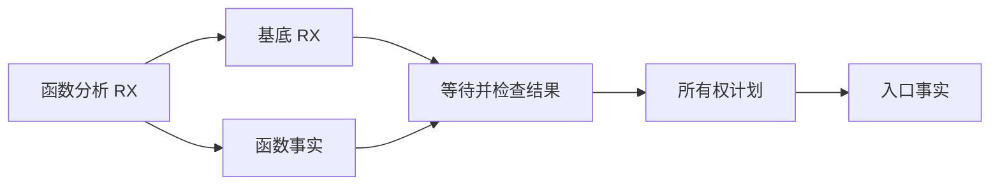
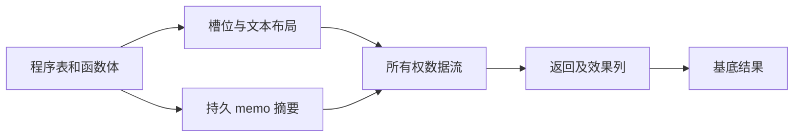

# 函数分析与所有权基底编排自举

## Intent · 最终目标

把 genz 的函数事实、所有权基底、所有权计划和入口事实的执行顺序交给 RX。覆盖冷创建、基底复用、并发分析和公开库入口的独立分析。

## Data · 可用证据

起点为 `6feddccac`。曾由 Zig 的 `analyzeFrom` 决定启动或就地计算基底、收集函数事实、等待工作线程、选择所有权分析和发布入口属性。基底构造也在 Zig 中决定何时计算持久 memo 所需的摘要，再组合槽位、数据流、返回事实和效果。[分析入口](../../packages/genz/src/zx/function_analysis.zig) · [基底构造](../../packages/genz/src/zx/uniqueness/basis.zig)

## Edges · 边界与限制

线程启动失败时沿用同步回退。函数事实与基底同时失败时，线程必须先退出，函数事实的错误先交付。复用基底不重新建立槽位或摘要。独立入口仍先更新入口能力，再更新独立所有权计划。线程和分配器继续由 Zig 提供，工作帧借用程序和输出地址。

## Answer · 验收

核对正式入口确实执行 RX 顺序，生成的编排无需临时堆分配。运行函数事实、并发、所有权和编译库入口的现有覆盖，对照引导产物、固定生成样本及 memo 内容。

### 正式路径

函数分析的 RX 入口接收待建或可复用的基底，决定并发启动、同步回退、函数事实收集和所有权计划。事实收集与基底构造各自保留结果，等待后先检查函数事实，再检查基底。普通、并发及公开库入口分析使用同一组入口事实操作。工作线程借用同一份只读程序描述符，释放、线程启动和等待仍由 Zig 提供。[函数分析编排](../../packages/genz/src/analysis/facts/workflow/analyze.rx) · [独立入口](../../packages/genz/src/analysis/facts/workflow/reentry.rx) · [资源绑定](../../packages/genz/src/zx/function_analysis/workflow.zig)

基底构造的 RX 入口按顺序登记类型槽位、按持久 memo 的需要摘要、建立数据流、计算返回事实并发布效果。各步骤直接写入最终基底，线程只共享构造所需的只读输入。原生阶段函数仍负责调用已有分析和绑定借用描述符。初始 seed 保留原来的执行顺序。[基底编排](../../packages/genz/src/analysis/facts/workflow/basis.rx) · [基底字段绑定](../../packages/genz/src/zx/uniqueness/basis.zig)

### 集中验收

- 使用 Zig 0.17.0、ReleaseSmall、16 分区，由上一阶段 Source 引导器构建候选，26/26 个步骤通过，候选 SHA-256 为 `0f837146a3ddad91b946aada5dfb42b1e91d5c9c1dd81a21b1dbc4ddc4ea5575`。初始 seed 词法目标通过 21/21 个构建步骤。
- 主清单和四份辅助清单的 16,711 个生成文件逐字节一致，排除工具身份戳。三条编排的生成代码均不分配临时堆对象。
- 函数分析及运行、所有权、库联结、分割模块和增量生成的集中回归通过 157 个构建步骤、171 项 Zig 测试和 3 项 Node 检查。
- 使用同一候选 CLI 运行公开库入口集成，5 项检查通过，覆盖 ZX/RX 单文件和清单入口，以及显式默认导出名。

### 性能对照

冻结清单含 735 个入口。两代工具均由 Source 引导器生成，运行使用 Source 分析与发射，关闭生成常驻服务。三次交替运行的 11,753 个生成文件及所有权 memo 载荷一致。表中的用时和进程树 RSS 取中位数，固定基线沿用同配置的已验收结果。

| 路径   | 比较            |  墙钟（秒） |     CPU（秒） |  峰值 RSS（MB） |
| ------ | --------------- | ----------: | ------------: | --------------: |
| 冷生成 | 上一阶段 → 候选 | 2.62 → 2.61 | 13.04 → 13.03 | 669.17 → 665.86 |
| 热生成 | 上一阶段 → 候选 | 1.93 → 1.92 |   8.31 → 8.27 | 645.86 → 646.76 |
| 无改动 | 上一阶段 → 候选 | 0.03 → 0.03 |   0.03 → 0.03 |     0.21 → 0.41 |
| 冷生成 | 固定基线 → 候选 | 2.82 → 2.61 | 12.43 → 13.03 | 884.77 → 665.86 |

冷生成的系统单进程 RSS 峰值为 689.34 → 690.32 MB，采样物理内存峰值为 662.10 → 664.59 MB。工具自身编译步骤约 27 秒，峰值约 1 GB。完整冷构建和三阶段自编译仍在最终验收范围内。

### 下一批

沿所有权计划的正式入口收口运行前准备。当前 Zig 仍决定如何连接已有 Source 的拓扑和摘要、何时计算持久 memo 身份、何时建立重放以及何时发布待处理正文。把这段准备顺序接入现有所有权运行流程，保留阶段局部 arena、线程池和平台 I/O 的生命周期。[所有权入口](../../packages/genz/src/zx/uniqueness/root.zig) · [运行入口](../../packages/genz/src/analysis/uniqueness/program/run.rx)
