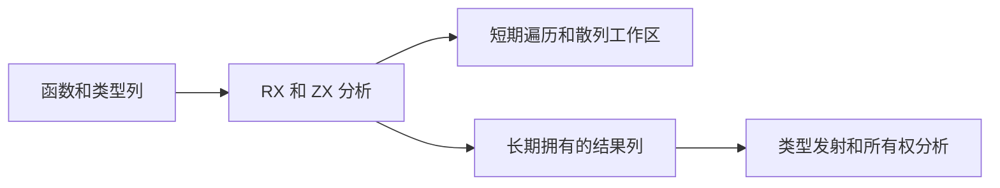

# 函数分析结果直接发布自举

## Intent · 最终目标

让 genz 的函数分析直接在长期结果区构造函数能力、值表示和类型布局列。RX 统一交付各列，移除 Zig 从临时区逐列复制结果的发布职责。

## Data · 可用证据

起点为 `27f9d22f9`。正式入口 `function_analysis.generated.analyze` 借入 IR 表，调用 Source 函数事实分析并销毁临时区。错误名称、返回分配策略、状态查询和类型布局已经能在长期区生成，其他布尔列和布局摘要仍要在宿主逐列复制。[函数事实编排](../../packages/genz/src/analysis/facts/analyze.rx) · [发布出口](../../packages/genz/src/zx/function_analysis/generated.zig)

## Edges · 边界与限制

结果列预分配后固定长度。类型闭包、布局摘要的输入、临时错误图继续使用短期区。增长传播维持对当前函数尚未发布的编号的原有处理。生成前后比较布局摘要、所有权缓存及生成文件，并验证销毁临时区后的消费。

## Answer · 验收

同时覆盖函数事实的共享消费者、普通与值 ABI 生成、类型布局和所有权。核对生成代码中的列分配和原地写入，以固定冷暖样本验证 CPU、墙钟与内存成本。

### 正式路径

RX 将结果区交给能力、值表示和布局分析。各分析通过内部 `memory` 分配固定长度的缓冲，按原有依赖顺序写入，发布后以只读切片共享。独立内联准备和名称分析使用各自的临时区。类型遍历、错误图和布局散列输入仍在短期区，散列结果直接写入最终列。Zig 只借入输入和分配器，将 ZX 已发布的列交给现有调用者。[结果区绑定](../../packages/genz/src/zx/function_analysis/generated.zig) · [缓冲操作](../../packages/core/src/memory/buffer_owner.zig) · [布局摘要](../../packages/genz/src/analysis/state/keys.zx)

首轮尝试在长期区构造普通数组，嵌套 `loop` 更新却经生成器的写入分支把结果复制进临时区。引导清单的一致性检查通过了这次尝试，独立函数分析对照和分配失败检查揭示了释放后读取的问题。修正后，各分析显式接收拥有缓冲区的分配器，一次分配切片描述符和底层数据，逐行写入。生成代码仍由已有约定处理普通 ZX 值的借用与转移。

### 集中验收

- Zig 0.17.0、ReleaseSmall、16 分区，使用上一阶段 Source 引导器构建候选，26/26 个构建步骤通过。候选 SHA-256 为 `7c38610cfc92398eb8a64deb5153cad3c5d899ddab68389bc980f8b92b3840fa`。初始 seed 的词法目标通过 21/21 个构建步骤。
- 正式主清单及四份辅助清单重跑后，16,687 个生成文件逐字节一致，排除工具身份戳。生成的布尔结果分配只有一次底层缓冲分配，布局摘要直接写入最终列，移除了生成代码中的旧数组复制分支。
- 独立函数分析通过 63 个构建步骤、49 项 Zig 测试，覆盖空函数表、独立依赖前缀、IO 和 Process 标记，以及分配失败时的资源回收。
- 函数分析运行、分割模块生成、增量生成及所有权契约通过 127 个构建步骤、114 项 Zig 测试和 3 项 Node 检查。

### 性能对照

冻结清单含 735 个入口。两代工具均由 Source 引导器生成，运行使用 Source 分析与发射，关闭生成常驻服务。三次交替运行，11,753 个生成文件及所有权 memo 载荷一致。表中用时与进程树 RSS 取中位数，固定基线复用同配置的已验收结果。

| 路径   | 比较            |  墙钟（秒） |     CPU（秒） |  峰值 RSS（MB） |
| ------ | --------------- | ----------: | ------------: | --------------: |
| 冷生成 | 上一阶段 → 候选 | 2.65 → 2.63 | 13.05 → 12.99 | 665.37 → 665.75 |
| 热生成 | 上一阶段 → 候选 | 1.94 → 1.96 |   8.31 → 8.30 | 645.35 → 646.68 |
| 无改动 | 上一阶段 → 候选 | 0.03 → 0.03 |   0.03 → 0.03 |     0.34 → 0.41 |
| 冷生成 | 固定基线 → 候选 | 2.82 → 2.63 | 12.43 → 12.99 | 884.77 → 665.75 |

冷生成的系统单进程 RSS 峰值为 690.59 → 686.78 MB，采样物理内存峰值为 659.98 → 664.08 MB。工具自身编译步骤约 27 秒，峰值约 1 GB。完整冷构建与三阶段自编译仍在最终验收范围内。

### 下一批

沿函数事实的消费端收口 `function_analysis.analyzeFrom`。普通与并发入口共用函数事实、所有权基底及入口事实的发布顺序。核对基底复用条件、线程启动失败及等待后的错误顺序，再把调度规则迁入 RX/ZX。已有临时区、分配器和线程接口继续作底层资源操作。[分析调度](../../packages/genz/src/zx/function_analysis.zig)
