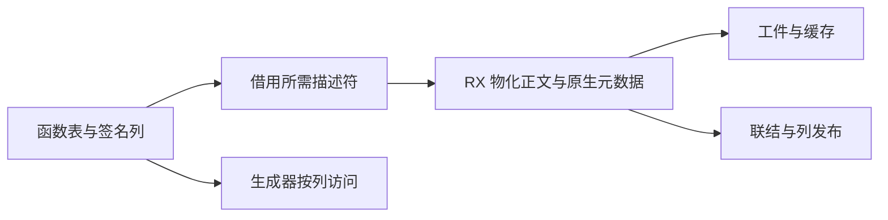

# 函数签名读取与描述符交接自举

## Intent · 最终目标

让正式工件提取、联结和生成借用已存在的函数列，由 RX/ZX 决定物化结果交接时的参数、控制根和原生元数据，保留缓存落盘的 IR 表示。

## Data · 可用证据

起点为 `2fd0c6792`。工件提取先用 `FunctionTable.at` 展开表达式和控制等描述符的值，再从这些临时描述符借用列。物化结果只交付部分字段，宿主从原记录补上所有权、控制根、Store 模式及原生调用标记。直接发布和批量联结共用 Source 物化，但属性还从另一条输入往后传递。缓存重绑由宿主先投影原生签名表，再构造 Source 签名视图。

## Edges · 边界与限制

工件源描述符在物化调用期间只读借用。已拥有的结果可在分析区释放后独立使用。控制根、外部参数、并发与错误标记的默认值，以及初始 seed 与磁盘格式保持原语义。

## Answer · 验收

核对正式提取、联结、恢复和发射路径的旧值构造是否退出。以既有用例覆盖普通、递归、原生和 Store，验证产物与冻结性能样本，并核对物化追加的描述符和分配。

### 正式路径

工件提取直接借用函数表已有的符号、表达式、契约与 Store 描述符。项目入口的同类描述符从原程序借出。签名视图直接按名称投影，缓存重绑从原签名表和增长中的函数列读取，省去宿主构造完整读视图再筛出签名列的步骤。[函数借用](../../packages/core/src/function_table/view.zig) · [工件提取](../../packages/compiler/src/zx/modules/artifact/prepared/root.zig) · [缓存重绑](../../packages/compiler/src/zx/modules/semantic_cache/restoring/rebind/host.zig)

RX 物化函数正文时，将原生调用参数、所有权、Store 模式和控制根一起交给结果。普通联结、批量函数发布和工件提取消费同一份结果。宿主将已拥有的结果装配成磁盘格式所用的 `ir.Function`，不再从原函数补回遗漏的字段。此处仍保留 ABI 类型转换和既有的结果分配。编译库直接读取签名的发布路径复用同一个最终写入规则。[物化编排](../../packages/compiler/src/zx/modules/artifact/materializing/own_function.rx) · [描述符安装](../../packages/compiler/src/zx/modules/artifact/materializing/descriptor.zig) · [编译库发布](../../packages/compiler/src/zx/modules/compiled/loading/functions/batch.zx)

普通调用、值调用、并行工作函数及 Store 适配直接读取所需的类型、原生标记与 Store 列。旧种子路径继续使用原过滤规则和完整函数视图。[普通调用](../../packages/genz/src/zx/regular_call/root.zig) · [值调用](../../packages/genz/src/zx/value_call/policy.zig) · [并行工作函数](../../packages/genz/src/zx/parallel/worker.zig) · [Store 适配](../../packages/genz/src/zx/store/adapter.zig)

### 集中验收

- 使用 Zig 0.17.0、ReleaseSmall、16 分区。上一阶段 Source 引导器构建候选，26/26 个步骤通过。候选引导器 SHA-256 为 `3875bd0de2f199013327fc5c6320028bba94af3f7b83848468539dd1182d1095`。
- 初始 seed 的词法生成目标 21/21 通过。候选重跑正式主清单及其四份辅助清单，16,667 份引导文件逐字节一致，工具身份戳单列。
- 八组集中回归的 171 个构建步骤、282 项 Zig 测试和 5 项跨进程缓存检查通过，覆盖工件提取、原生链接、统一库链接与编码、语义缓存、模块生成及所有权。

### 性能对照

冻结清单含 735 个入口。两代工具由 Source 引导器生成，运行也使用 Source 分析与发射，关闭生成常驻服务。交替运行三次，11,753 个生成文件与所有权 memo 载荷一致。下表取中位数，RSS 为进程树采样峰值。

| 路径   | 比较            |  墙钟（秒） |     CPU（秒） |  峰值 RSS（MB） |
| ------ | --------------- | ----------: | ------------: | --------------: |
| 冷生成 | 上一阶段 → 候选 | 2.61 → 2.60 | 13.02 → 13.03 | 665.32 → 676.38 |
| 热生成 | 上一阶段 → 候选 | 1.91 → 1.91 |   8.26 → 8.21 | 645.81 → 645.94 |
| 无改动 | 上一阶段 → 候选 | 0.03 → 0.03 |   0.03 → 0.03 |     0.33 → 0.36 |
| 冷生成 | 固定基线 → 候选 | 2.82 → 2.60 | 12.43 → 13.03 | 884.77 → 676.38 |

冷生成的进程树 RSS 采样峰值增加 11.06 MB，单进程的系统 RSS 峰值从 695.93 降至 691.06 MB，采样物理内存峰值从 659.87 降至 659.79 MB。工具构建单步约 26 秒、峰值约 1 GB，上一阶段同配置为 27 秒、约 1 GB。

### 下一批

沿 `Lower.selectFunction`、`regularPrototype` 和原生发射继续核对函数作用域。只需签名的原型和外部声明应借用签名列，正文入口按需安装符号、表达式和控制描述符。完整冷构建和三阶段自编译仍在最终验收范围内。[作用域安装](../../packages/genz/src/zx/lower.zig) · [模块签名发射](../../packages/genz/src/zx/modules/signature/execution.zig) · [原生发射](../../packages/genz/src/zx/external.zig)
