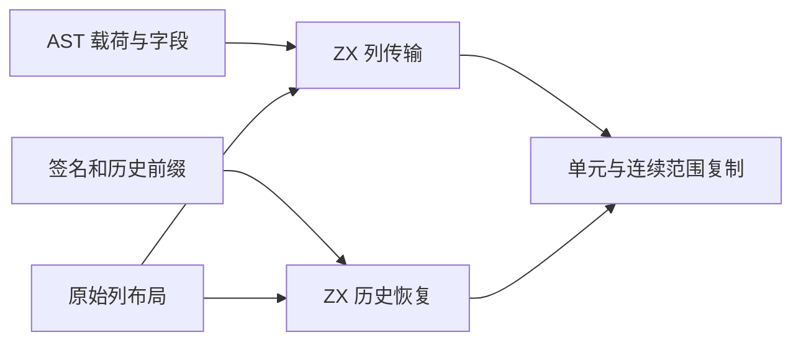

# 列搬运与历史范围恢复自举

## Intent

让 AST 载荷、工件字段和项目历史共同使用 ZX 的列传输。迁出跨步、重复写入及历史范围的容量预留和发布。

## Data

起点为 `ccc2e34d2`。正式 AST 导入委托 ZX 选择载荷与行，底层仍由 Zig 根据物理布局选择批量复制、跨步读或重复写。项目历史在 Zig 预留，筛选非空列并组装单列请求，再由 ZX 写入和发布。[列原语](../../packages/core/src/memory/column_transfer.zig) · [历史接续](../../packages/compiler/src/rx/analysis/project/history/columns.zig)

## Edges

连续列继续单次批量复制；跨步列保留每个字段的实际间距；重复源不消耗输入行。借用路径共享已有载荷。历史恢复先完成所有预留，失败时保持原有可见长度。静态字段绑定和内存读写由 Zig 提供，初始引导路径保留。

## Answer

核对正常入口的列布局和可见范围。小范围验证借用指针、跨步子范围、重复值与分配失败，集中执行引导产物对比、受影响回归及固定性能回测。

### 正式路径

- AST 导入的字段、选择分支及载荷统一在 ZX 选择传输方式。连续列直接写入尾部，跨步与重复列在 ZX 根据借用布局遍历，逐单元写入。重复源的步长为零，保留原值和源地址。
- 签名和项目历史将已确定的范围绑定为一组借用列。ZX 先完整预留，再按列写入并发布长度。宿主移除预留遍历、非空列筛选和单列分组。
- 原生的批量分派与复制遍历仅供初始引导。正式路径只调用布局读取、连续区间与单元复制，以及类型化容量操作。拥有载荷的接管与错误清理沿用此前的 Source 路径。

两项独立运行核验通过。空临时分配区覆盖带旧前缀的连续子范围、跨步子范围和重复填充。对历史恢复逐次注入分配失败，确认所有可见长度仍为旧值。成功时借用文本保持原地址，零宽列按逻辑行数发布。

### 引导与性能

由 `ccc2e34d2` 的 Source 引导器构建候选，通过 26 个步骤。候选 SHA-256 为 `8b88acd4f88c35d5b6367d75ebf1538b34e53bdd1fedc4c1c3265ef8981fcb1a`。

冻结 705 个入口、16 分区，关闭常驻生成器，交错三轮取中位数。工具本体均来自 Source 自编译并运行各自的 Source 分析与发射。9,894 个冻结输入的生成文件和所有权 memo 载荷逐字节一致。

| 对照     | 冷墙钟 | 冷 CPU | 冷进程树 RSS | 冷系统 RSS 峰值 | 冷物理占用峰值采样 | 热墙钟 | 热 CPU |
| -------- | -----: | -----: | -----------: | --------------: | -----------------: | -----: | -----: |
| 固定基线 | 2.04 s | 8.92 s |     737.9 MB |        788.3 MB |           783.2 MB | 1.63 s | 6.37 s |
| 上阶段   | 1.95 s | 9.48 s |     528.8 MB |        546.3 MB |           540.6 MB | 1.43 s | 6.25 s |
| 候选     | 1.93 s | 9.43 s |     530.4 MB |        546.6 MB |           540.9 MB | 1.41 s | 6.12 s |

较上阶段，冷生成墙钟减少 0.02 秒，CPU 减少 0.05 秒，进程树峰值 RSS 增加 1.7 MB，系统 RSS 峰值增加约 0.3 MB。热墙钟减少 0.02 秒，CPU 减少 0.13 秒。较固定基线，冷墙钟减少 0.11 秒，CPU 累计增加 0.51 秒，进程树峰值 RSS 减少 207.5 MB。无修改检查墙钟中位数为 0.03 秒。

两版引导器用本批源码生成五份清单，17,288 个生成文件逐字节一致。常驻核验使用四个 RX 入口，每个工具执行两组共 25 个请求。交替编辑实际复用历史模块，依赖重定向的产物与逐次冷生成一致。错误恢复后还原产物，无修改请求无需重新分析。

集中回归通过 90 个步骤、291 项测试，覆盖模块生成、工件、语义缓存、联结边界和 RX 推导。
