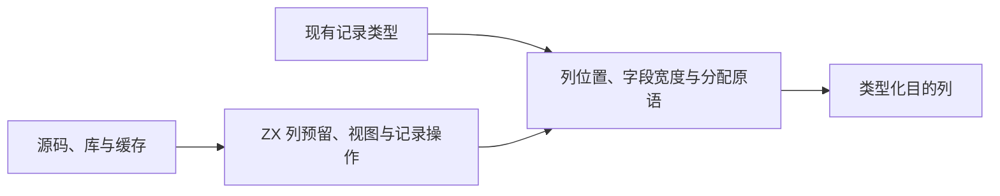

# 列视图与记录写入自举

## Intent

迁移统一列存储的预留、只读视图装配、逐列记录写入和可见长度更新。源码工件、编译库和语义缓存共用同一套 Source 操作。

## Data

起点为 `7f6154b95`。原生内存接口仍使用 Zig 反射遍历整个函数、原生模块或签名记录。类型校验和联结也通过同一宿主批量装配切片视图。[列表接口](../../packages/core/interfaces/memory/column_set_operations.d.zx) · [工件写入](../../packages/compiler/src/zx/modules/artifact/materializing/publication/write.zx)

## Edges

沿用类型化列分配、已有记录排序及预留失败的行为。类型形状由现有声明决定，列位置与宽度由目标 ABI 求得。只读视图借用原列，写入只传输一个记录的字段存储字节。保留立即发布和暂存写入两种路径的可见长度约定。

## Answer

直接运行新旧引导器验证同一批生成物。覆盖读视图保持同一存储、立即发布与暂存写入，以及分配失败与容量上限。按固定清单验收冷暖性能。

### 正式路径

- 源码工件和独立编译库物化共用函数尾部写入。ZX 决定逐列写入，写入尾部时保持已发布的长度。
- 函数表发布借用现有正文和原生字段两份记录，按原顺序发布。缺少原生绑定时读取静态空记录。
- 原生绑定、签名登记及语义缓存恢复共用 ZX 的容量预检、逐列预留和即时发布。类型校验及联结直接借用已有列切片。
- 宿主保留编译期字段布局、单列类型化扩容和内存访问。循环只捕获借用的记录地址和静态布局，记录持续存活到写入结束。

两项独立运行核验通过。空临时分配区覆盖原生模块写入、列视图借用、函数暂存尾部写入及正文发布。故障注入覆盖原生模块各列扩容失败，并核对上限拒绝前各列容量保持为零。视图与原列切片的存储地址相同。

### 引导与性能

候选由 `7f6154b95` 的 Source 引导器构建，通过 26 个步骤。候选 SHA-256 为 `7fe5954f47acee9b618aba0e104531a35ad2d0fd1ad20059706ef11d73a08b73`。

冻结的 705 个入口采用相同 16 分区配置并关闭常驻生成器，交错三轮取中位数。工具本体均来自 Source 自编译，并运行各自的 Source 分析与发射。与上阶段相比，冻结输入的 9,894 个生成文件逐字节一致。

| 对照     | 冷墙钟 | 冷 CPU | 冷进程树 RSS | 冷系统 RSS 峰值 | 冷物理占用峰值采样 | 热墙钟 | 热 CPU |
| -------- | -----: | -----: | -----------: | --------------: | -----------------: | -----: | -----: |
| 固定基线 | 2.09 s | 8.98 s |     738.1 MB |        760.1 MB |           755.0 MB | 1.59 s | 6.31 s |
| 上阶段   | 1.90 s | 9.37 s |     530.6 MB |        552.9 MB |           547.2 MB | 1.41 s | 6.17 s |
| 候选     | 2.02 s | 9.53 s |     529.8 MB |        553.3 MB |           547.6 MB | 1.40 s | 6.12 s |

较上阶段，冷墙钟增加 0.12 秒，CPU 增加 0.16 秒，进程树峰值减少 0.8 MB，系统 RSS 峰值与物理占用峰值采样均增加约 0.4 MB。较固定基线，冷墙钟减少 0.07 秒，CPU 累计增加 0.55 秒，进程树峰值减少 208.3 MB。无修改检查中位数为 0.03 秒。这组对照覆盖冷、热与无修改的生成阶段。

两版引导器用本批源码生成五份清单，17,214 个生成文件逐字节一致。

集中回归通过 127 个步骤、455 项测试，覆盖类型校验、名义类型、库和原生联结、模块工件与生成、语义缓存和 RX 推导。
