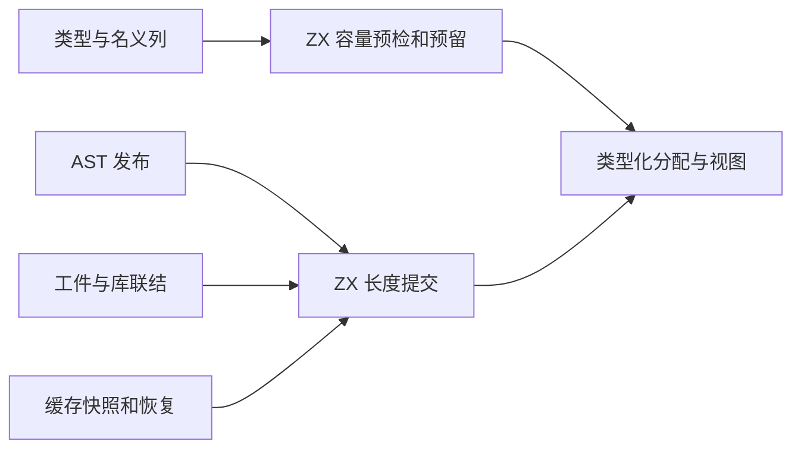

# 列长度与容量发布自举

## Intent

让 AST、IR、类型增量、语义缓存和模块联结共用 ZX 的列长度提交、快照和回滚。将类型与名义列的容量预检、按列预留和发布迁入同一批。

## Data

起点为 `4af8b324f`。遗留 Zig 负责遍历长度槽与类型列。源码工件及编译库联结的失败路径还直接调用 Zig 发布已成功的前缀。类型列按各列需求扩容，名义列按同一行数预留。[列存储](../../packages/core/src/memory/column_set.zig) · [类型发布](../../packages/compiler/src/zx/analysis/semantic/merging/publication/stage.rx) · [语义缓存检查点](../../packages/compiler/src/zx/modules/semantic_cache/restoring/checkpoint.zig)

## Edges

保留类型列全部通过上限检查后才扩容的顺序。精确预留和几何增长继续使用 Zig 分配器与类型化列表操作。尾部视图借用目标的分配区，扩容失败无需恢复未提交的长度。联结失败仍提交成功前缀，缓存回滚仍先恢复长度再回收载荷空间。

## Answer

沿原有调用链核对退出的 Zig 遍历。验证预留失败、列长恢复、名义列共享容量和成功前缀发布。复用上阶段 Source 引导器，以固定清单集中对比生成产物、冷暖耗时和峰值内存。

### 正式路径

- AST 首部、候选绑定、源码索引、库与工件联结共用 ZX 的列长度发布。库和工件继续在任何返回路径提交成功前缀。
- 语义缓存保存各类型列的可见长度。失败时用快照恢复类型列、函数前缀与名义列，再回收尚未提交的载荷。
- 类型及名义列共用 ZX 容量预检、逐列预留和提交。宿主根据真实 Zig 列类型借出尾部，通过标准列表保留精确预留和几何增长选项。调用方的描述符不再传仅用来标注类型的空元组。
- 类型增量及单独名义发布的失败清理复用文本列的 ZX 释放逻辑。宿主在错误退出时传入已经存在的视图和完成位置。
- 原生登记后的函数验证前缀归零。原 Source 入口把零解释为追加行数，修正后与 seed 对原生绑定变更的失效行为一致。

四个独立运行核验通过。空临时分配器可以执行长度快照、提交和恢复。容量上限拒绝发生在任何扩容之前。故障注入覆盖精确增长、名义列统一预留及未发布长度保留。原生登记的失效核验同时检查函数前缀和原生验证标记。

### 引导与性能

候选由 `4af8b324f` 的 Source 引导器构建，通过 26 个步骤。两版引导器以本批源码生成五份清单，17,155 个生成文件逐字节一致。候选 SHA-256 为 `a217aa669c6ea949f3136de07074b047dc22f86688785ab934a12ff8d079ceaa`。

固定的 705 个入口采用相同 16 分区配置并关闭常驻生成器，交错三轮取中位数。三个工具的本体均来自 Source 自编译，运行各自的 Source 分析与发射。冻结输入的 9,894 个生成文件一致。

| 对照     | 冷墙钟 | 冷 CPU | 冷进程树 RSS | 冷系统 RSS 峰值 | 冷物理占用峰值采样 | 热墙钟 | 热 CPU |
| -------- | -----: | -----: | -----------: | --------------: | -----------------: | -----: | -----: |
| 固定基线 | 2.06 s | 8.94 s |     738.0 MB |        763.7 MB |           732.8 MB | 1.61 s | 6.36 s |
| 上阶段   | 1.98 s | 9.47 s |     532.8 MB |        556.6 MB |           522.6 MB | 1.42 s | 6.16 s |
| 候选     | 1.93 s | 9.46 s |     525.5 MB |        558.3 MB |           520.0 MB | 1.45 s | 6.22 s |

相比上阶段，冷墙钟减少 0.05 秒，冷 CPU 减少 0.01 秒，进程树 RSS 减少 7.3 MB。系统 RSS 峰值增加 1.7 MB，物理占用峰值采样减少 2.6 MB。热墙钟增加 0.03 秒，热 CPU 增加 0.06 秒。相比固定基线，冷墙钟减少 0.13 秒，冷 CPU 增加 0.52 秒，进程树 RSS 减少 212.5 MB。

集中回归通过 127 个步骤、455 项测试，覆盖类型校验、名义类型、库和原生联结、模块工件与生成、语义缓存和 RX 推导。
