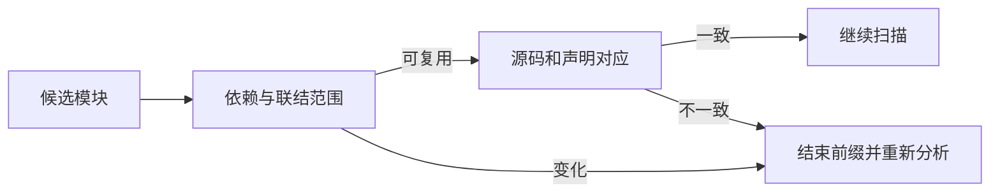

# 历史检查点与 Store 准入自举

## Intent

把混合分析的历史检查点写入、Store 文档比较和续用准入迁入 ZX。保留旧版的拒绝条件和借用关系。

## Data

起点为 `e90637527`。历史检查点由 Zig 直接枚举列并写入。批量扫描遇到 Store 时转回 Zig 递归比较，匹配后再启动一轮扫描。逐模块路径也经宿主做最后确认。[历史扫描](../../packages/compiler/src/rx/analysis/project/mixed/history/prefix/probe.zx) · [检查点](../../packages/compiler/src/rx/analysis/project/mixed/reuse.zig)

## Edges

Store 比较覆盖元素名、位置、属性类型、解码值与原始值、子元素和文本。相同存储的快捷判断继续使用。检查点直接写入现有目标，保留原生字宽和字段顺序。Zig 负责借用已有 XML 节点及内存视图，初始引导继续使用已有兼容路径。

## Answer

覆盖检查点原有布局、Store 全字段比较和拒绝条件。常驻编辑需要验证真实历史复用与失效恢复，再集中运行回归、产物对照和固定性能回测。

### 正式路径

- ZX 将类型和名义类型长度、函数数、原生模块数、初始化器数及库数直接写入现有检查点。它使用单个原生字宽视图，字段偏移在编译期核对。
- 批量历史扫描在同一轮处理 Store，原有按 Store 中断后重进扫描的步骤已删除。逐模块路径也由 Source 在依赖、联结范围和签名满足时确认 Store 结构。
- Store 比较递归借用 XML 节点。节点、属性和文本逐字段比较，保留原始值及两类位置。相同节点或相同子数组仍可直接跳过比较。
- 借用的 Store 切片描述符固定在扫描状态中，避免持有入口函数临时参数内的描述符。XML 节点和文本继续由原始解析结果持有。
- 同批修复已有的历史联结崩溃。联结比较在空分配器下构造临时组合对象，复用 Store 后会触发分配失败。初始化器前缀直接借用现有视图，成员逐字段读取，比较调用链的生成 Zig 无堆分配。

四项空临时分配区核验通过。覆盖非共享 Store 树、属性原始值与位置、变更后拒绝、Store 在新旧来源范围里偏移不同、逐模块确认，以及检查点的原生字序。

真实混合分析入口验证通过。两次独立解析的相同 Store 保留前两个模块的历史，将 Store 字段值改动后仅保留首个模块的历史，并重新分析受影响的入口。

### 引导与性能

由 `e90637527` 的 Source 引导器构建候选，通过 26 个构建步骤。候选 SHA-256 为 `64e203f5ec3b57e8ce6d35560465461713e2c8ee313be7ec0c99286a64b2ae65`。

冻结 705 个入口、16 分区，关闭常驻生成器，交错三轮取中位数。工具本体均来自 Source 自编译并运行各自的 Source 分析与发射。9,894 个冻结输入的生成文件与所有权 memo 载荷一致。用本批源码生成的五份清单共 17,305 个文件，也逐字节一致。

| 对照     | 冷墙钟 | 冷 CPU | 冷进程树 RSS | 冷系统 RSS 峰值 | 冷物理占用峰值采样 | 热墙钟 | 热 CPU |
| -------- | -----: | -----: | -----------: | --------------: | -----------------: | -----: | -----: |
| 固定基线 | 2.09 s | 9.04 s |     737.8 MB |        764.0 MB |           758.8 MB | 1.63 s | 6.43 s |
| 上阶段   | 1.96 s | 9.49 s |     527.1 MB |        546.2 MB |           540.5 MB | 1.44 s | 6.24 s |
| 候选     | 1.94 s | 9.46 s |     525.3 MB |        551.4 MB |           545.8 MB | 1.43 s | 6.24 s |

较上阶段，冷生成墙钟减少 0.02 秒，CPU 减少 0.03 秒，进程树峰值 RSS 减少 1.8 MB，系统 RSS 峰值增加 5.2 MB。热墙钟减少 0.01 秒，CPU 持平。较固定基线，冷墙钟减少 0.15 秒，CPU 累计增加 0.42 秒，进程树峰值 RSS 减少 212.5 MB。无修改检查墙钟中位数 0.03 秒。

模块生成、语义缓存、RX 推导和 Store 运行的 207 项回归通过。四个 RX 入口的 48 个常驻请求覆盖交替与组合编辑、依赖重定向、错误和恢复。逐次冷生成与重定向产物一致，恢复后的产物与初次生成一致，未修改请求无需分析。
