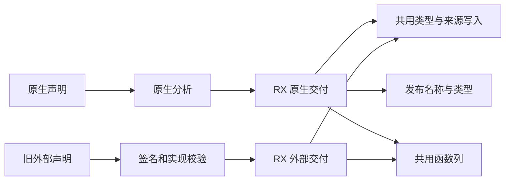
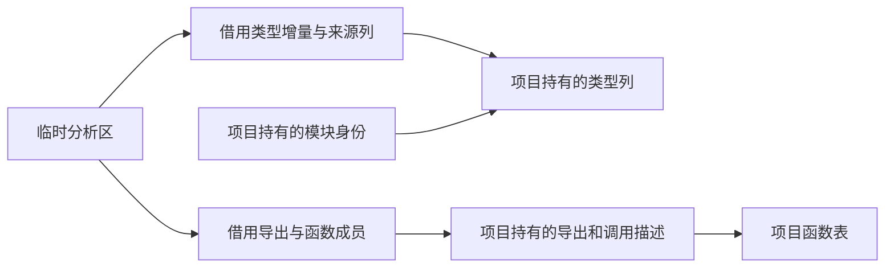

# 原生与外部声明交付自举

## Intent

让正式原生声明和旧外部声明在 Source 中完成分析后的类型与函数交付。保留声明诊断顺序、原生模块身份、公开名称及调用 ABI。

## Data

起点为 `07f823da4`。原生声明已有 Source 解析、解析类型和成员分析，宿主随后重建本批用完即丢弃的类型名索引、逐项复制导出并决定何时准备函数行。旧外部声明已有 Source 校验，宿主负责类型提交时机、复制实现路径和错误名及组合外部函数。

## Edges

分析结果暂存在单独的 arena，交付直接借用其中的列。持久名称进入项目 arena。新原生类型的名义来源借用本项目已经登记的模块身份。原生诊断先于交付。旧外部声明沿用既有协议，在实现校验失败时也提交已解析的类型，只有验证成功的外部实现写入函数表。

## Answer

- 原生交付直接借用项目类型列，去掉临时类型容器的搬移和交付前的名称索引重建。RX 决定提交类型、写入导出和准备函数行的顺序。ZX 将导出写入项目持有的定长行缓冲，仅在有可调用成员时准备函数列。
- 旧外部交付复用函数签名行与空正文列。ZX 按已知长度准备成员路径列表，边遍历边写入，每段文本只在归属到项目时复制一次。
- Zig 继续管理分析暂存区、项目列视图、定长导出缓冲和诊断桥接。语义缓存沿用工件准入与恢复。初始 seed 保留 Zig 实现。

### 验收过程

第一轮回归在合法原生声明的冷装载中暴露边界错误，固定清单生成覆盖的缓存路径没有触发该错误。通过既有类型导入用例定位到导出行写入。最终交付由宿主在分析成功后提供定长缓冲，ZX 直接填充。生成检查还发现旧外部成员路径有逐项扩容，改为先按长度分配，生成 Zig 随后直接写入该数组。

由 `07f823da4` 的 Source 引导器构建最终候选，27 个步骤通过，候选 SHA-256 为 `67ea858477859dd4a4b1a7565198468212bf041843834f6ae4009aea1e3033ae`。与上阶段工具按五份当前清单生成的 17,549 个文件逐字节一致。十次常驻生成请求的分析、复用、发射计数和产物哈希与上阶段一致。修改的 RX 与 ZX 文件通过格式及 lint 检查。

最终候选通过 90 个步骤与 184 项回归，覆盖原生冷装载、原生链接与运行、类型导入、名义来源及语义缓存。初始 seed 通过解析器构建和 39 项 RX 回归。

### 性能对照

固定 705 个入口和 16 个分区，关闭常驻生成器，交错三轮取中位数。三个工具均由 Source 构建，并运行各自的 Source 分析与生成。固定输入的 9,894 个生成文件与所有权 memo 逐字节一致。

| 对照     | 冷生成墙钟 | 冷生成 CPU | 冷进程树峰值 RSS | 冷系统记录峰值 RSS | 热生成墙钟 | 热生成 CPU |
| -------- | ---------: | ---------: | ---------------: | -----------------: | ---------: | ---------: |
| 固定基线 |     2.10 s |     9.03 s |         737.8 MB |           759.8 MB |     1.63 s |     6.42 s |
| 上阶段   |     1.96 s |     9.50 s |         525.7 MB |           543.1 MB |     1.45 s |     6.24 s |
| 候选     |     1.95 s |     9.49 s |         525.4 MB |           553.3 MB |     1.43 s |     6.23 s |

较上阶段，冷生成墙钟和 CPU 各减少 0.01 秒，冷进程树峰值减少 0.3 MB，系统记录峰值增加 10.1 MB。热生成墙钟减少 0.02 秒，热 CPU 减少 0.01 秒。无改动检查墙钟为 0.03 秒。较固定基线，冷生成墙钟减少 0.15 秒，CPU 累计增加 0.46 秒，进程树峰值减少 212.4 MB，系统记录峰值减少 206.5 MB。
