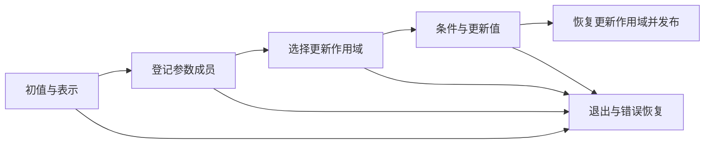

# 循环作用域与增长记录自举

## Intent · 最终目标

让普通、投影和深层循环共用 Source 的参数作用域、更新作用域、退出和增长记录流程。移除增长筛选结果从分析临时区复制到循环工作区的步骤。

## Data · 可用证据

从 `iteration.lowerMode` 追到初值准备、参数登记、首个条件、更新作用域和失败收尾。普通循环还要恢复深层参数的上下文。`reduce` 与循环共用增长筛选，下游借用被跳过的索引列表。起点为 `3f62b25f9`。[循环入口](../../packages/genz/src/zx/iteration.zig) · [参数登记](../../packages/genz/src/zx/iteration/parameters.zig) · [增长计划](../../packages/genz/src/zx/iteration/renewal.zig)

## Edges · 边界与限制

先保存并替换参数名称，再登记布局成员。登记失败时恢复已保存的名字及布局。首个投影条件借用种子名，求值有错时也必须恢复。退出按更新、初值、临时存储、参数、表示范围、语句容器的原顺序释放。增长分析临时存储在计划完成后立即释放；跳过的索引只保留在调用方的工作区。

## Answer · 验收

核对参数、作用域与增长记录的正式调用，验证已有的普通、投影、深层循环及集合更新回归，对照引导产物及固定性能清单。

### 正式路径

RX 按布局决定何时登记参数成员、何时启用深层上下文。ZX 绑定首个投影条件的种子名，选择更新与声明的布局。普通路径先恢复更新范围再交付值。正常返回和失败退出共用 RX 清理，ZX 直接对借用的状态与栈成员表撤销登记并恢复名称。Zig 继续提供列头、作用域字段交换和容器释放。[参数进入](../../packages/genz/src/analysis/iteration/workflow/execute/parameters.rx) · [退出流程](../../packages/genz/src/analysis/iteration/workflow/execute/release.rx) · [参数撤销](../../packages/genz/src/analysis/iteration/parameters/restore.zx)

循环和 `reduce` 的增长计划共用原有 RX 资格筛选。ZX 按路径顺序将跳过的索引直接写入调用方持有的列表。表达式资格分析仍用独立临时区，完成后立即释放。删除 Zig 将跳过索引从临时区复制到循环区的步骤。Zig 继续登记 IR 列的借用地址，提供工作区和发射 AST。[增长筛选](../../packages/genz/src/analysis/iteration/deferred/check.rx) · [直接写入](../../packages/genz/src/analysis/iteration/deferred/schedule.zx)

### 性能

候选和上一阶段均由 Source 引导器构建，使用各自的 Source 分析与生成。Zig 0.17.0、ReleaseSmall、16 分区。735 入口冻结清单关闭常驻，交错三轮取中位数。同版冷热及两代冷生成的 11,753 份产物逐字节一致，所有权缓存载荷一致。

| 场景   | 工具     | 墙钟（秒） | CPU（秒） | 进程树峰值 RSS（字节） | 单进程峰值 RSS（字节） |
| ------ | -------- | ---------: | --------: | ---------------------: | ---------------------: |
| 冷生成 | 固定基线 |       2.82 |     12.43 |            884,768,768 |            934,051,840 |
| 冷生成 | 上一阶段 |       2.59 |     13.01 |            661,766,144 |            681,377,792 |
| 冷生成 | 候选     |       2.59 |     12.93 |            661,929,984 |            686,161,920 |
| 热重建 | 上一阶段 |       1.91 |      8.27 |            646,201,344 |            646,234,112 |
| 热重建 | 候选     |       1.91 |      8.27 |            645,677,056 |            645,709,824 |

较上一阶段冷墙钟持平，CPU 减少 0.08 秒，树峰值增加 0.16 MB，单进程峰值增加 4.78 MB。相对固定基线冷墙钟减少 0.23 秒，CPU 累计增加 0.50 秒，树峰值减少 222.84 MB。热墙钟和 CPU 持平，无改动时墙钟和 CPU 均为 0.03 秒。该表覆盖引导生成和缓存复用。

### 引导一致性

候选引导器通过 25 个构建步骤。SHA-256 为 `0f304193a7a1c35626fc2ac0eecde9a263bb51a1a34b78f9b5ec7e039e18455f`。用该候选重新生成主、增长、集合和执行四份清单，16,284 份文件逐字节一致，排除工具身份戳。初始 seed 的词法引导另行通过 19 个步骤。

### 回归

八组循环列、模块化循环、字段事实、循环初值所有权、原生借用、对象转移、缓冲迭代及迭代调用通过 449 个构建步骤、634 项 Zig 测试和 25 项 Node 集成检查。模块化循环覆盖编译器准备和生成的逐次分配失败。对象转移的累计分配量在初值、首轮和 64 轮均为 1,966,434 字节。改动的 RX/ZX 文件通过格式化和 lint。原始日志位于 `.zig-cache/verification-tmp/loop-scope/`。
