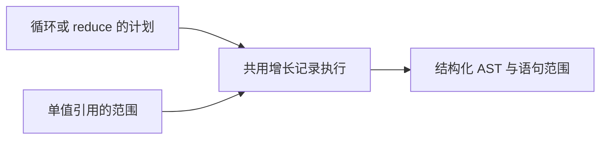
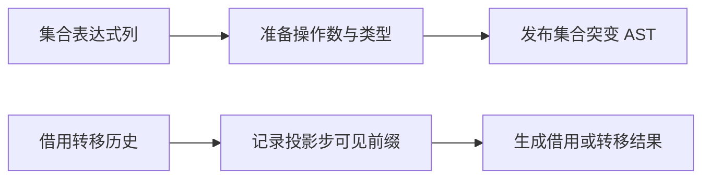

# 循环增长发射与深层迭代自举

## Intent · 最终目标

让循环、`reduce` 和单值引用共用 Source 的增长记录消费流程。将深层迭代的集合突变准备和投影转移记录写入迁入 RX/ZX。

## Data · 可用证据

从 `2aa699f27` 的循环和 `reduce` 入口追到 `Plan.store`，以及单值引用的 `appendValue`。两路已有各自的 Source 发射遍历，Zig 选择空范围、切出记录列并组合缓冲过滤条件。深层迭代的 `push`、`pop` 和索引更新在 Zig 递归准备参数和类型，投影由宿主在每一步写入名称编号和转移前缀长度。

## Edges · 边界与限制

增长遍历借用原始列和跳过索引。全部跳过时不构造目标标识符或 AST。单值引用始终使用原增长操作，循环保留逐行可写标记。集合按目标、下标、值、类型的原顺序准备，`pop` 无值表达式。投影只读取当前步骤可见的转移前缀。

## Answer · 验收

核对正式入口退出的 Zig 选择与写入。用同一候选验证源码与归档库中的循环、集合突变和对象转移，对照引导产物、固定性能及分配失败路径。

### 正式路径

循环、`reduce` 和单值引用共享 RX 的增长发射及同一份 ZX 记录遍历。Source 计算是否有需要发射的行、选取记录范围并组合内联过滤；空范围仍在初始化 AST 前返回。原始路径、标记和跳过索引按列借用。移除了单值引用内部重复的发射循环，保留单值行与循环行各自的可写标记语义。[增长编排](../../packages/genz/src/analysis/growth/renew/entry/build.rx) · [增长遍历](../../packages/genz/src/analysis/growth/renew/entry/execute.zx) · [增长计划](../../packages/genz/src/analysis/iteration/deferred/check.rx)

深层迭代的 `push`、`pop` 和索引更新共用 RX 的目标、参数及布局发射顺序。ZX 只借用所需表达式列，沿原顺序递归求值，再交由现有 AST 构造入口发布。投影步骤借用名称编号与转移前缀长度，ZX 直接写入已有的两个缓冲区；发布转移历史时借用 Source 生成的记录，去掉 Zig 将记录拆成四个 IR/AST ID 再封装的过程。[集合编排](../../packages/genz/src/analysis/iteration/mutation/execute/run.rx) · [投影步骤](../../packages/genz/src/analysis/iteration/resources/projection.zx) · [转移历史](../../packages/genz/src/analysis/iteration/transfer/history/append.zx)

Zig 继续提供递归子表达式与类型的执行、名称编号预留、原生列头及 AST 容器。直接探针覆盖新的集合调用与投影准备，两条生成路径均没有分配临时对象或回调环境。

### 性能

Zig 0.17.0、ReleaseSmall、16 分区。候选与上一阶段都由 Source 引导器构建，并使用各自的 Source 分析和生成。沿用 735 入口的冻结清单，关闭常驻，交替三轮取中位数。同一工具的冷热生成和两代工具的冷生成均有 11,753 份产物逐字节一致，排除工具身份戳。所有权缓存载荷一致。

| 场景   | 工具     | 墙钟（秒） | CPU（秒） | 进程树峰值 RSS（字节） | 单进程峰值 RSS（字节） |
| ------ | -------- | ---------: | --------: | ---------------------: | ---------------------: |
| 冷生成 | 固定基线 |       2.82 |     12.43 |            884,768,768 |            934,051,840 |
| 冷生成 | 上一阶段 |       2.59 |     12.97 |            673,873,920 |            686,555,136 |
| 冷生成 | 候选     |       2.60 |     13.06 |            669,663,232 |            684,736,512 |
| 热重建 | 上一阶段 |       1.92 |      8.27 |            645,840,896 |            645,873,664 |
| 热重建 | 候选     |       1.93 |      8.25 |            646,873,088 |            646,889,472 |

较上一阶段，冷墙钟增加 0.01 秒，CPU 增加 0.09 秒，树峰值降低 4.21 MB，单进程峰值降低 1.82 MB。相对固定基线，冷墙钟减少 0.22 秒，CPU 累计增加 0.63 秒，树峰值下降 215.11 MB。热墙钟增加 0.01 秒，CPU 减少 0.02 秒，无改动时墙钟与 CPU 均为 0.03 秒。计时覆盖引导生成与缓存复用。

### 引导一致性

候选引导工具通过 25 个构建步骤。SHA-256 为 `3175cc1ebacdfc7b54f3a29338793d8ea2b42c3c1ca58c2a37c8bd401032a991`。候选对主、增长、集合和执行清单的 16,293 份生成产物逐字节一致，排除工具身份戳。初始 seed 的词法引导通过 19 个步骤。

### 回归

十组回归通过 485 个构建步骤、780 项 Zig 测试和 21 项 Node 集成检查。覆盖循环列、模块化循环、字段事实、缓冲迭代、迭代调用、对象转移、`reduce` 运行与回调顺序、嵌套缓冲及多次追加。分配失败回归覆盖模块化循环的准备和生成。对象转移用例在初值、首轮和 64 轮的累计分配均为 1,966,434 字节。变更的 RX/ZX 文件通过格式化与 lint。原始日志位于 `.zig-cache/verification-tmp/iteration-growth/`。
