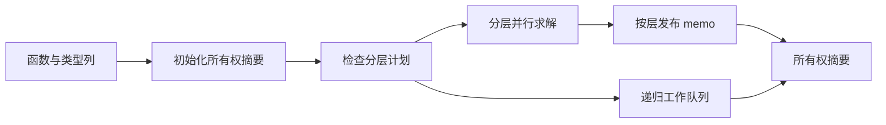
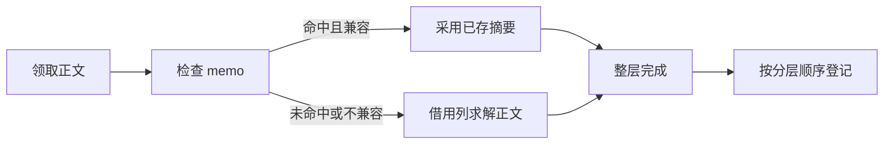

# 所有权数据流分层与递归求解自举

## Intent · 最终目标

让正式所有权数据流从初始化到收敛均由 RX/ZX 调度。贯通分层求解、正文 memo 复用和顺序提交，以及有环图的递归工作队列。

## Data · 可用证据

起点为 `970ba1a5c`。Zig 的 `Flow.create` 选择分层或递归路径。分层入口循环推进层边界，工作线程逐个领取正文并选择是否复用 memo，完成整层后由调用线程提交。递归入口已经用 Source 建队列和领取下一项，循环及正文保留仍由 Zig 决定。两条路径都先重建完整函数记录，再读取正文所需的列。[数据流入口](../../packages/genz/src/zx/uniqueness/flow.zig) · [递归队列](../../packages/genz/src/zx/uniqueness/flow/fixpoint.zig)

## Edges · 边界与限制

保留分层求解的并行度、同层任务分配、跨层可见性和按拓扑顺序写 memo。递归求解保留队列和正文复用规则。直接借用符号、表达式和控制列。Zig 负责 arena、通用线程池、原子领取和物理列视图。

## Answer · 验收

沿正式 Source 核对三条循环的分配形态，确认分层提交等候所有工作线程。复用函数分析、缓存、失败注入和模块生成回归，用固定样本比较产物、memo 数据和冷暖性能。

### 正式路径

`Flow.create` 由 RX 选择分层或递归。分层路径由 ZX 逐层推进，工作线程领取正文后在 ZX 中决定采用 memo 或遍历正文，各线程完成后才按原有拓扑顺序提交。递归路径由 ZX 推进队列，根据原规则保留正文事实，并登记需要重算的调用方。两条路径直接借用正文的表达式和控制列，省去完整函数记录的物化。[分层与递归入口](../../packages/genz/src/analysis/uniqueness/flow/solve/run.rx) · [分层提交](../../packages/genz/src/analysis/uniqueness/flow/solve/layers.zx) · [递归队列](../../packages/genz/src/analysis/uniqueness/flow/fixpoint/run.zx)

旧模式选择、分层循环、工人逐正文分派及递归队列主循环退出正式 Zig 路径。原生侧仍持有现有工作区、物理视图、线程与 memo 表，并执行单项读写。生成的分层、工人和递归循环均无堆分配调用。[原生交接](../../packages/genz/src/zx/uniqueness/flow/execution.zig)

### 集中验收

- 以上一阶段 Source 引导器构建候选，Zig 0.17.0、ReleaseSmall、16 分区，共 26 步。候选 SHA-256 为 `ee364fa2ff0c1a15637b97ebe7c5c4a737ea7870cc0708b6fcd9ab99c73efd82`。初始 seed 的词法引导目标另行通过 21 步。
- 候选重新生成主清单与四份辅助清单。16,753 个文件逐字节一致，排除工具身份戳。
- 函数分析、缓存所有权、所有权契约、分割生成和增量运行共 175 个构建步骤、275 项 Zig 测试与 3 项 Node 检查通过。缓存所有权覆盖源码及库两条入口。

### 性能对照

冻结清单包含 735 个入口。两代引导器均由 Source 工具构建，运行使用 Source 分析和发射，关闭生成常驻服务。三轮交替运行取中位数。11,753 个生成文件逐字节一致，排除工具身份戳。两代所有权 memo 载荷 SHA-256 均为 `fa56659df7eb32363623b9a8b9c0956a6d22ee5fc896dd72bd9d3b00a1f88b4c`。

| 路径   | 比较            |  墙钟（秒） |     CPU（秒） | 进程树峰值 RSS（MB） |
| ------ | --------------- | ----------: | ------------: | -------------------: |
| 冷生成 | 上一阶段 → 候选 | 2.56 → 2.56 | 12.89 → 12.90 |      665.60 → 670.01 |
| 热生成 | 上一阶段 → 候选 | 1.85 → 1.89 |   8.07 → 8.14 |      645.96 → 646.91 |
| 无改动 | 上一阶段 → 候选 | 0.03 → 0.03 |   0.03 → 0.03 |          0.41 → 0.38 |
| 冷生成 | 固定基线 → 候选 | 2.82 → 2.56 | 12.43 → 12.90 |      884.77 → 670.01 |

冷生成的系统单进程 RSS 峰值为 681.35 → 686.46 MB，采样物理内存峰值为 662.73 → 666.21 MB。完整冷构建和三阶段自编译仍待最终验收。

### 下一批

从 genz 的正式内联重写入口接续。ZX 已执行内联，Zig 仍收集每个函数的正文描述符，在重写后复制函数表的四列并逐行交付改写结果。下一批优先让 Source 直接借用现有函数描述符，并在结果归属区完成修改行的发布。[内联交付](../../packages/genz/src/zx/inline_call/generated.zig) · [内联流程](../../packages/genz/src/analysis/inline/prepare.rx)
