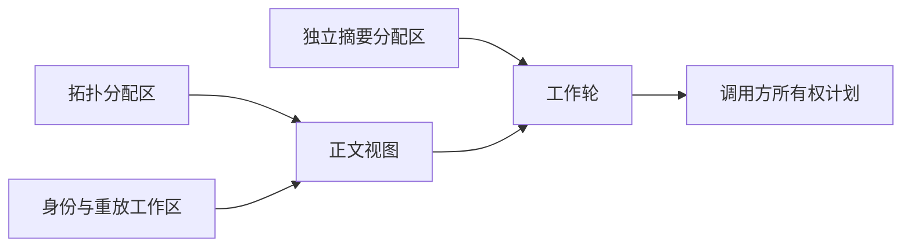

# 所有权计划与重放准备自举

## Intent · 最终目标

让正式所有权分析由现有 RX 入口推进存储准备、持久身份计算、重放准备、正文接入及完整分析工作轮的开启。统一普通、并发、短路重放和失败退出的生命周期。

## Data · 可用证据

起点为 `5fe200dd5`。函数事实与所有权基底已由 RX 调度。所有权根函数仍在 Zig 连接拓扑和摘要、选择持久身份与重放、绑定正文。重放未命中时，Zig 决定创建工作线程、前瞻和队列的顺序，随后才进入现有 Source 工作轮。[所有权入口](../../packages/genz/src/zx/uniqueness/root.zig) · [运行编排](../../packages/genz/src/analysis/uniqueness/program/run.rx)

## Edges · 边界与限制

沿用原工作区和输出区，保持 memo 摘要、导出编号字节和错误顺序。重放命中无需准备完整工作轮。失败后按原顺序关闭当前帧、线程池、重放及 arena。Zig 提供物理存储和线程操作，Source 决定依赖与启动顺序。

## Answer · 验收

沿正式入口确认原 Zig 准备次序退出，检查生成编排的分配和失败清理。以已有所有权缓存、失败注入、函数分析和代码生成回归覆盖普通和重放路径，再使用固定样本比较输出、memo 和性能。

### 正式路径

所有权根函数借入程序与基底，并提供原有的拓扑、摘要和重放分配区。RX 先接入拓扑及摘要，再根据持久 memo 和记录开关准备身份与重放，随后交付正文视图。重放未命中时才创建线程池、前瞻和工作队列。工作轮释放后沿原规则写入重放记录。初始 seed 继续使用 Zig 的准备次序。[运行入口](../../packages/genz/src/analysis/uniqueness/program/run.rx) · [准备编排](../../packages/genz/src/analysis/uniqueness/program/driver/prepare.rx)

函数内容摘要与 memo 身份共用原有的并行领取机制。ZX 决定原生或不活跃行的空摘要、复用现有正文摘要或按需重新计算。Zig 负责原子领取和把 SHA-256 结果写入已分配的目标行。复用时直接借用已有摘要字节。[身份选择](../../packages/genz/src/analysis/uniqueness/identity/worker.zx) · [并行领取与写入](../../packages/genz/src/zx/uniqueness/identity.zig)

### 集中验收

- Zig 0.17.0、ReleaseSmall、16 分区，以上一阶段 Source 引导器构建候选，26/26 个步骤通过。候选 SHA-256 为 `19d99f872fb5a618b8363e94bf9d2dd2a1dde660dba1f239ebb438182313b646`。初始 seed 的词法目标通过 21/21 个构建步骤。
- 候选重新生成主清单及四份辅助清单，16,723 个文件逐字节一致，排除工具身份戳。正式程序入口和身份工作循环的生成代码均无临时堆分配。
- 函数分析、缓存所有权、所有权契约、分割生成及增量运行的集中回归通过 175 个构建步骤、275 项 Zig 测试和 3 项 Node 检查。缓存所有权覆盖源码与库两个运行入口。

### 性能对照

冻结清单含 735 个入口。两代工具均由 Source 引导器生成，运行使用 Source 分析与发射，关闭生成常驻服务。三次交替运行的 11,753 个生成文件及所有权 memo 载荷一致。用时和进程树 RSS 取中位数，固定基线使用同配置的已验收数据。

| 路径   | 比较            |  墙钟（秒） |     CPU（秒） |  峰值 RSS（MB） |
| ------ | --------------- | ----------: | ------------: | --------------: |
| 冷生成 | 上一阶段 → 候选 | 2.57 → 2.57 | 12.84 → 12.90 | 666.14 → 664.35 |
| 热生成 | 上一阶段 → 候选 | 1.86 → 1.89 |   8.09 → 8.20 | 646.15 → 646.77 |
| 无改动 | 上一阶段 → 候选 | 0.03 → 0.03 |   0.03 → 0.03 |     0.25 → 0.41 |
| 冷生成 | 固定基线 → 候选 | 2.82 → 2.57 | 12.43 → 12.90 | 884.77 → 664.35 |

冷生成的系统单进程 RSS 峰值为 692.32 → 690.47 MB，采样物理内存峰值为 662.11 → 658.95 MB。引导工具自身的编译步骤约 26 秒，峰值约 1 GB。完整冷构建和三阶段自编译仍在最终验收范围内。

### 下一批

沿基底构造进入 `Flow.create`，收口数据流分析选择分层或递归求解、分层推进、按正文采用 memo 和按层提交。正式分支目前仍有 Zig 循环推进层边界、派发正文并提交本层记录。下一批沿同一调用链检查跨层可见性、工作区复用和写入顺序。[数据流入口](../../packages/genz/src/zx/uniqueness/flow.zig)
