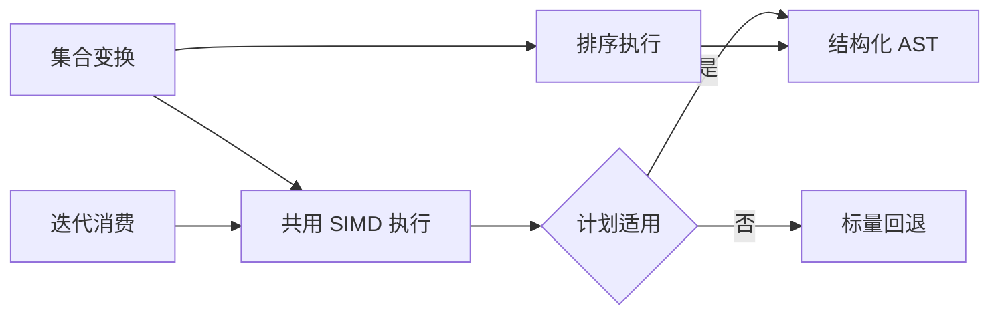

# 排序与 SIMD 执行自举

## Intent · 最终目标

让普通集合排序、集合变换 SIMD 和深层迭代 SIMD 的执行由 RX/ZX 推进。迁走比较器操作数选择、排序复用决策、SIMD 字面量遍历和 AST 提交顺序。

## Data · 可用证据

基于 `3ca1c2951`。正式集合变换已由 RX 派发排序和 SIMD。排序宿主决定比较器操作数准备、辅助声明、复用和结果发射。两路 SIMD 已共用 Source 分析与节点构造，Zig 仍选择是否消费计划、遍历向量及尾部常量、发布语句块和更新发射状态。

## Edges · 边界与限制

保留求值、错误和效果的原次序。比较器先执行正文，再按左右顺序物化实际用到的操作数。SIMD 先发布表达式，再按原顺序发布语句块，最后提交编号和分配标记。向量和尾部的字面量各有一次降级，保留底层表达式编号。两个入口继续在计划拒绝时返回空值，由现有调用方选择标量。以栈上工作区借用原始列。

## Answer · 验收

确认正式入口退出上述 Zig 决策及遍历。复用上一阶段引导工具，核对原生容器借用、生成产物、分配失败、排序与 SIMD 回退，再对照固定清单的冷暖生成。

### 正式路径

RX 依次预留声明、准备类型、构造比较器和排序辅助函数，再处理目标、复用、比较器环境和结果。ZX 选择可写别名或常量复用标记，省去过去为布尔值调用整套生成入口的过程。比较器由 RX 先登记参数、再降级正文，ZX 按左右顺序物化确实被使用的参数。排序表达式暂借生成的标识符列，直接在最终 AST 槽位替换持久名称，省去临时标识符描述符数组。[排序编排](../../packages/genz/src/analysis/sorting/execute/run.rx) · [复用选择](../../packages/genz/src/analysis/sorting/execute/bind_reuse.zx) · [比较器编排](../../packages/genz/src/analysis/sorting/worker/execute/run.rx)

集合变换和迭代消费共用 RX 的 SIMD 执行路径。拒绝计划时保留原来的标量回退。ZX 在向量和尾部两次借用同一条节点计划，按旧顺序写入已有字面量缓冲。表达式与语句列写入完成后再提交发射编号和分配标记。生成探针四条入口均无新堆分配或数组复制。宿主保留递归子表达式、类型及容器物化、列导入和范围恢复，比较器仍使用共用的原生绑定恢复，初始 seed 保留原实现。[SIMD 编排](../../packages/genz/src/analysis/simd/execute/run.rx) · [字面量写入](../../packages/genz/src/analysis/simd/execute/fill_literals.zx) · [AST 发布](../../packages/genz/src/analysis/simd/execute/publish.rx)

### 性能

沿用 735 入口冻结清单，Zig 0.17.0、ReleaseSmall、16 分区，关闭常驻。候选和上一阶段都由 Source 引导器构建并执行各自的 Source 分析与生成。三轮交替取中位数。前后与同版冷暖生成的 11,753 份文件均逐字节一致，排除工具身份戳。所有权缓存载荷一致。

| 场景   | 工具     | 墙钟（秒） | CPU（秒） | 进程树峰值 RSS（字节） | 单进程峰值 RSS（字节） |
| ------ | -------- | ---------: | --------: | ---------------------: | ---------------------: |
| 冷生成 | 固定基线 |       2.82 |     12.43 |            884,768,768 |            934,051,840 |
| 冷生成 | 上一阶段 |       2.59 |     13.02 |            666,894,336 |            685,654,016 |
| 冷生成 | 候选     |       2.61 |     13.07 |            667,107,328 |            691,585,024 |
| 热重建 | 上一阶段 |       1.96 |      8.33 |            645,758,976 |            645,791,744 |
| 热重建 | 候选     |       1.94 |      8.28 |            645,873,664 |            645,890,048 |

较上一阶段，冷墙钟增加 0.02 秒、CPU 增加 0.05 秒、树峰值增加 0.21 MB、单进程峰值增加 5.93 MB。相对固定基线，墙钟减少 0.21 秒、CPU 累计增加 0.64 秒、树峰值减少 217.66 MB。热墙钟减少 0.02 秒，CPU 减少 0.05 秒。无改动运行的墙钟与 CPU 均为 0.03 秒。计时覆盖引导生成及磁盘缓存复用。

### 引导一致性

候选通过 25 个引导构建步骤。SHA-256 为 `b49cbe27c13f2a6c8a06d4986ec197198cb3935283a706775b3f7139eaaf19bf`。候选重新生成主、增长、集合和执行四组清单，16,376 份文件逐字节一致，排除工具身份戳。初始 seed 的词法引导通过 19 个步骤。

### 回归

九组回归通过 714 个构建步骤和 11,868 项 Zig 测试，覆盖集合排序、循环借用、归档库调用、`map` 与 `filter` 回调，以及模块循环编译的分配失败。SIMD 回归另通过 378 项运行时语义检查，包含 Node、WASM 标量目标和 WASM SIMD 目标。用两代 CLI 对照 f32、f64、标量回退、可复用和不可复用的整数排序、字符串排序，六份 Zig 源码逐字节一致。变更的 RX/ZX 文件通过格式检查和 lint。原始日志位于 `.zig-cache/verification-tmp/sorting-simd/`。

下一批核对普通、值及子作用域共用的 Lower 状态和 AST 存储。优先处理符号、引用片段和声明表的共享写回，沿正式调用移除专用 Zig 状态，再核对剩余宿主依赖。
