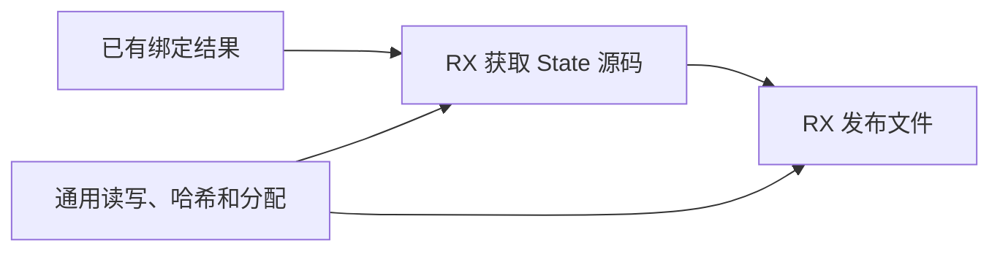
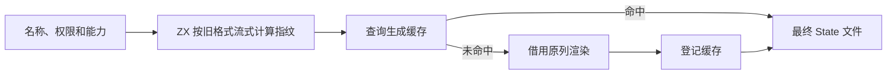

# 普通 Store 缓存与文件发布自举

## Intent · 最终目标

从普通应用的 `State.append` 收口绑定后的正式调用链。由 RX 推进缓存命中、生成、登记和 State 发布，由 ZX 决定指纹字段和字节顺序，去掉缓存路径的临时 Store 行和完整 JSON 缓冲。

## Data · 可用证据

阶段起点为 `bb0b9d548`。普通 Store 已直接借用初始化器名称和读写权限渲染。缓存兼容仍要求为每项组装对象，再用 Zig 序列化成完整字符数组。Zig 在命中或生成后写入 State 文件与模块名。[上一阶段](公开成员与Store绑定列自举.md) · [State 入口](../../packages/compiler/src/backends/zig/state.zig)

## Edges · 边界与限制

沿用原有指纹域、对象字段顺序、字节转义和 SHA-256。命中时跳过渲染，缓存失败或分配失败保持原先的发布顺序。保留初始 seed 和显式原生 genz 配置。

## Answer · 验收

复用已通过的 Source 引导器构建候选。按固定清单核对生成产物、性能和缓存正文，用普通应用夹具核对冷热输出和既有 State 缓存键。

### 正式路径

现有绑定入口验证初始化器并提供模块名称、访问权限和能力。RX 在有缓存时计算键并查询，命中返回源文件，未命中才渲染和登记。缓存关闭时直接渲染。两条路径汇合后由同一 RX 入口决定追加文件，再更新 State 模块名。[缓存编排](../../packages/compiler/src/backends/zig/state/publication/source.rx) · [文件发布](../../packages/compiler/src/backends/zig/state/publication/build.rx)

ZX 直接读取名称与权限列，将旧格式顺序写入栈上的缓冲哈希 writer。字段和值由 Source 决定，Zig 标准库保留字节切片的 JSON 编码和 SHA-256。正式缓存路径移除临时对象列表和整段 JSON 缓冲。宿主继续分配最终模块表，按已有 ABI 批量保留模块前缀。显式原生 genz 构建仍使用旧对象形状渲染。[流式指纹](../../packages/compiler/src/backends/zig/state/publication/fingerprint.zx) · [宿主资源](../../packages/compiler/src/backends/zig/state/publication.zig)

### 引导和固定清单

Zig 0.17.0、ReleaseSmall、16 分区，关闭常驻。两版引导器均由 Source 构建，执行 Source 分析与生成。候选通过 25 个引导步骤，二进制与上一版完全相同，SHA-256 为 `dc27ff0068cc91972baeabb294fd7893c23004fa2edb4552d3d2d2bdd1790dec`。本批的 State 执行路径由安装版覆盖。五组引导清单共 16,645 份产物逐字节相同，排除工具身份戳。

735 个固定入口交替测三轮取中位数。11,753 份冷暖产物一致，所有权缓存正文一致。

| 场景   | 工具     | 墙钟（秒） | CPU（秒） | 进程树峰值 RSS（字节） | 单进程峰值 RSS（字节） |
| ------ | -------- | ---------: | --------: | ---------------------: | ---------------------: |
| 冷生成 | 固定基线 |       2.82 |     12.43 |            884,768,768 |            934,051,840 |
| 冷生成 | 上一版   |       2.60 |     12.96 |            668,090,368 |            699,269,120 |
| 冷生成 | 候选     |       2.67 |     12.95 |            664,387,584 |            689,848,320 |
| 热重建 | 上一版   |       1.93 |      8.27 |            645,824,512 |            645,824,512 |
| 热重建 | 候选     |       1.94 |      8.28 |            645,824,512 |            645,857,280 |

同一引导器二进制的两组采样中，候选冷墙钟增加 0.07 秒，CPU 减少 0.01 秒，进程树峰值减少 3.70 MB。较固定基线，冷墙钟减少 0.15 秒，CPU 累计增加 0.52 秒，进程树峰值减少 220.38 MB。无修改用时均为 0.03 秒。

### 普通 Store 验收

初始 seed 词法引导通过 19 个步骤。候选通过 129 个安装与回归步骤，覆盖 39 项 Zig 测试、19 项 Store 运行检查、2 项公开库 Store 迁移和重发检查，以及 46 项进程入口检查。变更的 RX/ZX 通过格式检查与 lint。

现有只读、可写和双 Store 三组应用的 State 缓存键和生成文件逐字节相同。候选热构建分别从磁盘读取 9、5、6 个生成单元，生成计数均为零。

安装版用同一个双 Store 项目交替构建三轮，冷样本只清除 zxc 项目缓存，保留后端构建缓存。两版工具均由 Source 引导构建。下表取中位数。

| 工具   | 生成缓存 | 构建墙钟（秒） | CPU（秒） | 系统峰值 RSS（字节） |
| ------ | -------- | -------------: | --------: | -------------------: |
| 上一版 | 冷       |           0.71 |      0.76 |          170,639,360 |
| 候选   | 冷       |           0.71 |      0.76 |          171,081,728 |
| 上一版 | 热       |           0.71 |      0.76 |          170,901,504 |
| 候选   | 热       |           0.71 |      0.76 |          170,622,976 |

核验日志位于 `.zig-cache/verification-tmp/state-publication/`。下一批从 genz 的直接构造入口追踪表达式、语句和声明的 AST 存储，接续已有的 Source 行发布与区间规则。
