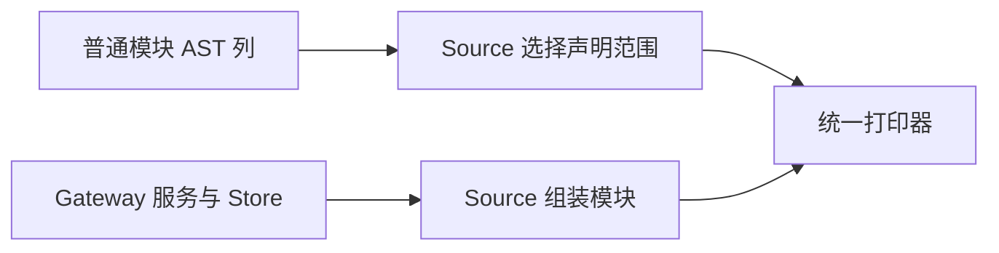

# 模块与 Gateway 渲染交接自举

## Intent · 最终目标

让普通模块的打印范围和 Gateway 的模块组装由 Source 执行。Gateway 服务发射直接借用绑定结果的 Store 槽列，沿完整构建入口移除原生物化和顺序控制。

## Data · 可用证据

基于 `7a7d5dd79`。普通模块经 `genz.render_module.render` 绑定表达式和声明等列，Zig 计算打印范围。Gateway 的 Source 已建立 Store 绑定与按服务生成代码，Zig 仍把槽列重组为记录，依次收集公开模块并构造 Store 和应用文件。

## Edges · 边界与限制

保留起始行、空范围、默认范围及越界错误。Gateway 保留服务声明顺序及 Store 的读写标记。编译库失败时保持原有资源所有权，成功后将同一分配区交给应用。引导 seed 保留原生成路径。

## Answer · 验收

用同一候选引导器核对 Gateway 多服务与跨请求 Store、模块和分区产物、分配失败以及固定清单的生成性能。输出 AST 由打印器遍历，保留宿主的物理列绑定和资源管理。

### 正式路径

普通模块交付原来的 AST 列，Source 检查声明总数、起点和可选长度，通过后直接调用统一打印器。列绑定只借用原始切片描述，保留已有声明顺序和错误映射。[范围编排](../../packages/genz/src/printer/range/render.rx) · [范围约束](../../packages/genz/src/printer/range/count.zx) · [模块列绑定](../../packages/genz/src/printer/module.zig)

Gateway 的 RX 串联 Store 绑定、容量计算、现有模块写入、公开文件收集、状态契约与状态模块发布、应用渲染。完整库和空 Gateway 共用这条链。只有生成成功后才把库的 arena 交给应用。Zig 继续持有原生模块记录和分配区，绑定输入时仍需组装公开成员描述。[Gateway 组装](../../packages/compiler/src/backends/zig/gateway/workflow/build.rx) · [原生交接](../../packages/compiler/src/backends/zig/gateway/root.zig)

原有绑定结果已经按下标和可写性分列，服务渲染借用这两列，按服务边界建立窗口。移除了正式路径按槽组装记录和分配记录缓冲区。适配器和写入能力检查读取同一个窗口。兼容的逐服务输入通过相同读列接口借用原记录。路由与槽标识对齐 Source 的 `u64` 形状。[服务窗口](../../packages/genz/src/analysis/gateway/entry/service_slots.zx) · [适配器读取](../../packages/genz/src/analysis/gateway/adapter/slots.zx) · [列借用](../../packages/genz/src/gateway/slots.zig)

### 固定清单性能

Zig 0.17.0、ReleaseSmall、16 分区，关闭常驻。两版均由 Source 引导器构建并执行各自的 Source 分析和生成。沿用 735 入口冻结清单，三轮交替取中位数。两代冷生成和同版冷热的 11,753 份文件逐字节一致，排除工具身份戳。所有权缓存载荷一致。

| 场景   | 工具     | 墙钟（秒） | CPU（秒） | 进程树峰值 RSS（字节） | 单进程峰值 RSS（字节） |
| ------ | -------- | ---------: | --------: | ---------------------: | ---------------------: |
| 冷生成 | 固定基线 |       2.82 |     12.43 |            884,768,768 |            934,051,840 |
| 冷生成 | 上一阶段 |       2.62 |     13.01 |            664,256,512 |            694,992,896 |
| 冷生成 | 候选     |       2.66 |     12.96 |            670,056,448 |            688,996,352 |
| 热重建 | 上一阶段 |       1.93 |      8.31 |            645,709,824 |            645,742,592 |
| 热重建 | 候选     |       1.94 |      8.26 |            646,660,096 |            646,692,864 |

较上一阶段，冷墙钟增加 0.04 秒、CPU 减少 0.05 秒、进程树峰值增加 5.80 MB、单进程峰值减少 6.00 MB。相对固定基线，冷墙钟减少 0.16 秒、CPU 累计增加 0.53 秒、树峰值减少 214.71 MB。热墙钟增加 0.01 秒，CPU 减少 0.05 秒。无改动用时为 0.03 秒。

### 引导一致性

候选通过 25 个构建步骤，SHA-256 为 `ceff7a68e65b99aa8ab8eb943bd7219181195a506ffdadf855240f4223e181ed`。重新生成主、宿主、增长、集合和执行五组清单，16,622 份文件逐字节一致，排除工具身份戳。初始 seed 词法引导通过 19 个步骤。补齐正式 CLI 使用的 Gateway 静态接口后，引导器哈希不变，沿用同一候选的引导对照和计时。

### Gateway 产物与回归

普通有状态、零请求体上限和空 Gateway 三组夹具实际构建，54 份生成 Zig 逐字节一致。复用工具链缓存，关闭 zxc 语义缓存，在同一项目路径预热后对有状态入口计时三对。macOS arm64、Zig 0.17.0、ReleaseSmall，候选与上一版均用 Source 工具生成和执行。

| 工具     | 构建墙钟（秒） | CPU（秒） | 系统峰值 RSS（字节） |
| -------- | -------------: | --------: | -------------------: |
| 上一阶段 |           1.32 |      1.42 |          211,812,352 |
| 候选     |           1.31 |      1.40 |          211,730,432 |

Gateway 与 JSON 边界回归通过 80 个构建步骤、48 项 Zig 测试、86 项 Gateway 检查和 52 项 JSON 边界用例。Store 借用生命周期与 I/O 两组回归共 8 项检查通过。变更的 RX/ZX 通过格式检查和 lint。原始日志位于 `.zig-cache/verification-tmp/render-handoff/`。

下一批核对公开库与 Gateway 共用的成员及 Store 绑定输入，继续移除宿主逐个构造的成员和路由记录。
