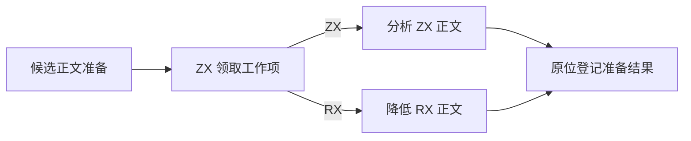
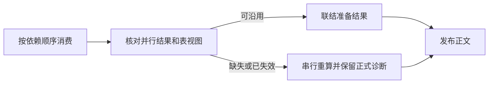

# 混合分析并行正文自举

## Intent

由 Source 领取并分派混合分析的并行正文任务，再按依赖顺序决定沿用准备结果或串行重算。解析缓存与混合正文共用内部原生字宽原子计数器。

## Data

起点为 `fc36d76d3`。`Ahead.analyze` 并行执行已准备的 ZX 与 RX 正文，`Transaction` 按依赖顺序消费。后台分析只读共享表，正式交付时需再次核对表的兼容性。

## Edges

保留并发粒度、参与线程数及原子顺序。每个任务写入自己的结果槽，工作区借用有效期覆盖联结。并行结果缺失、报告诊断或表失配时交给正式顺序入口，已开始联结后的错误直接传播。

## Answer

沿正式混合分析验证并行分派、单项失败不停止其他任务、串行回退与诊断顺序。集中核对引导、回归、常驻编辑和固定性能对照。

### 正式路径

- 混合分析的 RX 入口保留窗口执行与最终发布。ZX 选择正文动作，按依赖顺序沿用已通过核对的准备结果，或者在原位置重新分析。已开始的联结失败直接传播。
- 并行线程执行 ZX 的领取和分派循环。每次原子操作领取一行，每个工作项直接写入原有结果槽。解析缓存与混合正文共用 `memory.fetchAddIndexRelaxed`，沿用原生字宽和原子顺序。
- Zig 仍负责启动与汇合线程、提供工作区、绑定结果以及执行尚未迁出的分析、降低和联结操作。初始 seed 保留旧工作线程。

### 引导与性能

使用 `fc36d76d3` 的 Source 引导器构建候选，26 个引导步骤通过。候选 SHA-256 为 `349463ef29e1e428701f3b306cd54e0f00962c48ae3b3da05d7ea03ed56d94f6`。

固定 705 个入口、16 个分区，关闭常驻生成器，交错三轮取中位数。各工具由 Source 构建，运行各自的 Source 分析和生成。固定输入的 9,894 个文件和所有权 memo 载荷与上阶段逐字节一致。

| 对照     | 冷生成墙钟 | 冷生成 CPU | 冷进程树峰值 RSS | 冷系统记录峰值 RSS | 热生成墙钟 | 热生成 CPU |
| -------- | ---------: | ---------: | ---------------: | -----------------: | ---------: | ---------: |
| 固定基线 |     2.16 s |     9.00 s |         737.6 MB |           760.6 MB |     1.62 s |     6.36 s |
| 上阶段   |     2.08 s |     9.39 s |         529.4 MB |           547.7 MB |     1.41 s |     6.18 s |
| 候选     |     2.10 s |     9.55 s |         526.6 MB |           546.5 MB |     1.42 s |     6.20 s |

较上阶段，冷生成墙钟增加 0.02 秒，CPU 增加 0.16 秒，进程树峰值 RSS 减少 2.8 MB。较固定基线，冷生成墙钟减少 0.06 秒，CPU 累计增加 0.55 秒，进程树峰值 RSS 减少 210.9 MB。候选第一轮冷生成墙钟为 3.24 秒，其余两轮取值见核验日志。无改动检查墙钟中位数为 0.03 秒。

### 正确性核验

当前源码的五份引导清单共 17,350 个生成文件逐字节一致。检查生成的 worker，工作项循环直接读游标和结果视图，循环本身没有额外堆分配。

十次常驻请求与上阶段的分析、复用、发射计数一致，成功请求的产物与同输入冷生成逐字节相同。复用三项真实解析缓存核验，覆盖并行命中与新解析、顺序交付及分配失败后的成功前缀。

模块生成、语义缓存、RX 推导和解析缓存共 182 项回归通过。重算判定核对生成控制流和正式入口回归，本批没有单独构造令并行结果失效的夹具。
