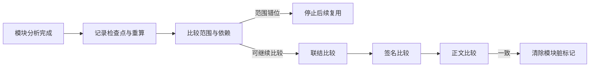

# 混合历史复验与状态写回自举

## Intent

由 Source 执行混合分析的初始历史准入和重算后复验，并更新脏标记与计数。除现有初始引导兼容路径外，Zig 宿主仅绑定表、检查点和可写槽位。

## Data

基线为 `72d122f02`。混合分析入口通过 `Reuse.begin` 和 `Reuse.analyzed` 进入历史复验。图、类型列、联结、函数表比较各有 Source 实现。宿主仍控制调用顺序、依赖何时被视为变更以及标记写回。

## Edges

保留依赖传播、Store 快速分支、空函数范围以及逐阶段短路。函数表和联结按需借用，写回原有槽位。检查点比较仅访问各自已发布的列范围。

## Answer

沿正式混合分析入口确认生成代码执行复验与标记写回，并覆盖一致、联结或正文变化、类型错位、Store 和无历史路径。集中验收引导产物、常驻编辑、回归和固定性能对照。

### 正式入口

- `Reuse.begin` 从一条 RX 入口完成图、初始检查点、类型和名义列以及签名比较。初始化视图各自使用已发布的长度，图或检查点不一致时只比较前置条件。
- `Reuse.analyzed` 绑定本轮检查点、计数和布尔槽位。RX 在需要复验时依次执行对齐、依赖确认和函数比对。联结和函数表继续使用既有 Source 比较器，宿主适配器在各步调用时借用列。Store 保留直接清除脏标记的条件。
- ZX 直接更新已分析计数、当前模块脏标记和整体对齐状态。两条入口的生成 Zig 通过空临时分配区核验。Zig 初始引导继续使用原逻辑。

### 产物与性能

使用 `72d122f02` 对应的 Source 工具构建候选，26 个构建步骤通过。候选 SHA-256 为 `99c6b40ea4b9512638fcf137ff0e1f951fc4721de09df4e23682bf224ee3b0fc`。对本批源码生成的五份清单共 17,304 个文件逐字节一致。

固定 705 个入口、16 分区，各工具由 Source 自编译并运行各自的 Source 分析与生成实现。关闭常驻生成器，各配置交错三轮取中位数。冻结清单的 9,894 个文件和所有权 memo 载荷一致。

| 对照     | 冷墙钟 | 冷 CPU | 冷进程树峰值 RSS | 冷系统记录峰值 RSS | 热墙钟 | 热 CPU |
| -------- | -----: | -----: | ---------------: | -----------------: | -----: | -----: |
| 固定基线 | 2.08 s | 9.02 s |         737.7 MB |           765.2 MB | 1.65 s | 6.45 s |
| 上阶段   | 1.94 s | 9.48 s |         524.5 MB |           556.8 MB | 1.46 s | 6.28 s |
| 候选     | 1.96 s | 9.51 s |         529.7 MB |           555.7 MB | 1.45 s | 6.27 s |

较上阶段，冷墙钟增加 0.02 秒，CPU 增加 0.03 秒，进程树峰值 RSS 增加 5.3 MB，系统记录峰值 RSS 减少 1.1 MB。较固定基线，冷墙钟减少 0.12 秒，CPU 累计增加 0.49 秒，进程树峰值 RSS 减少 208.0 MB。无改动检查墙钟中位数 0.03 秒。

### 常驻编辑与标记

两项定点验证覆盖初始图与类型短路、无历史记录、范围错位、编译库依赖、变更依赖、缺失联结、Store、完全一致和三步比较分别失败。经实际依赖链运行的十次常驻请求，分析、复用和发射计数与上阶段一致。增量产物与同输入的冷生成一致。等价正文编辑复用所有生成文件，实际正文变化使调用链重算，恢复初始输入后复用四个模块。

真实混合推导验证中，独立解析但结构相同的 Store 复用两个模块。修改字段值后仅复用一个模块。模块生成、语义缓存、RX 推导和 Store 运行共 207 项回归通过。

常驻计时同一四模块项目每种工具各发出 192 次正文编辑及 192 次纯 RX 编辑。正文请求中位数从 0.84 ms 到 0.83 ms，P95 从 1.06 ms 到 1.04 ms。纯 RX 请求中位数从 0.67 ms 到 0.66 ms，P95 从 0.81 ms 到 0.84 ms。
