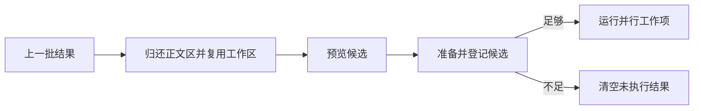
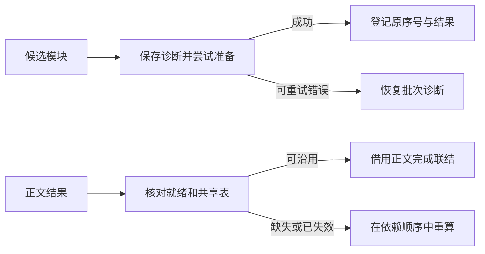

# 混合并行批次资源与交付自举

## Intent

将混合并行批次的旧结果清理、候选登记、诊断恢复和可用结果交付迁入正式 Source。顺序重试沿用现有正文编译入口。

## Data

起点为 `806f2a6ba`。Source 已经选择候选、领取并执行工作项。原生 `Ahead.analyze` 决定何时回收和复用工作区、启动并行工作。原生候选准备合并了诊断保留、正文准备和结果登记。

## Edges

保留首个顺序诊断，并行准备的普通失败只恢复诊断，分配失败仍中止。沿用原工作线程数量、工作区回收边界和容量复用方式。ZX 正文的分析区须覆盖联结，并在联结失败时释放。

## Answer

沿真实项目入口核对批次推进、候选恢复和联结前后资源。使用现有回归、常驻请求、引导产物和固定冷暖生成对照验收。

### 正式路径

- RX 先清理上一批，再选择、准备候选，最后启动工作线程或丢弃人数不足的批次。ZX 按原范围重置已使用的工作区和候选绑定，项目结束时复用同一套正文资源释放规则。
- 每次尝试保存当前诊断。成功结果通过显式借用的候选句柄按原位置登记，普通失败恢复保存的诊断，分配失败直接上抛。原生数组继续持有结果及工作区。
- ZX 正文在交付时重新核对结果和共享表。失效结果先释放，再进入顺序分析。可用结果借用正文直到联结返回，联结失败也会归还分析区。RX 正文通过有效行直接交付，省去中间的完整降低结果。
- Zig 提供线程执行、arena 原语、IR 联结和物理结果存储。初始 seed 保留原生批次选择与调度，继续使用同一组借用及联结操作。

### 引导与性能

使用 `806f2a6ba` 的 Source 工具构建候选，26 个引导步骤通过。候选 SHA-256 为 `cb560f2666debda9354adc09d2fb77c3fc48d82090f62fa52114646d7c3af549`。小范围生成及正式清单检查均使用空的临时分配区执行新编排。

固定 705 个入口和 16 个分区，关闭常驻生成器，交错三轮取中位数。各工具由 Source 构建并运行其 Source 分析和生成。冻结清单的 9,894 个生成文件与所有权 memo 载荷逐字节一致。

| 对照     | 冷生成墙钟 | 冷生成 CPU | 冷进程树峰值 RSS | 冷系统记录峰值 RSS | 热生成墙钟 | 热生成 CPU |
| -------- | ---------: | ---------: | ---------------: | -----------------: | ---------: | ---------: |
| 固定基线 |     2.08 s |     9.00 s |         737.6 MB |           795.8 MB |     1.66 s |     6.43 s |
| 上阶段   |     1.94 s |     9.48 s |         525.7 MB |           544.4 MB |     1.45 s |     6.24 s |
| 候选     |     1.92 s |     9.45 s |         523.6 MB |           552.9 MB |     1.45 s |     6.25 s |

较上阶段，冷生成墙钟减少 0.02 秒，CPU 减少 0.03 秒，进程树峰值减少 2.1 MB，系统记录峰值增加 8.5 MB，采样物理内存中位数减少 1.4 MB。较固定基线，冷生成墙钟减少 0.16 秒，CPU 累计增加 0.45 秒，进程树峰值减少 214.0 MB。无修改检查墙钟中位数为 0.03 秒。

### 正确性核验

当前源码的五份引导清单共 17,407 个生成文件逐字节一致。十次常驻请求的分析、复用和发射计数与上阶段一致，成功请求的生成产物与同输入冷生成一致。

模块生成、语义缓存、RX 推导、库链接和解析缓存共 228 项回归通过，涵盖缓存依赖更新、顺序诊断与分配失败清理。单项候选失败的诊断恢复按正式调用链核对。

初始 seed 的 `bootstrap-parser` 通过 32 个构建步骤。最终的多阶段引导与传递依赖核对继续按收敛计划执行。
