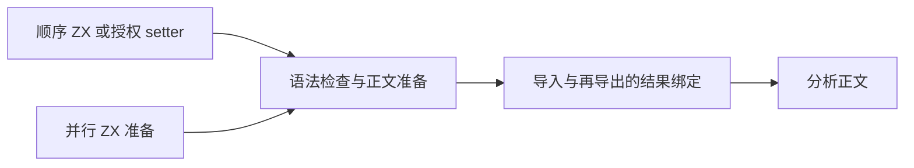
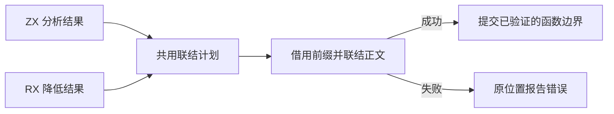

# 混合正文准备与联结自举

## Intent

把混合正文的导入绑定、分析准备与联结交接迁到正式 Source 路径。ZX 顺序编译、并行准备和编译授权 setter 共用绑定规则。RX 与 ZX 共用正文联结的前缀选择和结果提交。

## Data

起点为 `28f74329b`。ZX 正文通过 `Zx.prepare` 的导入表获得依赖函数。旧实现由 Source 先挑选值导入行，再交给 Zig 循环解析目标、预留目标列表和逐项提交。RX 和 ZX 正文的前缀计算已由 Source 提供，计算结果由各自 Zig 路径应用。

## Edges

保持导入顺序、签名期已有成员、前缀只写一次和诊断位置。保留 ZX 与 RX 正文各自所需的初值表和临时区借用。正式结果交付前不得释放分析区。

## Answer

沿顺序和并行调用链核对退出的 Zig 职责。集中核验模块生成、RX 推导、编译库、语义缓存及固定冷暖生成。

### 正式路径

- ZX 的顺序和并行准备共用 RX 的打开、语法检查和导入绑定。顺序编译和授权 setter 先校验语法，再绑定。并行准备保留原先的延后检查。
- 索引语法的导入扫描、签名期前缀的首次提交、函数与再导出列表的逐项发布由 ZX 推进。存储绑定、原有符号选择器及必要的名称所有权转移仍由宿主执行。初始 seed 的原生语法入口沿用同一组绑定操作。
- RX 和 ZX 的顺序执行分别显式交付分析或降低结果，失败时提交原诊断。ZX 校验 setter 的声明和槽位，再应用授权路径。临时区与编号缓冲保留在宿主，覆盖整个执行和联结过程。
- RX 与 ZX 共用前缀选择、正文联结和验证边界提交。联结输入按借用传递，减少阶段间的完整描述符传递。宿主仍构造和读取 IR 列，执行已有联结入口以及诊断和分析区的物理操作。

最初的优化构建在检查语法时读取了空的解析地址。准备入口现在显式返回借用的解析结果，再由 RX 传给检查和绑定。修复后的优化构建通过了原复现清单，五个新入口的生成代码核对未出现临时堆分配。

### 引导与性能

使用 `28f74329b` 的 Source 引导器构建候选，26 个引导步骤通过。候选 SHA-256 为 `90380199a9d0b1dfc31945ae660fe0a826306edda13d9644507b60e6ba6fac7c`。

固定 705 个入口和 16 个分区，关闭常驻生成器，交错三轮取中位数。各工具由 Source 构建，运行各自的 Source 分析和生成。固定输入的 9,894 个生成文件和所有权 memo 载荷与上阶段逐字节一致。

| 对照     | 冷生成墙钟 | 冷生成 CPU | 冷进程树峰值 RSS | 冷系统记录峰值 RSS | 热生成墙钟 | 热生成 CPU |
| -------- | ---------: | ---------: | ---------------: | -----------------: | ---------: | ---------: |
| 固定基线 |     2.07 s |     9.00 s |         737.1 MB |           782.0 MB |     1.64 s |     6.43 s |
| 上阶段   |     1.94 s |     9.51 s |         525.0 MB |           542.1 MB |     1.44 s |     6.25 s |
| 候选     |     1.92 s |     9.49 s |         528.1 MB |           555.6 MB |     1.45 s |     6.26 s |

较上阶段，冷生成墙钟和 CPU 各减少 0.02 秒。进程树峰值 RSS 增加 3.1 MB，系统记录峰值增加 13.5 MB，采样物理内存中位数减少 1.2 MB。系统记录峰值的三轮区间为上阶段 539.5–550.8 MB、候选 540.1–560.9 MB。较固定基线，冷生成墙钟减少 0.15 秒，CPU 累计增加 0.49 秒，进程树峰值减少 209.0 MB。无修改检查墙钟中位数为 0.03 秒。

### 正确性核验

当前源码的五份引导清单共 17,389 个生成文件逐字节一致。十次常驻请求的分析、复用和发射计数与上阶段一致，成功请求的产物与同输入冷生成逐字节相同。

模块生成、语义缓存、RX 推导和库链接共 214 项回归通过。授权 setter、编译库 Store 以及失败清理复用现有覆盖。

ReleaseSafe 在最小项目上仍触发 `reached unreachable code`。用 `28f74329b` 的源码、同一引导器和配置单独构建后得到同样的退出状态及生成器签名和所有权调度调用栈。这个问题列入最终引导验收。
