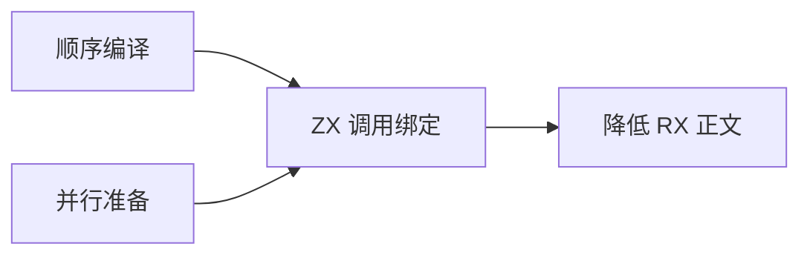
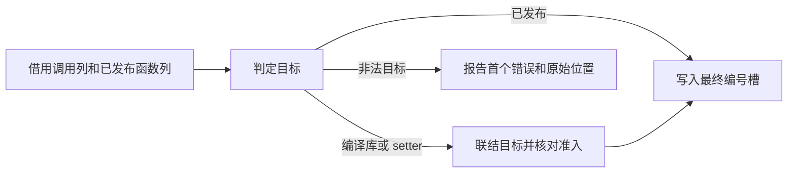

# 混合正文调用绑定自举

## Intent

由 Source 完成 RX 正文的调用绑定。顺序编译和并行准备共用查找、特殊调用处理和函数编号写入。

## Data

起点为 `185903dcd`。`Rx.compile` 和 `Ahead.prepare` 都调用 `callees.load`。旧实现由 ZX 批量写入普通调用，遇到编译库、授权 Store setter 或诊断时将游标交回 Zig。Zig 处理一项并写回编号后再继续批量扫描。

## Edges

按原调用顺序执行编译库联结和 setter 分析，保留路径归属、首个错误、字段位置及失败清理。维持原编号缓冲区的分配方式，普通调用直接写入目标槽。临时宿主继续提供编译库和 setter 的物理联结与诊断所有权。

## Answer

核对顺序和并行入口都由 Source 推进绑定，验证库、Store 和 RX 推导回归，以及同输入引导产物与冷暖生成性能。

### 正式路径

- 已发布函数和命名导出在查到后直接写入最终编号槽。编译库调用先联结，再由共用准入规则检查可执行性与 Store 权限。授权 setter 成功分析后恢复调用方归属，再检查并发布编号。特殊调用失败沿原错误路径退出。
- Zig 提供原有列和编号缓冲区，交付编译库的函数及 Store 事实，执行尚未迁出的 setter 正文联结，并复制诊断文本到结果持有区。ZX 决定诊断文本与位置类别。初始 seed 和非本机列宽入口保留旧绑定实现。
- 生成形态检查发现，临时复合结果和携带原生句柄的跨函数参数会给绑定循环引入堆分配。查找已发布函数现在原位写入，只返回下一步动作，特殊调用在同一循环中消费。循环借用原输入，生成代码使用空缓冲区即可运行。名称选择的宿主改用既有 ABI 适配，适应生成布局在传值与借用间切换。

### 引导与性能

使用 `185903dcd` 的 Source 工具构建候选，26 个引导步骤通过。候选 SHA-256 为 `b7df2818d2d87c83e090ca1ae7e4d04a7801f399c72986f4ef83ebffd460f208`。

固定 705 个入口和 16 个分区，关闭常驻生成器，交错三轮取中位数。各工具由 Source 构建，运行各自的 Source 分析和生成。冻结清单的 9,894 个生成文件和所有权 memo 载荷与上阶段逐字节一致。

| 对照     | 冷生成墙钟 | 冷生成 CPU | 冷进程树峰值 RSS | 冷系统记录峰值 RSS | 热生成墙钟 | 热生成 CPU |
| -------- | ---------: | ---------: | ---------------: | -----------------: | ---------: | ---------: |
| 固定基线 |     2.08 s |     9.01 s |         737.7 MB |           760.2 MB |     1.63 s |     6.40 s |
| 上阶段   |     2.02 s |     9.52 s |         529.5 MB |           553.0 MB |     1.44 s |     6.29 s |
| 候选     |     1.94 s |     9.50 s |         529.0 MB |           555.1 MB |     1.46 s |     6.27 s |

较上阶段，冷生成墙钟减少 0.08 秒，CPU 减少 0.02 秒，进程树峰值减少 0.5 MB，系统记录峰值增加 2.1 MB。较固定基线，冷生成墙钟减少 0.14 秒，CPU 累计增加 0.49 秒，进程树峰值减少 208.7 MB。无改动检查墙钟中位数为 0.03 秒。

### 正确性核验

当前源码的五份引导清单共 17,362 个生成文件逐字节一致。十次常驻请求的分析、复用和发射计数与上阶段一致，成功请求的生成产物与同输入冷生成一致。

模块生成、语义缓存、RX 推导和库链接共 214 项回归通过，覆盖编译库 Store 槽共享与隔离、源 setter 权限及分配失败后的清理。初始 seed 的完整自编译留在收敛验收。
