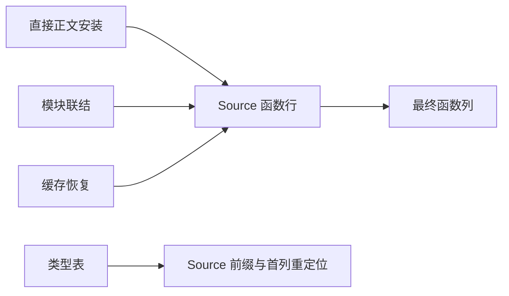
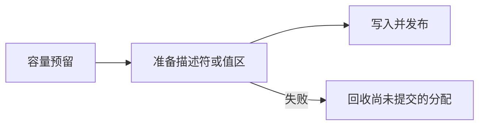

# 类型表与函数 IR 写入自举

## Intent · 最终目标

让直接函数登记与联结、缓存恢复共用 Source 对函数行的表示和写入规则。类型表共用 Source 的列类型、前缀边界和增量重定位。保留现有的分配、提交及失败回收契约。

## Data · 可用证据

起点为 `62a842582`。正文安装、独立分析结果和旧式外部模块直接调用 `FunctionStorage.append`；普通联结与正式缓存已经用 Source 写函数列。类型合并已有 Source 的前缀计算和首列重定位，核心类型表仍保留独立循环。沿这两个公共存储入口复用现有规则。[函数存储](../../packages/core/src/function_table/storage.zig) · [类型存储](../../packages/core/src/type_table/storage.zig) · [正文安装](../../packages/compiler/src/zx/modules/project/execution/body.zig)

## Edges · 边界与限制

函数列保持现有分配顺序、标签值及失败处理，借用既有描述符和列缓冲，原生签名缺省语义保持一致。类型列维持原存储顺序和缓存格式。初始 seed 保持独立构建，仅正式编译器取得 Source 入口。

## Answer · 验收

检查正式直接写入和增量重定位的生成代码，覆盖独立入口、联结、缓存恢复和分配失败。使用同一个 Source 引导器候选集中回归与回测，解释生成产物中由新增正式入口产生的差异。

### 正式路径

`FunctionStorage.appendBodyAssumeCapacity` 改由 Source 发布。直接正文安装、独立分析登记和旧式外部导入仍沿原 `append` 入口预留容量并取得它们拥有的描述符。普通联结及缓存的递归入口也调用同一个 Source 发布函数。正文列和原生签名列直接从两份借用记录写入最终列表，按 ABI 字段名在编译期确定位置。缺少签名时，通用列表操作写入该投影的空值。原生批量写入继续按已预留的尾列发布。[函数行发布](../../packages/core/src/function_table/publication/publish.zx) · [联结递归入口](../../packages/compiler/src/zx/modules/link/artifact/body/publish.rx) · [缓存递归入口](../../packages/compiler/src/zx/modules/link/result/publication/register.rx)

最初的整行对象参数触发了生成器的临时分配。最终发布入口分别借用正文和签名，生成的 Zig 中无整行分配或整行复制。对照完整函数行定义，两份投影覆盖了所有列，每列恰好出现一次。保留原来由 Zig 分配的描述符与失败回收点，使借出的表头继续有明确的所有者。[借用适配](../../packages/core/src/function_table/publication/host.zig) · [通用列写入](../../packages/core/src/memory/column_set.zig)

联结与核心类型表使用同一份 Source 前缀扫描。类型增量首列复用语义合并规则，直接写入已预留的最终首列，零偏移时连续复制，其他情况按类型重定位。其余列沿用原有的容量检查与提交。正式类型表与函数表的基础列使用 Source ABI 中的类型，拥有列从读视图推导元素类型，保留原生字段顺序。初始 seed 继续使用原算法。独立生成宿主元数据的工具继续使用同一套种子布局和自身所需的 Source 打印模块。[前缀边界](../../packages/core/src/type_table/retained.zx) · [增量首列](../../packages/core/src/type_table/write_first.zx) · [类型存储](../../packages/core/src/type_table/storage.zig)

### 集中验收

- 使用 Zig 0.17.0、ReleaseSmall、16 分区。已验收的上一阶段 Source 引导器构建候选，26/26 个步骤通过，候选 SHA-256 为 `10ed74fbf6995ee5f853b7803f82dd1cb8c53185f6c6bd891ab0d960782203d8`。
- 初始 seed 的词法生成目标 21/21 通过。以候选重跑正式主清单和四份辅助清单，16,667 份引导文件逐字节一致，工具身份戳单列。
- 九组集中回归的 194 个构建步骤、517 项 Zig 测试和 5 项跨进程缓存检查通过，覆盖类型合并、模块工件、原生链接、公开库、语义缓存、RX 推导与所有权。

### 性能对照

冻结清单含 735 个入口。两代工具由 Source 引导器生成，运行也使用 Source 分析与发射，关闭生成常驻服务。交替运行三次，11,753 个生成文件和所有权 memo 载荷一致。下表取中位数，RSS 为进程树采样峰值。

| 路径   | 比较            |  墙钟（秒） |     CPU（秒） |  峰值 RSS（MB） |
| ------ | --------------- | ----------: | ------------: | --------------: |
| 冷生成 | 上一阶段 → 候选 | 2.63 → 2.62 | 13.00 → 13.00 | 667.17 → 667.40 |
| 热生成 | 上一阶段 → 候选 | 1.93 → 1.92 |   8.27 → 8.28 | 645.86 → 646.86 |
| 无改动 | 上一阶段 → 候选 | 0.03 → 0.03 |   0.03 → 0.03 |     0.23 → 0.25 |
| 冷生成 | 固定基线 → 候选 | 2.82 → 2.62 | 12.43 → 13.00 | 884.77 → 667.40 |

同配置两轮引导器的构建单步均约 27 秒、峰值约 1 GB。回归记录中的 CLI 后端构建单步均约 2 分钟、峰值约 4 GB。

### 下一批

接续正式联结和缓存读取共用的函数签名与描述符。先从 `FunctionTable.at`、`SignatureTable.read` 和 `Nodes.functionEntry` 核对哪些调用方只需借用列、哪些调用方需要接管新分配的描述符。迁移可共用的签名、控制体与原生描述符读取，保持分析结果区和长期缓存的生命周期。完整冷构建和三阶段自编译仍在最终验收范围内。[函数读取](../../packages/core/src/function_table/root.zig) · [签名读取](../../packages/core/src/signature_table/root.zig) · [联结函数](../../packages/compiler/src/zx/modules/artifact/nodes.zig) · [收敛计划](../2026-11-20/自举收敛计划.md)
