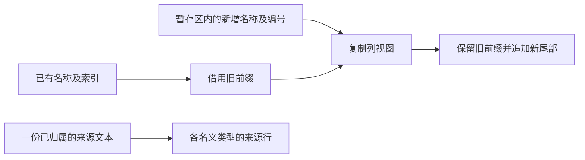

# 类型解析名称与来源写回自举

## Intent

让普通声明、单个名称和类型节点共用 Source 交付已解析名称、类型增量与名义来源。已有前缀在分配失败时继续可读取，错误返回保持原顺序。

## Data

起点为 `975caaa4e`。正式解析由 ZX 计算增量，Zig 随后逐项插入名称哈希表、复制共享来源和遍历名义类型。原生与外部交付已共用 Source 的类型列写入。本批沿普通类型解析入口将名称和来源接到同一套列发布。

## Edges

解析增量中的名称只在新名称完成时写入。小表直接查找，较大的表借用已有字节索引规则。类型提交前只前置容量准备。若索引需要扩容，旧前缀先完成重建，之后的失败不改变有效名称。名义来源的文本沿用每批拥有一份的约定，分配失败时按进度释放。

## Answer

- 普通声明初始化、名称查找和类型节点解析共用同一条写回链路。RX 先准备名称表和索引，再提交类型和来源，最后发布名称与新索引。每次只写新增尾部。
- ZX 发布类型名称、编号和索引，生成路径移除了逐项更新 Zig 哈希表和逐项追加名义来源的循环。小表直接查找，长表使用现有借用字节索引，扩容时才重建旧桶。Zig 继续提供实际列内存和索引所需的借用视图。初始 seed 保留原名称表。
- 已有的类型写入事务为每一批名义来源保留一份持有的文本。失败清理按列记录进度，释放每段拥有的文本一次。

### 正确性核验

用 `975caaa4e` 的 Source 工具构建候选，27 个步骤通过。候选 SHA-256 为 `3fcf59da1a1600243f9754ea3b5092399146cc328fe846cb99a7dbb14302d0a2`。五份当前引导清单的 17,576 个生成文件逐字节一致。十次常驻请求的产物哈希、分析、复用和发射计数与上阶段一致。修改的 RX 与 ZX 文件通过格式与 lint 检查。

正式候选通过 110 个步骤与 293 项测试，覆盖类型解析、类型联结、名义来源、跨模块匹配、原生声明和语义缓存。已有类型解析回归验证了递归与未知名称诊断、有效前缀、逐项分配失败和重试。初始 seed 的解析器构建与 39 项 RX 回归通过。

### 性能对照

固定 705 个入口和 16 个分区，关闭常驻生成器，交错三轮取中位数。三个工具均由 Source 构建，运行各自的 Source 分析和生成。固定输入的 9,894 个生成文件和所有权 memo 逐字节一致。

| 对照     | 冷生成墙钟 | 冷生成 CPU | 冷进程树峰值 RSS | 冷系统记录峰值 RSS | 热生成墙钟 | 热生成 CPU |
| -------- | ---------: | ---------: | ---------------: | -----------------: | ---------: | ---------: |
| 固定基线 |     2.09 s |     9.02 s |         737.7 MB |           760.0 MB |     1.64 s |     6.44 s |
| 上阶段   |     1.97 s |     9.52 s |         530.4 MB |           553.5 MB |     1.46 s |     6.27 s |
| 候选     |     1.97 s |     9.51 s |         528.0 MB |           547.6 MB |     1.46 s |     6.29 s |

较上阶段，冷、热生成墙钟持平，冷 CPU 减少 0.01 秒，热 CPU 增加 0.02 秒。冷进程树峰值减少 2.3 MB，系统记录峰值减少 5.9 MB。无改动检查墙钟为 0.03 秒。较固定基线，冷生成墙钟减少 0.12 秒，CPU 累计增加 0.49 秒，冷进程树峰值减少 209.6 MB，系统记录峰值减少 212.4 MB。
