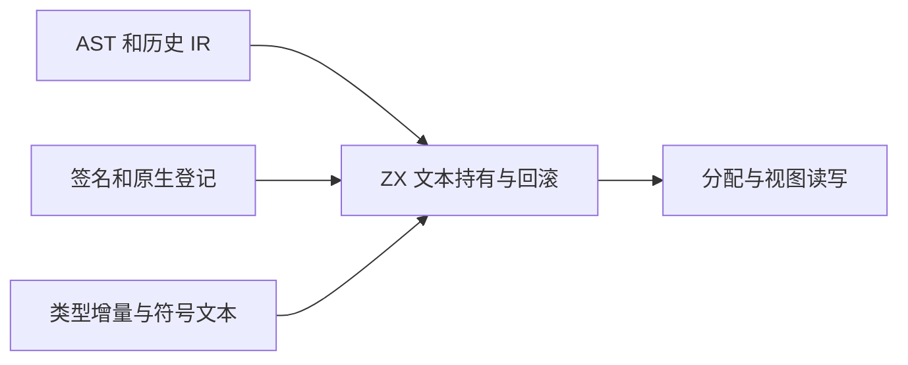
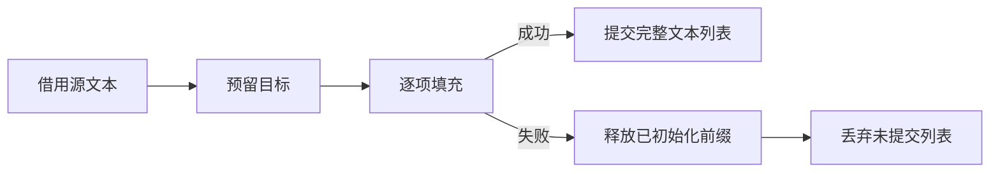

# 编译器文本载荷自举

## Intent

让 AST 和 IR 的列传输、联结签名与原生模块发布、类型增量、RX 字面量与捕获名的写入共用 ZX 的文本所有权操作。退出正式路径中按文本项遍历、克隆及失败清理的手写 Zig 函数。

## Data

起点为 `583594b47`。列传输目前由 ZX 逐行推进，嵌套文本列表的再分配仍由宿主处理。签名和原生模块发布使用相同的 Zig 逐项复制函数，类型增量依赖现有目标列并执行类似的清理。[列传输](../../packages/core/src/memory/column_transfer.zig) · [签名准备](../../packages/compiler/src/zx/modules/link/signature/publication/prepare.zx) · [类型增量](../../packages/compiler/src/zx/analysis/semantic/merging/publication/text.zx)

## Edges

拥有文本列表继续为外层视图与单条文本各分配一次。借用文本的列表只复制视图。可空槽保持原值。分配失败释放当前列表已初始化的前缀，外层调用继续完成既有回滚。原始字节复制、类型对齐和单次分配释放留在通用内存边界。单值热点只按列选路。

## Answer

对照正式 Source 调用与保留的 seed 调用。复用原生联结、工件与缓存回归中的所有权和分配失败覆盖。集中对照生成产物与冷暖墙钟、CPU、峰值 RSS，保留既有固定基线。

### 正式路径

- AST 与 IR 的列传输按列区分拥有的文本项和只拥有外层视图的文本列。拥有项的复制、空值保留和回滚在 ZX 中执行。物理列槽的借用、写入与单次分配通过现有内存边界交接。
- 原生模块登记和联结签名共用拥有文本列表的复制，签名的可空参数名保留对应槽位。列槽和文本分配借用同一个宿主分配器，保留各自的内部类型契约。
- RX 字面量、符号名、捕获名、名义类型来源及类型增量都用同一条 ZX 预留槽填充路径。已有的外层事务仍按完成标记发布或回滚。
- 手写的文本列表复制接口已删除。初始 seed 的列传输保留原批量复制实现。正式路径继续使用 Zig 的字节复制、视图对齐和单次分配释放。

### 验收结果

候选由 `583594b47` 的 Source 引导器构建，通过 26 个步骤。两版引导器均以本批源码执行五份引导清单，17,122 个生成文件逐字节一致。候选引导器 SHA-256 为 `ec2896e56b89cd83acee2b0de23ada8e9de0d8330f603ff86b7093460468f43a`。

两个独立运行核验逐个注入分配失败，覆盖拥有文本、可空文本、源与目标共用同一视图、可空嵌套列和未发布数据的回滚。外层视图复制后仍共享借用的文本内容。由空固定分配器提供临时区，成功路径与失败清理均只使用目标分配区。

配对采用冻结的 705 个入口、相同 16 分区、关闭常驻生成器，交错三轮取中位数。三个工具的本体均由 Source 生成，运行各自的 Source 分析和发射。冻结输入的 9,894 个生成文件一致。

| 对照     | 冷墙钟 | 冷 CPU | 冷进程树 RSS | 冷系统 RSS 峰值 | 冷物理占用峰值采样 | 热墙钟 | 热 CPU |
| -------- | -----: | -----: | -----------: | --------------: | -----------------: | -----: | -----: |
| 固定基线 | 2.10 s | 8.97 s |     738.0 MB |        761.2 MB |           732.8 MB | 1.63 s | 6.41 s |
| 上阶段   | 1.94 s | 9.43 s |     528.4 MB |        549.5 MB |           523.2 MB | 1.44 s | 6.24 s |
| 候选     | 1.95 s | 9.45 s |     542.8 MB |        554.3 MB |           523.4 MB | 1.44 s | 6.25 s |

相比上阶段，冷墙钟增加 0.01 秒，冷 CPU 增加 0.02 秒。进程树 RSS 增加 14.4 MB，系统记录的 RSS 峰值增加 4.8 MB，物理占用峰值采样增加 0.2 MB。相比固定基线，冷墙钟减少 0.15 秒，CPU 增加 0.48 秒，系统 RSS 峰值减少 206.8 MB。物理占用和热生成均基本持平。

集中回归通过 116 个步骤和 343 项测试，覆盖原生联结、库联结、联结边界、模块生成与工件、语义缓存和 RX 项目推导。
