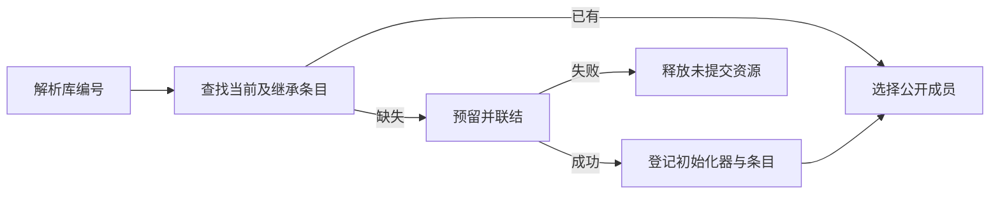

# 编译库条目与签名交接自举

## Intent · 最终目标

将编译库的解析编号、已链接条目引用及发布结果沿 RX 编排显式传递。签名阶段冻结已有索引，混合分析直接借用，在本次分析中单独保存新增条目。移除签名结果的逐行快照和正文的逐项重新登记。

## Data · 可用证据

起点为 `c1726aca3`。ZX 和 RX 项目共用编译库加载入口。原入口通过 Zig 暂存选择的编译库编号和已加载条目的指针。签名发布先遍历原哈希表构造列表，正文分析再从列表恢复第二张哈希表。常驻历史继续引用签名结果，要求冻结的索引在后续分析期间保持只读。[编译库加载](../../packages/compiler/src/zx/modules/compiled/imports.zig) · [签名发布](../../packages/compiler/src/zx/modules/project/execution/signatures/host.zig) · [混合状态](../../packages/compiler/src/rx/analysis/project/mixed/state.zig)

## Edges · 边界与限制

配置中的原始库编号继续作为索引键。源文件路径归一化、工件联结、分配失败和缺少公开成员的错误次序保持一致。首次加载成功时先登记初始化器与库条目，再查找请求成员。公开成员缺失后已链接工件仍可复用。新增库只写入当前分析的索引，签名工作区与常驻历史可以零拷贝继续借用原表。

## Answer · 验收

使用上一阶段 Source 引导器。集中检查独立 ZX 导入、混合 RX 调用、同实例复用、Store 初始化器和分配失败。比较本阶段引导产物、冻结生成清单及编译库导入检查的耗时和内存。列明保留的分配器及通用哈希容器。

### 正式路径

RX 接收工件编号，依次查询当前与继承索引，再把借到的条目交给公开成员查找。首次联结成功后发布初始化器与条目，再将该条目交给公开成员查找。宿主帧退出编译库编号和当前条目指针。错误退出时由原分配器释放尚未提交的导出索引。[导入编排](../../packages/compiler/src/zx/modules/compiled/imports/load.rx) · [宿主边界](../../packages/compiler/src/zx/modules/compiled/imports.zig)

签名阶段传递其拥有区中已有的哈希索引。混合分析借用索引与导出条目，单独发布本次新增记录。原先逐行构造签名列表及正文重新建立索引的路径均已移除。物理索引继续使用 Zig 标准库哈希容器，条目和名称索引由所属分析的分配区管理。[签名发布](../../packages/compiler/src/zx/modules/project/execution/signatures/host.zig) · [混合正文](../../packages/compiler/src/rx/analysis/project/mixed/state.zig)

第一轮回归暴露了返回不透明引用的包装函数会给参数对象分配堆空间，空分配器随即返回错误。RX 改用既有的原生元组调用直接传参。只读索引查找和提交顺序仍由 RX 决定。重新生成的执行入口中没有参数分配。

### 集中验收

- 使用 Zig 0.17.0、ReleaseSmall、16 分区。上一阶段 Source 引导器构建最终候选，25/25 个步骤通过。初始 seed 的词法生成目标为 19/19。修正后的候选 SHA-256 为 `6f15af3006bbffbd39eb76aaf05d9c18c0e71b9bfcf4747c01cdfabc1a68e3de`。
- 五份清单的 16,657 个引导文件逐字节一致。八组回归的 228 项 Zig 测试与 32 项集成检查通过，涵盖六种库导入顺序、首次和重复导入、分配失败、Store 授权、RX 推导以及常驻重建。

### 性能对照

冻结清单含 735 个入口。两代工具由 Source 引导器生成，运行也使用 Source 分析与发射。交替运行三次，11,753 个生成文件和所有权 memo 载荷一致。下表以中位数计，RSS 为进程树采样峰值。

| 路径   | 比较            |  墙钟（秒） |     CPU（秒） |  峰值 RSS（MB） |
| ------ | --------------- | ----------: | ------------: | --------------: |
| 冷生成 | 上一阶段 → 候选 | 2.70 → 2.61 | 13.16 → 13.09 | 665.19 → 666.86 |
| 热生成 | 上一阶段 → 候选 | 1.95 → 1.93 |   8.28 → 8.29 | 645.63 → 645.38 |
| 无改动 | 上一阶段 → 候选 | 0.03 → 0.03 |   0.03 → 0.03 |     0.38 → 0.41 |
| 冷生成 | 固定基线 → 候选 | 2.82 → 2.61 | 12.43 → 13.09 | 884.77 → 666.86 |

独立导入使用同一批冻结库，复用普通及多导出四种 ZX/RX 场景。安装版关闭生成缓存后交错执行十二轮，取最后十轮中位数。各场景生成的 Zig 均逐字节一致。相对上一阶段，墙钟差值为 −0.050 至 +0.194 毫秒，CPU 差值为 −0.009 至 +0.482 毫秒，单进程峰值 RSS 差值为 −0.025 至 +0.025 MB。多导出 RX 的墙钟为 99.47 → 99.66 毫秒，资料中固定基线为 100.66 毫秒。[固定导入样本](../2026-11-19/编译库导入名称索引自举.md)

本次性能覆盖正式库消费和编译器生成。完整编译器冷构建与三阶段自编译仍在最终验收范围内。
