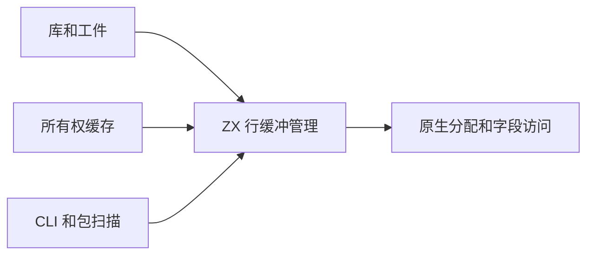

# 行缓冲与子列表交接自举

## Intent

让编译库装载、工件发布、所有权缓存和包管理共用 ZX 的行缓冲增长、视图刷新和子列表接管。

## Data

起点为 `e7ddb1a24`。行分配、已有缓冲扩容、增长后的列视图更新以及子列表发布和腾空都经由手写 Zig。入口分布在编译器、genz、CLI 和 pkgs。[行缓冲](../../packages/core/src/memory/write_column.zig) · [编译库装载](../../packages/compiler/src/zx/modules/compiled/loading/interface) · [所有权缓存](../../packages/genz/src/analysis/uniqueness/memo)

## Edges

保留分配器归属、容量公式、平台整数边界及错误顺序。优先原地扩容，无法原地扩容时只移动已初始化前缀。分配失败保留已有缓冲和视图，转移失败保留源子列表，成功时依原顺序写入目标并腾空借用视图。

## Answer

核对各正式入口退出旧 Zig 分配编排及视图循环。验证空分配、增长失败、借用描述符、子列表转移顺序和无额外临时分配，集中完成回归、引导产物比较及固定性能回测。

### 正式路径

- 编译库装载、工件物化、函数输出和包管理共用 ZX 的行分配，调用者可使用当前分配器或传入已有归属分配器。分配成功后按列刷新写视图。
- 编译库的别名与初始化器登记在 ZX 计算几何增长，预留成功后刷新读写视图。所有权 memo 的预留、分配及子列表接管复用同一套操作。
- 子列表分配保留请求的逻辑行数。接管先写父行，成功后才腾空源缓冲及写视图。父行仍直接引用原存储。
- Zig 保留对齐、原地扩容与必要前缀复制的分配原语，提供单个字段描述符读写。原生传入已存在的类型化缓冲时，编译期展开字段绑定。

三项独立运行核验通过。分配可使用显式归属和空临时分配区。故障注入覆盖扩容失败后原指针与读写视图保持，强制回退扩容后保留已写数据，以及子列表接管失败后仍可用。还验证了零宽度元素列表的逻辑行数。

### 引导与性能

由 `e7ddb1a24` 的 Source 引导器构建候选，通过 26 个构建步骤。候选 SHA-256 为 `25e4d3ae8bfca3e02c2a34e6c20639d1049f70f2ba41fa01344de06a36f96266`。

冻结 705 个入口、16 分区，关闭常驻生成器，交错三轮取中位数。工具本体均由 Source 自编译并运行各自的 Source 分析与发射。9,894 个冻结输入的生成文件和所有权 memo 载荷逐字节一致。

| 对照     | 冷墙钟 | 冷 CPU | 冷进程树 RSS | 冷系统 RSS 峰值 | 冷物理占用峰值采样 | 热墙钟 | 热 CPU |
| -------- | -----: | -----: | -----------: | --------------: | -----------------: | -----: | -----: |
| 固定基线 | 2.09 s | 8.99 s |     737.9 MB |        762.1 MB |           756.9 MB | 1.64 s | 6.42 s |
| 上阶段   | 1.93 s | 9.45 s |     530.2 MB |        548.9 MB |           543.2 MB | 1.45 s | 6.24 s |
| 候选     | 1.97 s | 9.52 s |     525.3 MB |        543.9 MB |           538.2 MB | 1.45 s | 6.31 s |

较上阶段，冷生成墙钟增加 0.04 秒，CPU 增加 0.07 秒，进程树峰值 RSS 减少 4.8 MB，系统 RSS 峰值减少 5.1 MB。热墙钟持平，CPU 增加 0.07 秒。较固定基线，冷墙钟减少 0.12 秒，CPU 累计增加 0.53 秒，进程树峰值 RSS 减少 212.5 MB。这组对照覆盖生成阶段，无修改检查中位数 0.03 秒。

两版引导器用本批源码生成五份清单，17,268 个生成文件逐字节一致。

集中回归通过 128 个步骤、111 项 Zig 测试和 2,045 项安装版集成检查。覆盖库联结与编解码、模块生成、公开包清单、正式包安装以及原生别名。
