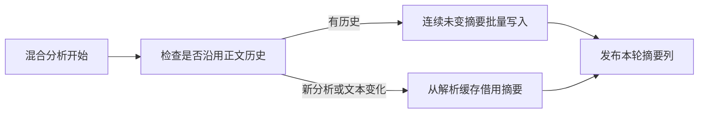
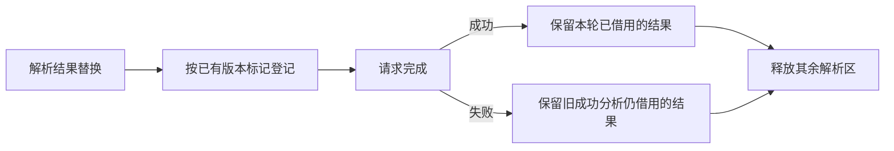

# 解析缓存版本与摘要发布自举

## Intent

由 Source 推进历史摘要写入，以及常驻解析结果的替换、保留和释放。保留冷构建、正文编辑和失败恢复使用的原有借用边界。

## Data

起点为 `0b82c62c6`。`Reuse.begin` 写入 ZX 源码摘要，正文编辑复用上一个成功版本的未变摘要。`ParseCache` 在发布或放弃请求时处理被替换的结果，已发布分析可能仍借用其解析区。

## Edges

摘要表只借用已存在的路径索引与摘要列。旧摘要从未变的成功结果沿用，缺失摘要只更新存在标记。解析缓存必须在转交或释放结果前保证目标区间容量，Zig 负责实际分配器的释放和原生解析结果的移动。

## Answer

覆盖新建与正文编辑的摘要写入，常驻成功、失败及恢复期间的结果保留顺序与释放。集中验证引导产物、受影响回归及固定性能对照。

### 正式路径

- 冷分析与正文编辑共用 ZX 摘要写入入口。ZX 直接借用已有路径、哈希桶及摘要列，沿用未变区间的批量写入。只有历史摘要本身写入独立快照，因为活动缓存项会被替换。缺失的路径只写存在标记。旧 Zig 的逐条查找保留于初始引导，原跨语言往返循环已删除。
- 解析结果替换由 ZX 决定立即丢弃、保留或放入请求待处理队列。事务请求保留原有版本时钟规则，原生队列预留失败会在活动缓存项被覆盖前返回。
- ZX 按请求结果推进待处理版本，调用原生资源操作转移或释放完整解析区，并直接写回保留容量。解析器、分配器和最终清空现有保留列表仍由宿主提供。

### 引导与性能

使用 `0b82c62c6` 的 Source 工具引导候选，26 个步骤通过。候选 SHA-256 为 `e1da30c267b0b8078eb058c59786ae1b12658c7d3c7b94333e7b27ff8d9d6c07`。对本批源码生成的五份清单共 17,320 个文件逐字节一致。

冻结 705 个入口、16 分区，关闭常驻生成器，各配置交错三轮取中位数。各工具由 Source 自编译并运行各自的 Source 分析与生成实现。冻结清单的 9,894 个生成文件和所有权 memo 载荷一致。

| 对照     | 冷墙钟 | 冷 CPU | 冷进程树峰值 RSS | 冷系统记录峰值 RSS | 热墙钟 | 热 CPU |
| -------- | -----: | -----: | ---------------: | -----------------: | -----: | -----: |
| 固定基线 | 2.08 s | 9.03 s |         738.0 MB |           786.8 MB | 1.65 s | 6.45 s |
| 上阶段   | 1.95 s | 9.48 s |         530.3 MB |           552.7 MB | 1.45 s | 6.26 s |
| 候选     | 2.00 s | 9.42 s |         530.4 MB |           547.3 MB | 1.44 s | 6.28 s |

较上阶段，冷墙钟增加 0.05 秒，CPU 减少 0.06 秒，进程树峰值 RSS 增加 0.1 MB，系统记录峰值 RSS 减少 5.4 MB。较固定基线，冷墙钟减少 0.08 秒，CPU 累计增加 0.39 秒，进程树峰值 RSS 减少 207.6 MB。无改动检查墙钟中位数 0.03 秒。

### 常驻编辑与生命周期

直接调用正式解析缓存核对了成功发布、失败后保留旧解析结果、丢弃本轮独有结果和最终释放。逐个注入分配失败时，旧缓存项、摘要和借用文本保持有效。摘要写入在空临时分配区验证了冷分析、沿用旧值、读取缓存新值和无摘要四种情况。模块生成、语义缓存、RX 推导和解析缓存共 182 项回归通过。

十次常驻请求的分析、复用和发射计数与上阶段一致，活跃与保留解析区容量及替换数量也一致。增量输出与同输入冷生成逐字节相同。使用同一四模块项目交错计时，每种工具各完成 192 次正文编辑和 192 次纯 RX 编辑，正文请求中位数从 0.84 ms 到 0.83 ms，纯 RX 请求中位数均为 0.66 ms。
