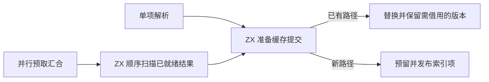
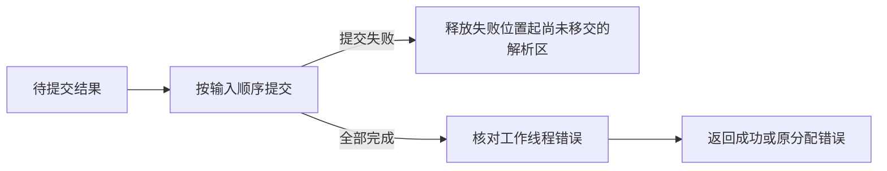

# 解析缓存顺序提交与清理自举

## Intent

将单项解析与并行预取共用的缓存提交规则迁入 Source。解析线程结束后依照输入顺序提交已就绪结果，发生错误时只释放尚未移交给缓存的结果。

## Data

起点为 `f27cd92cd`。正式入口是 `ParseCache.getEntry` 和 `ParseCache.prefetchInto`。工作线程保留独立解析区，主线程在汇合后登记索引和输出视图。源码路径与所分配的 `ModuleResult` 保持原有生命周期。

## Edges

借用现有路径列、结果列和输出视图。成功前缀继续由缓存拥有，未提交结果的解析区在临时工作区析构前释放。工作线程已确认的命中保持原输出，解析和分配对象的物理操作由原生层执行。

## Answer

以实际批量预取入口核验顺序、部分成功、失败回收、缓存命中及修复后的复用。集中核对固定基线、引导产物和相关回归。

### 正式路径

- 单项解析和预取共用 ZX 提交函数。ZX 根据已有索引项选择替换或插入。Zig 绑定缓存对象、调用原有分配操作，并在索引增长后重定位写入位置。
- 并行汇合后由 ZX 读取原有结果列，按输入顺序提交已就绪结果。只有成功提交后才写入对应输出视图。并行阶段已写下的命中不经重新登记。
- RX 在提交失败时只启动未提交后缀的清理。工作线程自身报告错误时，先提交所有已就绪结果，再向调用方返回原分配错误。
- 提交阶段唯一可恢复的错误是分配失败。该原生边界以空结果交付失败，外层 API 继续返回 `OutOfMemory`。生成的正式路径经空临时分配区核验，未创建用于捕获错误的中间对象。

### 引导与性能

使用 `f27cd92cd` 对应的 Source 工具引导候选，26 个步骤通过。候选 SHA-256 为 `9967ea62748fbe3b925eced1592a3ed55687f0af1654ad3b8e1bfe5d0c39bf42`。本批源码生成的五份清单共 17,334 个文件逐字节一致。

固定 705 个入口和 16 分区，关闭常驻生成器，交错三轮取中位数。各工具均由 Source 自编译，并运行各自的 Source 分析和发射。冻结清单的 9,894 个生成文件和所有权 memo 载荷一致。

| 对照     | 冷墙钟 | 冷 CPU | 冷进程树峰值 RSS | 冷系统记录峰值 RSS | 热墙钟 | 热 CPU |
| -------- | -----: | -----: | ---------------: | -----------------: | -----: | -----: |
| 固定基线 | 2.09 s | 9.02 s |         738.0 MB |           760.1 MB | 1.65 s | 6.43 s |
| 上阶段   | 1.94 s | 9.49 s |         525.0 MB |           540.8 MB | 1.45 s | 6.26 s |
| 候选     | 1.97 s | 9.53 s |         530.0 MB |           549.1 MB | 1.45 s | 6.31 s |

较上阶段，冷墙钟增加 0.03 秒，CPU 增加 0.04 秒，进程树峰值 RSS 增加 5.0 MB，系统记录峰值增加 8.3 MB。较固定基线，冷墙钟减少 0.12 秒，CPU 累计增加 0.51 秒，进程树峰值 RSS 减少 208.0 MB。无改动检查墙钟中位数为 0.03 秒。

### 正确性核验

空临时分配区核验覆盖工作线程报告错误后仍提交已就绪项，以及提交在中间行失败时清理失败行和剩余行。实际预取入口验证了新建、已有项替换、命中输出、无输出预取及逐个分配点失败。故障注入覆盖只提交第一项和提交前两项两种成功前缀。旧借用文本维持可读，失败的当前项和后缀均未发布。

十次常驻请求的分析、复用和发射计数与上阶段一致，增量产物与同输入冷生成逐字节一致。模块生成、语义缓存、RX 推导和解析缓存共 182 项回归通过。

同一四模块项目交错测量，每种工具各接受 192 次正文编辑及 192 次纯 RX 编辑。正文中位数从 0.85 ms 到 0.84 ms，P95 从 1.06 ms 到 1.04 ms。纯 RX 请求中位数分别为 0.67 ms 和 0.66 ms，P95 均为 0.84 ms。
