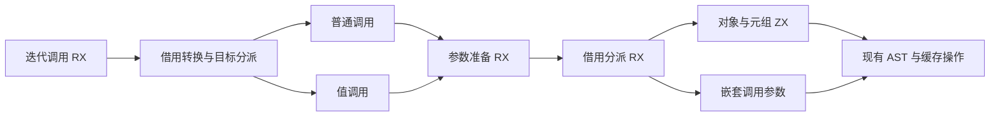

# 调用参数求值与借用物化自举

## Intent · 最终目标

让普通调用、值调用和迭代调用共享的参数准备遵循 Source 编排。迁出借用参数的分派、对象和元组求值、字段发布以及迭代调用的目标选择，保持引用身份和生成结果。

## Data · 可用证据

普通调用和值调用经 `invocation/execute.zig` 进入 `value_call/argument.zig`。此前只用 ZX 选择借用路径，递归求值、构造和缓存时序仍由 Zig 执行。迭代调用已有独立的借用转换计划，但从普通调用与值调用中选择目标仍在 Zig。

## Edges · 边界与限制

对象先按求值表顺序求值并绑定，字段随后按布局读取，最后处理未引用的中间值。借用对象的缓存快照与嵌套调用的作用域必须在成功和失败时恢复。ZX 直接借用表达式 ID 列。宿主继续提供 AST 写入、受限的递归入口和栈上作用域清理。seed 保留独立路径。

## Answer · 交付与验证

以同一正式入口核对分派和遍历已退出 Zig。复用既有普通调用、原生 ABI、迭代调用及借用回归，比较自编译产物，并在固定输入下核对 CPU、墙钟和 RSS。

### 实现

普通调用的 RX 入口按已选的普通、值和指针调用路线分派。普通分支继续用已有参数规则，ZX 解析调用所需的转换、Store 和宿主能力标记。迭代调用先借用输入，再由 RX 选择被调形式并转换结果。

借用参数的 RX 入口按缓存命中、对象、元组和嵌套调用分派。对象和元组的 ZX 循环直接读取借用的 IR 列，宿主把对应结果写入已有 AST 存储。对象流程单独决定求值、写缓存、字段发布、处理未引用值和发布聚合的顺序。嵌套调用先准备入参，再在宿主管理的作用域内执行并恢复临时状态。

小清单发现将临时参数对象传入原生回调会生成堆分配。调用节点现通过栈上的句柄传递已有上下文，结果合并和普通调用计划通过标量传递。重新生成的五个入口及其函数未引入对象堆分配、列表扩容或底层数据复制。

[普通调用](../../packages/genz/src/analysis/invocation/regular/build.rx) · [借用分派](../../packages/genz/src/analysis/value/call/argument/materialize/run.rx) · [对象求值](../../packages/genz/src/analysis/value/call/argument/materialize/object.rx) · [迭代调用](../../packages/genz/src/analysis/invocation/execution/iteration.rx)

### 验收

工具链采用 Zig 0.17.0、ReleaseSmall 和 16 个引导分区。初始 seed 通过 19/19 步骤，Source 引导器通过 25/25 步骤。候选引导器的 SHA-256 是 `6bd16a084abe18f13405bbf6dd9c41f2a82cf94381268feddcf15e5865e30850`。由候选再生成的主清单、集合、增长和执行共 16,138 份产物逐字节一致，排除只记录工具身份的 `.zxc-inputs`。

原生借用与值 ABI、调用顺序、借用视图、集合和循环、库链接及模块生成的集中回归通过 619/619 构建步骤和 1,713/1,713 项测试。只读视图对照仍为直接读取和借用读取各 1 次分配、80 字节。改动的 20 个 RX/ZX 文件通过 lint。

固定冻结清单含 735 个入口。上一阶段与本阶段都由 Source 引导器生成，实际测量均使用各自的 Source 分析和生成实现。两套工具以相同配置交替运行三轮。下表为中位数，RSS 单位为字节。

| 工具     | 冷墙钟（秒） | 冷 CPU（秒） | 进程树峰值 RSS | 单进程峰值 RSS |
| -------- | -----------: | -----------: | -------------: | -------------: |
| 固定基线 |         2.82 |        12.43 |    884,768,768 |    934,051,840 |
| 上一阶段 |         2.60 |        13.07 |    660,832,256 |    677,675,008 |
| 本阶段   |         2.63 |        13.05 |    660,783,104 |    686,325,760 |

较上一阶段，冷墙钟增加 0.03 秒，CPU 减少 0.02 秒，进程树峰值减少 0.05 MB，单进程峰值增加 8.65 MB。相对固定基线，冷墙钟减少 0.19 秒，CPU 累计增加 0.62 秒，进程树峰值减少 223.99 MB。热生成墙钟均为 1.94 秒，CPU 由 8.33 秒降至 8.30 秒。无修改运行均为 0.03 秒。冻结清单的 11,753 份产物及所有权缓存载荷一致，两套工具冷暖产物各自一致。

原始记录位于 `.zig-cache/verification-tmp/call-argument-materialization/`。宿主仍持有缓存恢复、AST 目标存储、迭代借用布局解析及调用结果的原生转换。下一批沿调用和迭代借用路径检查布局解析与 AST 发布，优先收掉仍在 Zig 中处理的布局遍历和临时名称交接。
