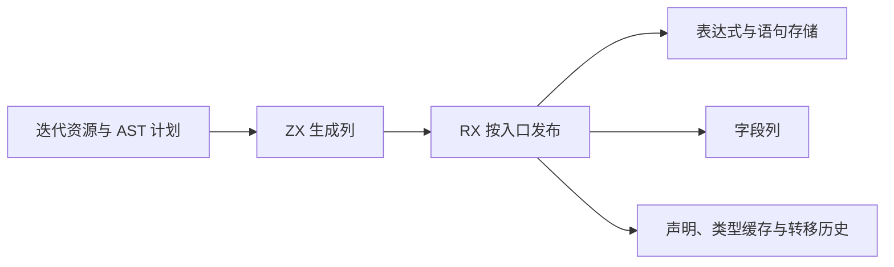

# 迭代 AST 发布与投影准备自举

## Intent · 最终目标

让借用、入参、返回、布局类型、投影、集合更新和缓冲区交接共用 Source 发布流程。投影逐项解析表达式与布局资源，同时记录后续生成所需的序号和转移历史。

## Data · 可用证据

生成端已输出 AST 列，各 Zig 入口仍分别写表达式、字段、语句和缓存。常规转换先提交全局语句，类型和借用先提交字段。局部声明和引用存储分别在转换的序号更新之后发布。集合更新为保留同一个块标签，原来复制两份临时描述符列再覆盖末项。

## Edges · 边界与限制

所有阶段沿用已经生成的列和原有目标存储。同一字段的文本借用或拥有策略须保持不变。入参、返回和转移的失败前缀按原顺序保留。投影解析可能追加转移记录，历史长度须在对应值解析后、处理下一项前取得。

## Answer · 交付与验证

沿真实迭代入口核对发布顺序和生成结果，覆盖普通与带捕获表达式、嵌套缓冲区、集合更新、资源失败与分区引导回测。

### 实现

借用、布局类型、入参、返回、投影、集合更新、缓冲转移、缓冲对象和缓冲准备共用 RX 发布。ZX 选择表达式、字段和语句的借用或拥有方式。普通转换先提交全局语句再提交字段，借用与类型先提交字段；缓冲转移在提交局部语句后登记历史。入参的局部声明与返回的引用存储在序号更新后写回。缓存登记仍复用现有 Source 循环。

集合更新只为实际出逃的块标签保留一份文本。两个最终列直接登记同一份拥有的标签，退出复制临时标签描述符列的做法。投影的资源求值循环由 ZX 执行，每次先解析值、类型或表达式，再在已有输出列登记序号和当时的转移历史长度。

[发布流程](../../packages/genz/src/analysis/iteration/publication/run.rx) · [投影准备](../../packages/genz/src/analysis/iteration/resources/projection.zx) · [列存储接入](../../packages/genz/src/zx/iteration_value/publication.zig)

### 一致性与性能

候选使用 Zig 0.17.0、ReleaseSmall、16 个引导分区，构建通过 25/25 步骤。候选引导器 SHA-256 为 `d5008917661b26137bba14ee1b31daa0f3f18a20374f12c2119bbb8d32a5fbee`。主清单、增长、集合和执行的再生成共 16,169 份产物逐字节一致，排除仅记录工具身份的 `.zxc-inputs`。小清单的发布与准备入口均未引入新的堆分配、数组扩容或数据复制。

固定 735 个入口，两套工具均由 Source 引导器生成并执行各自的 Source 分析和生成。相同配置下交替运行三轮。下表是中位数，RSS 单位为字节。

| 工具     | 冷墙钟（秒） | 冷 CPU（秒） | 进程树峰值 RSS | 单进程峰值 RSS |
| -------- | -----------: | -----------: | -------------: | -------------: |
| 固定基线 |         2.82 |        12.43 |    884,768,768 |    934,051,840 |
| 上一阶段 |         2.59 |        12.97 |    667,123,712 |    684,343,296 |
| 本阶段   |         2.60 |        12.94 |    662,634,496 |    678,969,344 |

冷墙钟增加 0.01 秒，冷 CPU 减少 0.03 秒，进程树峰值下降 4.49 MB，单进程峰值下降 5.37 MB。采样的物理内存峰值中位数下降 6.19 MB。相对固定基线，冷墙钟减少 0.22 秒，CPU 累计增加 0.51 秒，进程树峰值下降 222.13 MB。热墙钟均为 1.93 秒，热 CPU 由 8.24 秒增加到 8.29 秒，无改动运行均为 0.03 秒。11,753 份固定清单产物和所有权缓存载荷一致，两套工具各自的冷暖生成也一致。

### 回归与余项

循环列、模块化循环、嵌套缓冲区、独立产品转移、函数更新、迭代调用及原生借用通过 449/449 构建步骤和 815/815 项测试。十个改动的 RX/ZX 文件通过 lint。原始日志位于 `.zig-cache/verification-tmp/iteration-ast-publication/`。

本批退出 Zig 的是迭代 AST 的发布顺序和投影逐项准备。宿主继续提供列导入、AST 目标存储、标签分配、序号计数及缓存记录的原语。下一批收口循环状态声明、字段布局、归属名称和字段更新。
