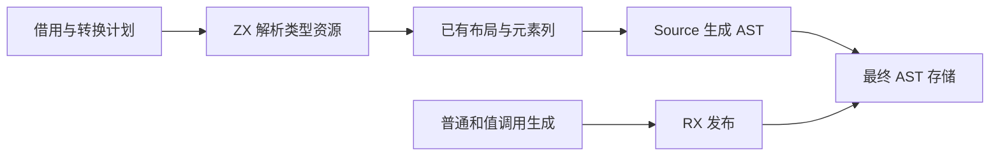

# 迭代类型资源与调用 AST 交接自举

## Intent · 最终目标

将迭代借用、入参转换、返回转换和迭代类型声明的资源遍历迁入 ZX，将普通调用和值调用的 AST 交接顺序收进 RX。复用最终存储，不改调用生成结果。

## Data · 可用证据

迭代生成的三组 ZX 计划已决定类型结构，但 Zig 仍逐行解析布局及元素类型。迭代类型也在 Zig 中逐行解析叶类型并登记缓存。普通调用和值调用的生成模块已返回 AST 列，函数需求、临时名称和标记的发布还在 Zig。

## Edges · 边界与限制

可选布局需先解析原布局再解析替代类型。根布局的既有解析时机、类型缓存写入顺序和失败传播必须保持。AST 列和临时名字仍在原分配区内生成，发布时只保留真正出逃的字节。函数请求先登记，再写 AST，最后合并生成状态。

## Answer · 交付与验证

沿正式生成入口核对迭代资源和类型缓存的 Zig 遍历已经退出。对照调用与借用的生成结果、原生边界、分配失败路径和固定冷暖基线。

### 实现

借用、入参转换、返回转换和类型叶节点共用 ZX 资源遍历。布局与元素 ID 写入原有目标列，保留可选项中先解析基础布局、再解析实际类型的顺序。迭代类型缓存由 ZX 逐行登记，复用原缓存及其写入语义。类型构造和缓存底层操作继续由现有宿主接口提供。

普通调用、值调用和只生成函数引用的入口共用 RX 发布。流程先登记待生成函数，再提交表达式和可选语句，最后合并序号与能力标记。需要延长生命周期的函数名和局部操作数名先复制到最终分配区，表达式导入直接使用原列，随后在新增的标识符位置登记拥有的名字，移除了临时标识符列的整列复制。资源遍历、缓存登记和调用发布三个小清单入口的生成代码均未引入堆分配或扩容。

[资源遍历](../../packages/genz/src/analysis/iteration/resources/resolve.zx) · [迭代类型缓存](../../packages/genz/src/analysis/iteration/resources/cache.zx) · [调用发布](../../packages/genz/src/analysis/invocation/publication/run.rx) · [目标列写入](../../packages/genz/src/zx/invocation/publication.zig)

### 一致性与性能

候选采用 Zig 0.17.0、ReleaseSmall、16 个引导分区，构建通过 25/25 步骤。引导器 SHA-256 为 `e552eabd14d19512b86bdb9d2c913288e1d106adc0d26b58999799565d554e31`。候选重新生成的主清单、增长、集合和执行共 16,150 份产物与引导输入逐字节一致。比较排除记录工具身份的 `.zxc-inputs`。

固定 735 入口清单的上一阶段和候选均由 Source 引导器生成，测量执行各自的 Source 分析和生成实现。两个工具按相同配置交替运行三轮。下表是中位数，RSS 单位为字节。

| 工具     | 冷墙钟（秒） | 冷 CPU（秒） | 进程树峰值 RSS | 单进程峰值 RSS |
| -------- | -----------: | -----------: | -------------: | -------------: |
| 固定基线 |         2.82 |        12.43 |    884,768,768 |    934,051,840 |
| 上一阶段 |         2.59 |        12.98 |    663,011,328 |    684,130,304 |
| 本阶段   |         2.59 |        12.98 |    668,532,736 |    682,541,056 |

冷墙钟和 CPU 持平，进程树峰值增加 5.52 MB，单进程峰值减少 1.59 MB，采样物理内存峰值中位数下降 3.88 MB。相对固定基线，冷墙钟减少 0.23 秒，CPU 累计增加 0.55 秒，进程树峰值下降 216.24 MB。热生成墙钟由 1.92 秒降为 1.91 秒，CPU 均为 8.27 秒。无改动运行均为 0.03 秒。11,753 份冻结清单产物和所有权缓存载荷一致，两套工具各自的冷暖产物也一致。

### 回归与余项

模块化循环、循环布局列、原生借用、普通调用返回的借用视图、对象求值顺序、Process 能力传播及模块生成通过 262/262 步骤和 420/420 项测试。10 个改动的 RX/ZX 文件通过 lint。原始日志位于 `.zig-cache/verification-tmp/iteration-call-publication/`。

本批退出 Zig 的四类迭代类型资源遍历、迭代类型批量缓存登记，以及三条调用相关入口的 AST 发布编排。迭代转换结果的表达式、字段、语句和引用存储仍由各宿主入口按既有时序写回。下一批合并这些写回流程，保留借用与拥有数据各自的生命周期和失败顺序。
