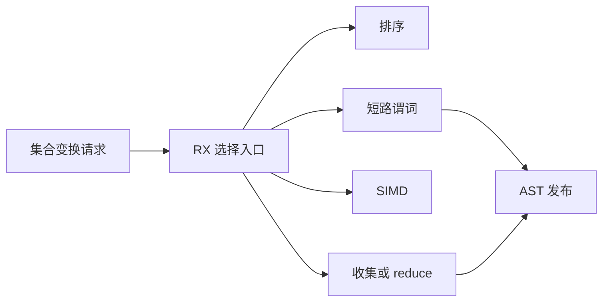

# 集合变换回调与累积器自举

## Intent · 最终目标

用 RX/ZX 控制正式集合变换的路径选择、回调参数范围、操作数求值、累积写回及结果发射。排序、短路谓词、SIMD、普通收集及 `reduce` 共用该入口。

## Data · 可用证据

基于 `2f5b5dc4f` 沿 `transform.lower` 追踪正式调用。旧入口先处理排序，再登记状态参数，接着处理谓词、SIMD、`reduce` 和普通收集。循环、条件、累积器和结果 AST 已有 Source 构造入口，宿主还决定前置求值次序和语句切片的发布顺序。

## Edges · 边界与限制

排序跳过外层参数登记。谓词保留短路与出错次序，标量转换在 SIMD 不适用时才执行。普通收集在回调降级后处理可选上下文，`reduce` 此时才降级初始值。参数登记只撤销本次增加的符号，失败时也释放本次暂存。保持已有兼容 seed。

## Answer · 验收

沿正式入口确认 Zig 的执行决策退出，使用相同的引导器、工具链和清单验证生成产物、实际运行、错误清理与冷暖生成开销。

### 正式路径

RX 先派发排序，再进入回调参数范围，依序选择短路谓词、SIMD 或标量路径。谓词保留目标、标签、回调、可选上下文和元素绑定的顺序。普通收集由 ZX 选择一次分配和下标写入，或追加缓冲和保留元素。`reduce` 在回调降级后处理初值，并由 RX 在增长发射前后分别转换初值和累积更新。[变换入口](../../packages/genz/src/analysis/transform/execute/run.rx) · [集合收集](../../packages/genz/src/analysis/transform/execute/collect.rx) · [累积器](../../packages/genz/src/analysis/transform/execute/reduce.rx)

谓词、收集与 `reduce` 共用 Source 的语句片段顺序，借用原来的列头和已提交区间。生成路径的探针确认新增入口及片段编排没有临时堆对象。Zig 仍提供递归降级、类型物化、容器与列导入，以及离开回调范围时撤销本次新增符号的物理操作。初始 seed 保留单独入口。[片段顺序](../../packages/genz/src/analysis/transform/publication/append.zx) · [工作区](../../packages/genz/src/zx/transform/execution.zig)

### 性能

沿用 735 入口冻结清单，Zig 0.17.0、ReleaseSmall、16 分区，关闭常驻。候选与上一阶段均由 Source 工具构建，执行各自的 Source 分析和生成。交替三轮取中位数。两版冷生成和同版冷热的 11,753 份文件逐字节一致，排除工具身份戳。所有权缓存载荷一致。

| 场景   | 工具     | 墙钟（秒） | CPU（秒） | 进程树峰值 RSS（字节） | 单进程峰值 RSS（字节） |
| ------ | -------- | ---------: | --------: | ---------------------: | ---------------------: |
| 冷生成 | 固定基线 |       2.82 |     12.43 |            884,768,768 |            934,051,840 |
| 冷生成 | 上一阶段 |       2.61 |     13.03 |            668,745,728 |            684,900,352 |
| 冷生成 | 候选     |       2.74 |     13.03 |            665,305,088 |            691,863,552 |
| 热重建 | 上一阶段 |       1.94 |      8.31 |            646,496,256 |            646,529,024 |
| 热重建 | 候选     |       1.96 |      8.27 |            645,677,056 |            645,709,824 |

较上一阶段，冷墙钟增加 0.13 秒，CPU 持平，树峰值减少 3.44 MB，单进程峰值增加 6.96 MB。相对固定基线，冷墙钟减少 0.08 秒，CPU 累计增加 0.60 秒，树峰值减少 219.46 MB。热墙钟增加 0.02 秒，热 CPU 减少 0.04 秒。无改动时墙钟和 CPU 均为 0.03 秒。计时覆盖引导生成与磁盘缓存复用。

### 引导一致性

候选通过 25 个构建步骤。SHA-256 为 `0416e5c9a3b564ddb1ee2b153e8eb86d1191c0f19d1e3440171ac0babcbff366`。同一候选重新生成主、增长、集合和执行四组清单的 16,329 份文件，全部逐字节一致，排除工具身份戳。初始 seed 词法引导通过 19 个步骤。

### 回归

十三组回归通过 700 个构建步骤、11,629 项 Zig 测试和 82 项 Node 集成检查。覆盖回调访问与上下文失败顺序、`reduce` 初值和浮点累积、重复追加和嵌套参数恢复、整数和字符串排序、谓词短路和零分配、SIMD 尾部与标量回退、WASM，以及模块化循环编译中的逐次分配失败。变更的 RX/ZX 文件通过格式化和 lint。原始日志位于 `.zig-cache/verification-tmp/collection-transform/`。
