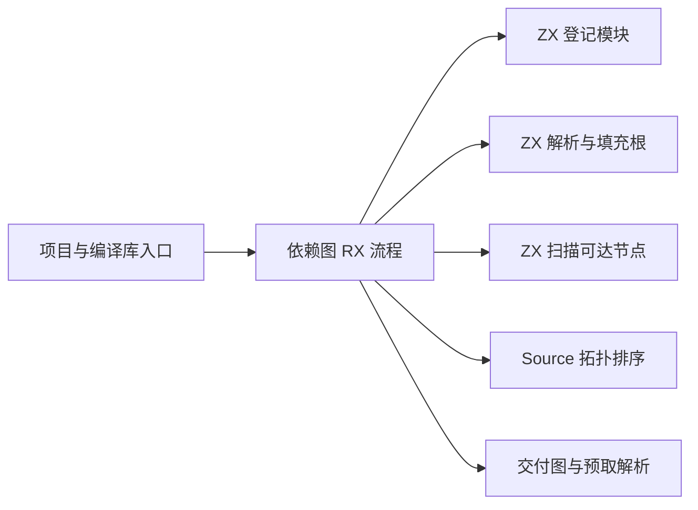
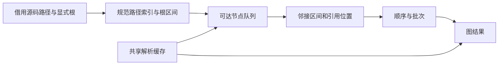

# 项目依赖图构建自举

## Intent

从普通项目和编译库共用的 `source_graph.buildWithRoots` 入口迁移模块登记、根解析、依赖扫描和结果交付。保持原有错误顺序、可达节点范围及缓存所有权。

## Data

起点 `05e40fe4c` 由 Zig 逐项登记模块、写入根区间、推进扫描队列并发布结果。Source 已负责扫描队列的单步邻接发布、入队和最终拓扑排序。

## Edges

注册按 ZX、RX、Store 的顺序进行。每项先校验再占用索引槽，使同条错误优先级和重复路径的诊断位置可保持。根列表顺序为入口、已选 RX、显式根、Store。显式根继续借用路径列，普通路径与导出记录各自沿用现有存储。启动解析预取及循环诊断包含原有范围，只有排序成功后交付预取结果。

## Answer

- RX 串联登记、根解析、扫描、排序及发布。ZX 决定每个登记和根槽的规则，并在扫描中推进队列及选择 ZX、RX 或 Store 读取方式。
- 队列推进只交回下一个模块行号，去掉扫描前重复计算的节点类别和本地索引。扫描结果沿原有邻接缓冲交付，顺序与环路的定位保持原有契约。
- 绝对路径解析、原生表的物理写入、原生解析结果的生命周期和邻接存储仍由宿主持有。引用解析的原生适配、各类边记录和扫描工作区仍在正式路径，后续继续迁移。初始 seed 共用单项宿主操作。
- 已核对项目规则中的 RX 复杂度边界。根列表组装和节点扫描各用单独的 ZX 函数承载，RX 保留实际阶段和预取发布条件。

### 引导与性能

用 `05e40fe4c` 的 Source 工具构建候选，26 个引导步骤通过。候选 SHA-256 为 `7f3cbd07c7d7e7e52d2a4b31876ed7377f35b1d4434d44d07a016089589cb0c7`。宿主接口按职责分文件后，引导工具的哈希保持一致。检查两个新入口的生成 Zig，登记、根循环及节点扫描均未生成临时分配。原有的路径、队列、邻接区和解析存储沿用原分配器。

固定 705 个入口和 16 个分区，关闭常驻生成器，交错三轮取中位数。三个工具均由 Source 构建并运行各自的 Source 分析和生成。9,894 个固定输入生成文件和所有权 memo 载荷逐字节一致。十次常驻请求的计数与产物哈希和上阶段一致，成功的编辑结果和对应的冷生成一致。

| 对照     | 冷生成墙钟 | 冷生成 CPU | 冷进程树峰值 RSS | 冷系统记录峰值 RSS | 热生成墙钟 | 热生成 CPU |
| -------- | ---------: | ---------: | ---------------: | -----------------: | ---------: | ---------: |
| 固定基线 |     2.07 s |     9.03 s |         738.9 MB |           766.9 MB |     1.63 s |     6.42 s |
| 上阶段   |     1.93 s |     9.50 s |         526.4 MB |           547.2 MB |     1.44 s |     6.27 s |
| 候选     |     1.90 s |     9.41 s |         525.8 MB |           547.6 MB |     1.44 s |     6.25 s |

较上阶段，冷生成墙钟减少 0.03 秒，CPU 减少 0.09 秒，进程树峰值减少 0.6 MB，系统记录峰值增加 0.4 MB。较固定基线，冷生成墙钟减少 0.17 秒，CPU 累计增加 0.38 秒，进程树峰值减少 213.1 MB。无修改检查墙钟为 0.03 秒。

### 正确性核验

当前源码的五份引导清单共 17,463 个产物逐字节一致。所有改动的 RX、ZX 文件通过格式与 lint 检查。

初始 seed 的解析器构建和 RX 语法、依赖图回归共通过 49 个构建步骤和 39 项测试。依赖图用例包含三节点有向图的全部 512 种组合。

正式 Source 候选的模块生成、语义缓存、RX 推导、解析缓存、库链接和 Store 初值共通过 77 个构建步骤与 254 项测试。首次启动回归的 shell 变量名冲突已修正。回归沿用同一候选工具和构建目录，生成对照与性能结果直接复用。
